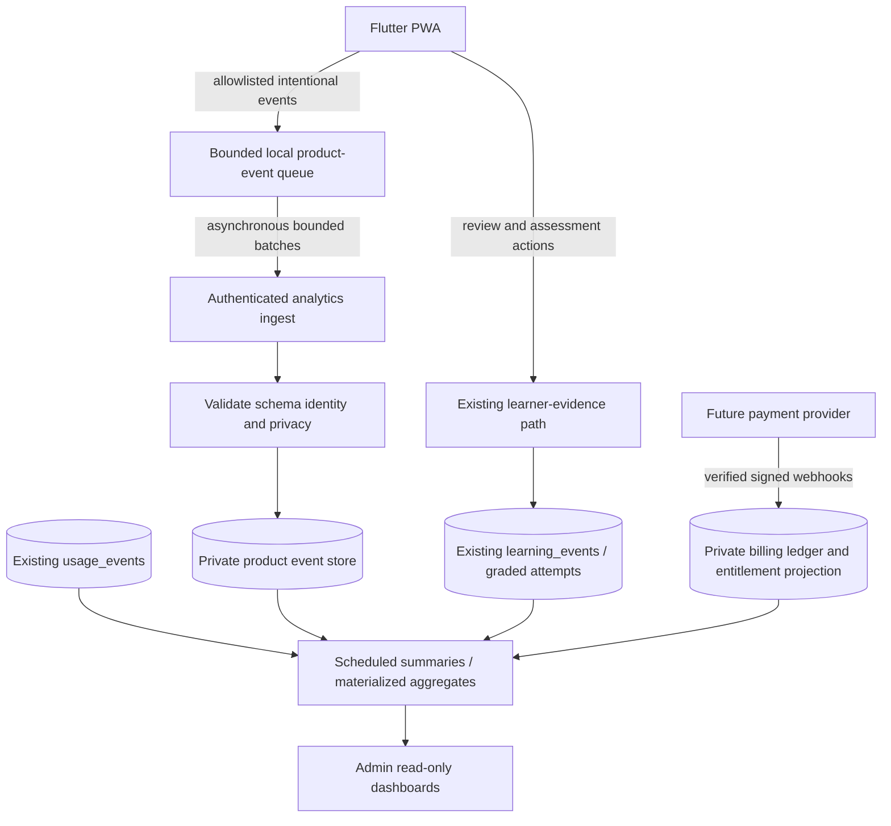

# LearningApp — Product, Learning, Revenue & Performance Analytics

**Implementation plan and source-grounded technical design**  
**Prepared:** November 9, 2026  
**Repository:** [RACCHUS/LearningApp](https://github.com/RACCHUS/LearningApp)  
**Audited default-branch commit:** [`0970a76bd2af09014011e6a8010728acdfedb9c3`](https://github.com/RACCHUS/LearningApp/commit/0970a76bd2af09014011e6a8010728acdfedb9c3) (confirmed as `main` on November 9)  
**Database:** Connected Supabase project **Learning App**; read-only schema and migration inspection performed November 9, 2026  
**Status:** **Implementation plan v3 — proposed, not implemented; read-only verification only**  
**Evidence basis:** Repository `main` at `0970a76`; connected project read-only count/constraint/policy queries and official documentation checks on November 9, 2026.  
**Decision stance:** Correctness and privacy first; reuse existing infrastructure; no mandatory paid analytics vendor.

> **Executive decision.** LearningApp has genuine learning-event, progress, and operational-cost infrastructure, but **does not yet have a trustworthy end-to-end product and commercial analytics system**. The immediate blockers are mismatched legacy progress contracts, duplicate local progress models, local IDs incompatible with the hosted UUID primary key, no measured activity baseline, guest-account eligibility, direct DML rights on learning evidence, and pending migration drift. Fix those contracts and security boundaries first; then deliver the smallest useful admin report and a separate lightweight product-event pipeline. Add verified subscription/revenue reporting only with an actual payment integration. Do not conflate study duration, page views, and demonstrated learning.

## Contents

1. [Goals, success criteria, boundaries](#1-goals-success-criteria-boundaries)
2. [Audit findings: code and connected database](#2-audit-findings-code-and-connected-database)
3. [Measurement principles and metric dictionary](#3-measurement-principles-and-metric-dictionary)
4. [Event catalog and payload contracts](#4-event-catalog-and-payload-contracts)
5. [Recommended architecture](#5-recommended-architecture)
6. [Accurate active-time and session measurement](#6-accurate-active-time-and-session-measurement)
7. [External learning resources, simulations and learning evidence](#7-external-learning-resources-simulations-and-learning-evidence)
8. [Revenue, subscriptions and unit economics](#8-revenue-subscriptions-and-unit-economics)
9. [Privacy, security and retention](#9-privacy-security-and-retention)
10. [Performance, observability and cost controls](#10-performance-observability-and-cost-controls)
11. [Admin dashboard specification](#11-admin-dashboard-specification)
12. [Prioritized development backlog and release gates](#12-prioritized-development-backlog-and-release-gates)
13. [Test matrix and data reconciliation](#13-test-matrix-and-data-reconciliation)
14. [Open product decisions](#14-open-product-decisions)
15. [Research and repository references](#15-research-and-repository-references)

---

## 1. Goals, success criteria, boundaries

### Why build it

The purpose is not to maximize time inside LearningApp. Its mission is to **help learners identify a goal, find a strong path (including useful external content), close gaps, practice, verify understanding, and make progress toward a real-world outcome**. The analytics must tell us which of those steps succeed or fail, how the product performs, and whether the economics are sustainable.

**Questions the administrator should be able to answer:**

- How many genuine people are using the product daily, weekly and monthly? Which are new, retained, returning, trialing or paying?
- What goals are users pursuing? Which discovery, plan-building, practice, import and simulation features do they actually use?
- How long is the app actively used? Which activities lead to measurable improvement, completion, or a verified outcome? Where do users abandon a path?
- Which searches have no good results? Which useful sources are external, and which gaps can LearningApp fill?
- How often are users directed to YouTube, Coursera or another external resource? Did they return, complete an independent check, or demonstrate learning afterward?
- What are gross revenue, refunds, paying customers, subscription status, churn and operating cost? What is **verified vs estimated**?
- Are analytics themselves harming load times, responsiveness, bandwidth, battery or database health? Are they losing or double-counting events?

### Non-negotiable success criteria

1. **No invented numbers.** Unavailable is `null`/“Not measured,” never zero, and mock data must never reach a production dashboard.
2. **Learning outcomes are authoritative.** Verified assessment data from trusted grading paths remains separate from self-reported clicks and completions.
3. **Payments are authoritative.** Revenue and paid entitlements come from verified provider events and backend records—not client claims or in-memory demo ledgers.
4. **Low user impact.** Analytics are asynchronous and bounded. Failure must never block a lesson, an assessment, checkout, offline study or navigation.
5. **Auditable mathematics.** Every KPI has a documented numerator, denominator, eligible population, timezone, deduplication rule and freshness contract.
6. **Privacy by default.** No surveillance-style recording, unbounded user text, assessment answers, hidden-session profiling of minors or unnecessary personal information.
7. **No surprise vendor spend.** Launch with existing Supabase/Postgres where practical; measure cost before adding specialized tools.

### Scope exclusions for first release

- No session replay, cursor-level logging, DOM autocapture or recording of typed responses.
- No ads/behavioral advertising pipeline and no ad identifiers.
- No comprehensive external-site watch time; outbound referrals do **not** grant visibility into third-party engagement.
- No automated claim that an external resource caused learning; correlations are not proof of causation.
- No unverified dashboards labeled “real-time.” Do not run heavy ad hoc queries on learning production tables during user actions.
- No provider selection for billing until an actual approved monetization implementation exists.

---

## 2. Audit findings: code and connected database

**Scope of evidence:** The repository was examined at the confirmed `main` commit above; the connected Supabase project was inspected using read-only project, migration, table and `information_schema.columns` operations. This is **not** a production traffic test, row-level data quality audit, CI run, or proof all application routes use the inspected services. Those validations belong to Phase 0.

| Component | Confirmed implementation | Gap / required action | Priority |
|---|---|---|---|
| `public.learning_events` | Present in hosted DB; `record_events` exists. Current grants permit authenticated `INSERT`; the INSERT RLS policy checks user ownership only. No event-type CHECK or user trigger was found. | **ANA-008 — first security PR:** authenticated INSERT is granted, with an ownership-only insert policy and no event-type CHECK or user-defined trigger. Revoke direct DML after checking for legitimate callers and negative-testing the bypass. The existing `record_events(jsonb[])` is `SECURITY DEFINER`, has fixed `search_path=public, extensions`, and is executable by `authenticated`; preserve and regression-test that approved RPC path. Never turn client telemetry into scored evidence. | **P0 security** |
| Offline `LearningEventOutbox` | `lib/services/offline/learning_event_outbox.dart` batches up to 50, retries offline, and checks acknowledgements. | Useful pattern, **not** an unrestricted product analytics queue. SharedPreferences list serialization, retry limits, privacy and anonymous behavior need separate analysis. | P1 |
| `public.user_progress` | Existing table has zero rows and links to legacy `lessons` and `public.users`, with unique `(user_id, lesson_id, date)`. `StudyNotifier` sends four absent fields; the **two duplicated progress model classes** in `lib/models/user_progress.dart` and `lib/models/lesson_progress.dart` also serialize absent `content_id`, `last_position`, `metadata`, and a locally generated string ID incompatible with UUID PK. | **ANA-001A:** identify route IDs and decide content-version/attempt grain with a failing local-schema test. **ANA-001B:** implement the canonical model/writers, consolidate the duplicate `UserProgress` classes, use valid UUIDs and separate Hive/remote serialization; test same-day conflict and profile identity behavior. **Do not merely add obsolete columns.** | **P0 blocker** |
| Duration capture | `durationMinutes` is optional; the completion screen omits it and does not await the returned Future. | Existing path writes **0 seconds for an unknown duration** and risks unhandled completion failures. Replace with measured seconds and a non-blocking, visible success/retry contract. | **P0 blocker** |
| Local cache safety | Local progress cache is attempted before success. | `_cacheProgressLocally()` catches/logs errors without rethrowing, weakening the caller’s `localCacheSuccess` signal. Test full offline-recovery semantics. | **P0 blocker** |
| `ProgressService` | Progress calculations and API exist; progress dashboard consumes it. | `getUserCourseProgress()` and `getCourseProgress()` return mock records; `_saveCourseProgress()` is a print stub; average score and longest streak use randomness, skills are hardcoded. Never surface these as genuine analytics. | **P0 blocker** |
| Hosted `public.course_progress` | Present, zero rows in this inspection. `CourseService.getCourseProgress()` is a **real** Supabase path that may create a row; `ProgressService` independently returns mocks. | Inventory both readers/writers and decide their authority; do not mistake all `course_progress` callers for mocks. | P0 |
| `usage_events`, `usage_quotas` | Present, with admin cost/telemetry RPC and console. | Tracks provider quotas/cost—not general product DAU. Cost figures are estimates using static prices and must be labeled as such. | P1 |
| Feature analytics | No dedicated product-event table among 116 inspected public tables; no cohesive screen/search/funnel instrumentation found in code search. | Build dedicated consent-aware capture, schema, ingestion and reporting. | P1 |
| Commercial analytics | No dedicated subscription/payment ledger among inspected public tables. `MarketplaceService` ledger is in-memory. | Do not report it as collected revenue or active paid subscriptions. Add verified billing foundation when monetization is real. | P3 |
| Privacy policy | `docs/legal/PRIVACY_POLICY.md` describes usage telemetry and minor restrictions. | Update inventory, retention and notices before introducing new tracking. Independently review COPPA/FERPA applicability. | P0 |
| Simulation design | `docs/design/SIMULATION_VIRTUAL_LEARNING_FRAMEWORK.md` clearly separates completion telemetry from scored evidence and private anonymous behavior. | Respect that boundary, including adapters for Phaser/3D/external systems. | P1–P2 |

**Read-only hosted snapshot (November 9, 2026):** 24 authentication accounts; 20 anonymous and 4 non-anonymous; 17 `public.users` profiles; **7 auth accounts without matching profiles (5 anonymous, 2 non-anonymous)**; 7 legacy lessons; **zero** rows in each of `user_progress`, `learning_events`, `usage_events`, `course_progress`, `assessment_attempts`, `study_set_progress`, `review_items`, `xp_events`, `exam_reference_drill_events`, `exam_part_practice_attempts`. These are **checked tables**, not an exhaustive proof of zero learning activity anywhere. There is no historical product-analytics baseline to backfill from these particular tables.

**Extra nuances:** `public.usage_events` counts API consumption, so its `active_users` is **not** DAU/MAU. Direct authenticated `learning_events` insert access needs urgent reviewed remediation. The app's public repository visibility was independently confirmed; if confidentiality is desired, that is an ownership decision unrelated to telemetry. The hosted migration list ends with `20261108000000_assessment_item_server_grading`; checked-in `20261108140000_clep_simulation_bank_and_item_privacy.sql` was **not** on the hosted list at review time. Supabase's performance advisor reports four categories (unindexed foreign keys, auth RLS init plans, unused indexes, multiple permissive policies), including `auth_rls_initplan` findings involving `user_progress`, `usage_events`, and `course_progress`; investigate relevant policies before rewriting them. A table/migration's existence does not prove live clients successfully emit events.

**Security and scheduling snapshot (read-only, November 9, 2026):** `pg_cron` version 1.6 is **available but not installed**; `pg_graphql` version 1.5.11 is installed. The Supabase security advisor flags **93 GraphQL-schema-visible objects for `anon` and 113 for `authenticated`**: these are schema-discoverability/`SELECT`-grant warnings, **not proof that RLS can be bypassed or that all rows are readable**. One `security_definer_view` **ERROR category contains two affected views**, `public.public_educator_verifications` and `public.skill_leaderboard`. The advisor also flags the project's Postgres build `17.4.1.064` as having available security patches; do not assume an upgrade target or apply changes without a separate vetted maintenance plan. Track as **ANA-010** and coordinate with existing security owners.

**Immediate diagnosis to reproduce and resolve:** First capture the actual `lessonId` type flowing from each lesson route (legacy UUID vs other curriculum/content IDs). Then run a lesson completion against a **local Supabase database built from the committed migration chain**: inspect request body, schema/foreign-key error, local persisted ID, async handling, restart/retry, same-day second attempt, and accurate progress display. This is required because generated Supabase mocks can conceal schema drift. No hosted write was performed in this review.

**Repository evidence:** [Study provider](https://github.com/RACCHUS/LearningApp/blob/0970a76bd2af09014011e6a8010728acdfedb9c3/lib/providers/study_provider.dart), [lesson screen](https://github.com/RACCHUS/LearningApp/blob/0970a76bd2af09014011e6a8010728acdfedb9c3/lib/screens/study/lesson_screen.dart), [progress service](https://github.com/RACCHUS/LearningApp/blob/0970a76bd2af09014011e6a8010728acdfedb9c3/lib/services/progress_service.dart), [progress dashboard](https://github.com/RACCHUS/LearningApp/blob/0970a76bd2af09014011e6a8010728acdfedb9c3/lib/screens/progress/progress_dashboard_screen.dart), [offline outbox](https://github.com/RACCHUS/LearningApp/blob/0970a76bd2af09014011e6a8010728acdfedb9c3/lib/services/offline/learning_event_outbox.dart), [strict learner-event migration](https://github.com/RACCHUS/LearningApp/blob/0970a76bd2af09014011e6a8010728acdfedb9c3/supabase/migrations/20261107050000_arch_04_learning_events_strict_rules.sql), [cost observability](https://github.com/RACCHUS/LearningApp/blob/0970a76bd2af09014011e6a8010728acdfedb9c3/lib/services/governance/cost_observability_service.dart).

---

## 3. Measurement principles and metric dictionary

### Canonical metric rules

- **Identity:** `auth.users.id` is not sufficient to describe a *registered* learner: Supabase anonymous sign-ins have an ID and the `authenticated` role. Check the trusted `is_anonymous` identity claim **on the server** and apply separately reviewed consent/minor eligibility. Do not count distinct session IDs as people; do not silently merge anonymous and permanent accounts. Phase 1 defaults to **no server-side anonymous product tracking**. Anonymous learning evidence is governed separately and must not be repurposed as behavioral telemetry.
- **Qualification:** define an **active user** as an eligible account with at least one **qualified intentional interaction** in the interval (e.g., search submitted, resource opened, lesson engaged, assessment attempted, goal created). Simple background startup, repeated retries and cost-quota calls are excluded.
- **Business reporting timezone:** Use UTC event timestamps and UTC days for business DAU/cohorts; **daily learning goals are a separate learner-local calendar** using a documented timezone setting and DST/travel rules. Derive learner-local goal intervals from canonical timestamped actions; do not assume a `date` column or locale offset is globally interchangeable with UTC.
- **Cohorts:** cohort by the UTC date of first verified meaningful activity for product retention; signup cohorts remain distinct. With only **4 current non-anonymous auth accounts and no tracked activity**, first show **counts and data-coverage notes**, not misleading retention percentages. Suggested minimum eligible denominator `n >= 20` for displaying exploratory percentage tiles is a **presentation guardrail, not a statistical guarantee**; confidence/uncertainty and mature cohorts are still required.
- **Readiness:** learning mastery = validated evidence under the existing versioned rubric and governance, **not** app attendance, checkmarks, time spent, clicks or self-reported completion.
- **Unique event:** server `event_id` unique; retries with same `event_id` count once. Provider payments use separate provider-specific unique identifiers.
- **Freshness:** product overview typically T+1 day finalized; “preliminary” for rolling recent periods until late/offline events settle. Clearly show `data_as_of`, `last_successful_refresh` and sample/count coverage.
- **Zeros vs unknowns:** zero is a measured, valid zero. Missing integration, incomplete records or no permission = unavailable, not zero; specifically, `daily_goal_provider` currently returns 0 on exceptions and must instead return an error/unavailable state.

### KPI definitions (initial)

| KPI | Exact definition / denominator | Notes |
|---|---|---|
| DAU / WAU / MAU | Distinct eligible authenticated `user_id` with ≥1 qualified activity in trailing 1 / 7 / 30 UTC dates | Separate **registered accounts**, **active authenticated learners** and **anonymous traffic**. Never sum DAU to get MAU. |
| New activated users | Distinct newly registered users who within 7 days select a meaningful goal **and** complete a first useful step (save a path, validated attempt or deliberate resource open) | Proposed product definition; validate actual user journey. |
| Activation rate | Activated newly registered users ÷ newly registered eligible users in a **mature** signup cohort | Exclude cohorts not yet 7 days old from finalized rate. |
| D1 / D7 / D30 retention | Eligible users in a first-activity cohort with a qualified event on exact day 1 / 7 / 30, divided by cohort size | Also report rolling retention separately if useful; never silently swap definitions. |
| Returning engagement | Distinct qualifying returning active users / eligible active users | Define “returning” as active in an earlier UTC calendar day. |
| Sessions/user | Number of distinct valid sessions ÷ active users in interval | Device/browse sessions are **not** people. |
| Active study minutes | Union of non-overlapping foreground, non-idle study intervals per user; rounded only for display | Estimated user activity, not mastery or proof they read content. |
| Median time-to-first-value | Median time from eligible signup/first landing to first meaningful outcome | Survival/censoring rules for never-activated users must be specified; don't only analyze successful users. |
| Feature adoption | Distinct qualified users of feature ÷ distinct eligible active users who had feature available | Segment by exposure/rollout and accessibility needs. |
| Funnel conversion | Unique eligible entities reaching stage N+1 after stage N within defined window ÷ unique eligible entities at stage N | Track distinct users and attempts; decide a single primary funnel key. |
| Search no-result rate | Valid searches with 0 eligible returned matches ÷ total valid searches | Segment by destination, content type and query category, without storing raw potentially sensitive queries. |
| Outbound resource CTR | Unique outbound clicks ÷ qualified external-resource impressions | Not evidence of visits, watch time or learning completed. |
| Return-after-resource rate | Distinct referral attempts followed by a return event/learning action within 7 days ÷ eligible outbound referral attempts | Cross-site visibility unavailable unless user chooses an integrated flow. |
| Learning gain | Matched, appropriately comparable baseline-to-post assessment delta, for paired attempts and same rubric/construct | Report sample size, selection bias, source trust, uncertainty; no causal claim. |
| Verified goal completion | Eligible users with verified defined outcome ÷ eligible users with same goal/cohort | Self-reported and externally verified outcomes are separate series. |
| Paying customers | Distinct customers with current qualifying paid entitlement backed by provider status | Do not treat trial, unpaid, invoice-created or abandoned checkout as paid. |
| MRR (when live) | Sum of eligible recurring subscription amount normalized to monthly frequency, using a documented gross/net tax, discount and currency policy | Recognized revenue and cash collected are distinct. |
| Revenue received (when live) | Successful settled/recognized provider payment amounts less refunds and chargebacks according to financial policy | Never compute from click or client purchase event. |
| Customer churn | Paying customers who cease to hold a qualifying paid entitlement in period ÷ eligible paying customers at period start | Define reactivation, grace periods and trials. |
| Revenue per active paying customer | Recognized period revenue ÷ distinct eligible paying customers in same period | Match time windows, currencies and refunded amounts. |
| Cost per active learner | Attributable measured/estimated platform operational cost ÷ eligible active learners | Break out actual bill, metered estimate, fixed cost and unattributed cost. |
| Analytics delivery rate | Server-accepted unique eligible events ÷ client-emitted eligible events on controlled test cohorts | Production client-side attempts are incompletely observable; use instrumentation health metrics, not fake exactness. |

**Priority “north-star” candidate:** **Weekly Learners Making Verified Progress** = distinct eligible learners who make defensible verified improvement during the past 7 days. Initially report as an *experimental quality metric* with a coverage denominator and evidence tiers. Do **not** make it official until baseline matching and rubrics pass validation. A companion guardrail is **median time to verified goal progress**, not raw screen time.

### Reporting segments (only where lawful and useful)

- Time window, product surface (`Learn`, `Library`, `Progress`), feature, app version/build, browser family, device class, connectivity context, learning context/target/version, guest vs authenticated (separate populations), free/trial/paid **server-derived** status, content provenance/tier, new vs returning and experiment assignment.
- Avoid raw IPs, full URLs with query tokens, fine location, free-text answers, protected test items and inferred sensitive personal categories.
- For small cohorts/minor-related data, suppress or coarsen group sizes before admin-facing aggregation according to policy.

---

## 4. Event catalog and payload contracts

**Design rule:** three physically/logically separate streams with explicit ownership:

1. **Product telemetry** (`product_events`) — screen navigation, discovery, feature adoption, funnels, estimated time. **Never writes learner mastery.**
2. **Learning evidence** (existing `learning_events`, assessment and validated state tables) — server-checked attempts, concept state and official readiness under current safeguards.
3. **Commercial/operations** (`billing_*` provider-backed records; existing `usage_events`) — payments and costs. **Never treat quota events as active learners.**

### Candidate event vocabulary v1

| Event | Trigger | Minimal properties | Source / trust | Priority |
|---|---|---|---|---|
| `app_session_started` | First visible, eligible interaction after idle gap | `session_id`, `surface` | client estimate | P1 |
| `surface_viewed` | Actual route/surface becomes visible | `surface`, `screen_key` | client | P1 |
| `navigation_selected` | User intentionally changes major destination | `from_surface`, `to_surface` | client | P2 |
| `goal_selected` | A goal/context is saved successfully | `goal_type`, `context_id` | server-confirmed outcome | P1 |
| `path_recommended` | Recommendation rendered to user | `path_type`, `ranking_version`, `count` | client exposure | P2 |
| `resource_search_submitted` | Deliberate search | `source_type`, `filter_types`, `query_category` | client; **do not include raw query** | P1 |
| `resource_results_displayed` | Result payload actually shown | `result_count`, `source_mix`, `ranking_version` | client exposure | P1 |
| `resource_opened` | Internal learning resource intentionally opened | `resource_id`, `resource_type`, `source_tier` | client | P1 |
| `external_resource_clicked` | User initiates link/navigation outside LearningApp | `resource_id`, `provider_category`, `referral_id` | client; click only | P1 |
| `external_learning_followup_started` | User returns to optional study check | `referral_id`, `followup_type` | client | P2 |
| `lesson_engaged` | Meaningful lesson activity, not just mount | `lesson_id`, `mode`, `context_id` | client | P1 |
| `study_active_interval` | Closed foreground/non-idle interval | `interval_id`, `duration_ms`, `session_id`, `activity_type` | client estimate; tightly bounded | P1 |
| `assessment_attempt_started` | Backend creates an authorized attempt | `attempt_id`, `assessment_type` | server authoritative | P1 (derive from existing data if possible) |
| `assessment_attempt_finalized` | Server grading finalizes | `attempt_id`, `rubric_version`, `verified_status` | **server only** | P1 (derive from existing data) |
| `simulation_launched` / `simulation_terminated` | Simulation host lifecycle | `attempt_id`, `tier`, `termination_reason` | host telemetry only | P2 |
| `feature_error_observed` | Allowlisted client failure | `error_category`, `feature`, `app_version` | client diagnostics | P1 |
| `checkout_started` | Backend creates real checkout | `checkout_id`, `plan_id` | backend | P3 |
| `subscription_state_changed` | Verified provider event changes subscription projection | `provider_event_id`, `plan_id`, `status` | **server/provider only** | P3 |
| `payment_settled` / `payment_refunded` | Verified payment-provider processing | provider IDs, amounts in integer minor units, currency | **server/provider only** | P3 |

Avoid redundant event emission if an existing server record can reliably answer a question. **Never create an assessment `score` from a client analytics event.** For content performance, join analytics through stable source/version IDs, not full text titles.

### Minimum event envelope (illustrative contract, not executable migration)

```json
{
  "event_id": "uuid-v4",
  "event_name": "resource_opened",
  "schema_version": 1,
  "occurred_at_client_utc": "2026-11-09T19:00:00.000Z",
  "session_id": "uuid-v4",
  "client_seq": 18,
  "app_version": "build-id",
  "surface": "library",
  "properties": {
    "resource_id": "non-sensitive-content-id",
    "resource_type": "external_link",
    "source_tier": "reviewed"
  }
}
```

**Server enrichment required:** derive authenticated `user_id` from verified JWT/session, set `received_at`, `ingested_at`, event source/quality status and server-validated property dimensions. Ignore any client-supplied `user_id`, role or payment status. Validate event name, known schema version, property allowlist, size limit, timestamps, cardinality and idempotency at the edge/database boundary; reject/quarantine invalid events with safe diagnostic codes. Use **one append-only immutable event ID per logical occurrence**, preserved on retry.

**Suggested initial limits to benchmark rather than assume:** up to 20–50 events/batch, periodic background flush or 16–32 KB buffer threshold, coarse active interval every ~15–30 seconds during genuine activity, hard queue quota and bounded retries. These are **engineering starting parameters**, not validated production performance commitments.

---

## 5. Recommended architecture



### Implementation choices

- **Flutter PWA:** add an isolated `ProductAnalyticsService` / injected event collector alongside the existing `lib/services/analytics/` **psychometric/item-analytics** code; keep naming and data domains distinct. Use `GoRouter` observers and selected meaningful actions; no broad widget interception. Do not await analytics network I/O in learning actions.
- **Web lifecycle:** use Page Visibility API through an isolated web adapter and monotonic elapsed-time clock. Prefer `visibilitychange` to unreliable unload events. For JWT-protected API/RPC requests, use **`fetch(..., keepalive: true)`** if needed at hide; `sendBeacon` cannot set the required Authorization header. Keep request payload small and respect browser keepalive size limits. Neither guarantees delivery: durable local queue plus acknowledged later retry is primary.
- **Client storage:** product telemetry gets a **separate account-scoped, bounded storage contract**. Avoid blindly reusing the existing `LearningEventOutbox` since it is designed for durable learning evidence, rewrites SharedPreferences string lists, and has different privacy/retry semantics. For large/long queues consider IndexedDB on web; compare implementation complexity with an in-memory buffer plus bounded local persistence.
- **Ingestion:** prefer a **dedicated, tightly scoped, authenticated Postgres RPC** for product events because the hosted project currently lists zero deployed Edge Functions. Model its explicit item-level ACK, idempotency and replay handling on `record_events` **without calling that learning-scoring function**. Enforce server-derived identity, guest/minor eligibility, schema/type/size allowlists, quotas, grants and safe SECURITY DEFINER operation; store raw events in an **unexposed `analytics` schema**, not `public`. The installed `pg_graphql` extension’s current advisor warnings (93 `anon` / 113 `authenticated` visible objects) reinforce the need to audit grants and exposed API schemas; discoverability is **not equivalent to row-data access**. Do not give browser roles direct table INSERT/SELECT/UPDATE. An Edge Function remains an option only if later requirements justify it.
- **Storage:** immutable event rows keyed by `event_id`; `unique(event_id)` prevents replay. Add selective indexes aligned with the dashboard queries—especially `(occurred_at)`, `(user_id, occurred_at)` where justified. Indexes add write/storage cost; inspect `EXPLAIN (ANALYZE, BUFFERS)` on realistic synthetic data before over-indexing. Partitioning should be **triggered by observed volume**, not defaulted prematurely.
- **Rollups:** `pg_cron` **is available but not installed** on the inspected project (available version 1.6, `installed_version = NULL`). Do **not** assume a scheduler is already running; if authorized, install/enable Supabase Cron/`pg_cron` through a reviewed migration/operations decision, or use an approved existing scheduler. Build `analytics_daily_active_users`, `analytics_feature_daily`, `analytics_funnels_daily`, `analytics_content_daily` and operational health snapshots. Recompute affected dates **idempotently** so late arrivals can correct totals. If no scheduler is approved, use a controlled manual refresh and clearly show stale/unavailable data.
- **Dashboards:** reuse the deployed `public.is_admin()` (and examine the existing `private.is_admin()` counterpart) as the starting administrative gate for narrowly privileged aggregate RPCs. Both inspected functions are SECURITY DEFINER with explicit empty `search_path` and executable by `authenticated`; **verify function internals and non-admin/guest denial with pgTAP** before relying on them. Do not create a parallel role model or give ordinary users raw analytics-table access. Compute expensive funnels/retention offline or in bounded jobs. Provide metric definitions and freshness metadata with every chart.

**Progress source-of-truth decision (ANA-001A design → ANA-001B implementation, not a preapproved migration):** Existing `user_progress` is a date-level legacy lesson projection with FK constraints incompatible with arbitrary future content IDs. Choose between a narrow new `learner_activity_progress` table (e.g., `user_id → auth.users`, typed `content_kind`, stable `content_id`, `content_version_id`, a UUID attempt/event key and its authoritative temporal grain) and a carefully scoped compatibility layer, after tracing the actual lesson IDs, review/assessment attempts, and `CourseService` updates. A **single `content_id` unique key is insufficient**: attempts, daily aggregation, revisions and multi-device replay require explicit rules. Preserve existing `learning_events` and protected exam tables as authoritative evidence; avoid a second competing grading store. If introducing a projection, define upsert conflict targets and server-side monotonic/atomic merge rules; do not overwrite accumulated duration or completion on replay. Consolidate the **duplicate `UserProgress` / `StudyMode` implementations** from `lib/models/user_progress.dart` and `lib/models/lesson_progress.dart` with a deliberate backwards-compatible import strategy; expose separate `toHiveJson()` and `toRemoteJson()`; never send `is_synced`, local-only metadata or synthetic string IDs to a UUID server column.

### Proposed data model (logical, not runnable SQL)

| Dataset | Grain | Keys / important fields | Access |
|---|---|---|---|
| `analytics.product_events` | One accepted unique product event | `event_id`, `user_id?`, `session_id`, `event_name`, `occurred_at_client`, `received_at`, `schema_version`, validated dimensions | Server ingest; admin-only aggregate outputs |
| `analytics.active_intervals` | One server-validated time interval for a user, session and activity | `interval_id`, `user_id`, `started`, `ended`, duration, validation status / quality, source | Server-checked caps and overlap union; account erasure supported |
| `analytics.daily_user_activity` | One **identifiable** eligible user per UTC date | `(date,user_id)` unique, qualified activity counts, merged active seconds, first/last activity; explicit 90-day retention/erasure or policy-reviewed alternate | Private aggregation |
| `analytics.feature_daily` | Date × feature × safe dimensions | counts and denominators, `as_of`, quality flags | Admin aggregates |
| `analytics.content_daily` | Date × content/version/source | impression, open, completion, check results, attribution limits | Admin aggregates |
| `analytics.ingestion_health_daily` | Date × app version or platform | accepted/rejected/replayed/backlogged events, batch latency/size | Admin operations |
| `billing.provider_events` | One verified external provider event | `(provider,event_id)` unique, verified received timestamp, processing status | Server only |
| `billing.payments`, `billing.subscriptions`, `billing.entitlements` | Canonical provider objects / revisions | provider object IDs, status, currency, amounts, effective periods | Server only; least-privilege account views |

**Existing table reuse:** `learning_events`, `assessment_attempts`, `course_progress`, `usage_events` and `usage_quotas` remain their canonical operational domains. Analytics projections should query them through protected read paths, without replacing a learning correctness contract. The exact final schema must be validated against current DB views, policies, migrations and app deployment before writing migrations.

---

## 6. Accurate active-time and session measurement

Tracking study time is deceptively easy to get wrong. A page left open for three hours is not necessarily three hours of learning.

### Session definition v1

- **Session starts** with first visible qualified interaction or initial intentional navigation into the app.
- **Session gap:** start a new session after a **proposed 30-minute inactivity gap**; do not equate a tab briefly hidden with a new session. PostHog documents a similar 30-minute inactivity session convention, but LearningApp should define its own stable policy.
- **Foreground requirement:** only measure activity while the app is visible/active. Background playback should be counted only under a separately defined engaged-audio policy if justified; do not automatically count hidden video/audio as active study time.
- **Idle timeout:** after **proposed 60–120 seconds without meaningful interaction or deliberate activity**, stop accruing active time. Accessibility modes (long reading, hands-free audio) may justify richer domain-specific activity signals; avoid discriminating against slower readers or users with disabilities.
- **Intervals:** open on eligible activity, close on idle, hide, route change or session end. Use a monotonic clock for elapsed duration and UTC timestamps for time placement. Clamp negative/implausible duration to unknown or invalid; preserve quality flags.
- **Multiple tabs/devices:** compute a **union of overlapping time intervals per user** within reporting window, avoiding double-counted time across simultaneous tabs. Report parallel attempts/sessions separately.
- **Server-side time caps and anti-inflation rules:** the product-events RPC must validate `duration_ms >= 0`, `end >= start`, schema version and session ownership; reject or quarantine negative/malformed/implausible intervals rather than silently counting them. **Proposed initial hard cap: 120 seconds per interval** (normal client flush target 15–30 seconds); values over the cap are rejected or marked invalid, **not silently replaced with 120 seconds**. Require reported duration to agree with the stated interval within a documented tolerance, verify timestamps against server receipt and the approved offline window (proposed up to 7 days), dedupe by stable interval ID, and cap aggregate user-day elapsed time to the actual wall-clock bounds. Combine overlapping tabs/devices using an interval union. These are proposed limits for calibration, not claims of a measured optimal setting; accessibility-aware reading/audio exceptions require distinct evidenced activity categories and tests.

- **Crash/kill:** end event is not guaranteed; close at last confirmed activity plus conservative bounded grace, mark inferred. Never fabricate full duration from session start to next login.
- **Offline:** keep local intervals with stable IDs for retry and label client-time uncertainty. Do not distort cohort reporting if an event arrives days late; use server receipt timestamp and clearly defined finalization windows.

### Separate the following time concepts

1. `time_app_foreground`: visible non-idle LearningApp engagement.
2. `time_active_study`: foreground non-idle intervals tied to a known learning action.
3. `time_assessment_elapsed`: wall-clock server-authorized attempt duration where applicable; **not equivalent to study time**.
4. `time_external_resource`: **unknown** without an approved external integration or specific voluntary user report; never infer from outbound-link open/return timestamps.

**Do not** use raw `DateTime.now()` differences as the sole duration source. System clocks change, tabs can sleep, and long intervals create false totals. Prefer monotonic elapsed time plus lifecycle visibility and explicit evidence.

**Daily goal correctness:** A single canonical aggregator should feed the daily goal ring and admin metrics, with precisely specified timezone. Existing `user_progress.study_time_seconds` may remain as a compatibility projection, but changes should originate from validated intervals/events and deterministic aggregation rather than unrelated upserts that overwrite daily totals.

---

## 7. External learning resources, simulations and learning evidence

LearningApp's core differentiated proposition is to organize **the best content wherever it exists**, then measure the gaps and support practice and verification.

### Resource discovery and follow-up funnel

`goal_selected → resource_search_submitted → resource_results_displayed → resource_opened / external_resource_clicked → voluntary follow-up check → assessment_attempt_finalized → verified progress`

Each stage has a separate eligible denominator. Show missing steps, abandonments and resource source/provenance. For external content:

- Record **internal impression, recommendation, save and click** events, plus the stable resource record and optional `referral_id` generated by LearningApp.
- Do **not** record a claimed external playback duration, course completion or view percentage unless supplied through an approved, verified integration with explicit data-sharing permissions.
- Offer optional return checkpoints: “What did you understand?”, targeted micro-quiz, skills simulation, or study plan check-in. **Completion of the follow-up is not the same as verified skill improvement.**
- Label claims clearly: **observed in LearningApp**, **reported by learner**, **verified by provider integration**, **validated by LearningApp assessment**.
- Comparison and ranking of resource effectiveness must control for baseline skill and selection effects. Start with descriptive observational results; A/B tests or stronger evaluation are needed before claiming causation.

### Learning evidence and quality

Use existing server-side grading/assessment systems as much as possible. Record rubric/content/source versions and the timing of comparable baseline/post-test windows. Track delayed retention (e.g., a concept recheck a week later), not just immediate accuracy. Consider confidence intervals and minimum sample size for item- and source-level comparisons; avoid reporting scores based on two learners as decisive.

Simulations at tiers T0–T3 should emit **host-controlled** launch, complete, terminate and failure telemetry with approved `tier` metadata. Actual scoring, mastery propagation and readiness eligibility depend on server-valid rubrics and security. Preserve the rules in [Simulation Virtual Learning Framework](https://github.com/RACCHUS/LearningApp/blob/0970a76bd2af09014011e6a8010728acdfedb9c3/docs/design/SIMULATION_VIRTUAL_LEARNING_FRAMEWORK.md); never let arbitrary iframe/postMessage events write to `learning_events` in a way that affects protected evidence. External adapter events need origin validation and minimal payloads.

---

## 8. Revenue, subscriptions and unit economics

**Current state:** The reviewed `MarketplaceService` has an in-memory ledger and emits demo-style events. That is **not a verifiable accounting or subscription source**. The hosted database inventory did not show dedicated `billing.payments`/`subscriptions` tables. Financial analytics remain *not yet available* until billing is implemented.

### Future commercial pipeline

`Provider creates payment/subscription event → verified signed webhook endpoint → unique provider event ledger → authoritative payment/subscription projection → entitlements → reconciliation → read-only revenue aggregates`

Stripe is **an illustrative provider, not an integration decision**. If Stripe is chosen:

- Verify `Stripe-Signature` against the **raw** request body with the correct endpoint secret.
- Deduplicate by provider event ID, handle retries, and tolerate events arriving out of order. Do not assume a checkout redirect proves successful payment.
- Track subscription created/updated/deleted, `invoice.paid`, `invoice.payment_failed`, credits/refunds/chargebacks and entitlement updates as appropriate for the chosen billing flow; define which events drive access.
- Reconcile provider payments/invoices and bank deposits/accounting totals with your internal projections. Publish separate **gross billings**, **cash collected**, **refunds**, **net revenue**, **MRR** and **recognized revenue** only with clearly documented financial conventions.
- Money fields use integer **minor currency units** with currency code; report FX conversion policy and conversion date if multi-currency. Do not sum heterogeneous currencies without conversion.
- An annual subscription's MRR is the recurring amount normalized to a month; do not mistake an annual cash charge for monthly cash receipts.
- Trialing, past-due/grace and canceled-but-active-through-period must be explicit states. “Paid user” requires a chosen authoritative entitlement/business rule.

### Unit economics

At minimum: `gross_revenue`, `refunds`, `payment_fees`, `recognized_net_revenue`, `AI/TTS/STT/provider_cost_estimate`, `storage/egress/database_cost_estimate`, `observed_paid_customers`, `active_learners`, and a coverage indicator for unallocated/fixed infrastructure cost. Keep **provider invoice actuals** separate from estimates generated using hardcoded tokens/price assumptions. Forecast costs per learner by actual sampled workload, not an unsupported flat rate.

---

## 9. Privacy, security and retention

LearningApp includes literacy, school, possible minor accounts, educational goals and protected assessment interactions. Analytics choices affect privacy and should be reviewed before launch.

### Data-minimization rules

- Capture only approved event names and typed, allowlisted dimensions; **never** dump `Map<String,dynamic>` UI state, raw question/answer content, typed searches, notes, conversations, private profile data, payment details or full URL query strings into event metadata.
- Avoid session replay and DOM autocapture by default. The mere availability of third-party analytics tools does not justify enabling their maximum capture settings.
- Never put service-role tokens in Flutter PWA clients. Server derives user identity and verifies ownership/authorization; admin raw access is least-privileged.
- Apply `RLS` to every exposed schema table and revoke unnecessary grants. Put raw analytics in a **non-exposed schema** and return only least-privileged, `is_admin()`-gated summaries through reviewed RPCs. `pg_graphql` is installed and its advisor reports 93 schema-visible objects for `anon` and 113 for `authenticated`; this is a grant/discoverability audit item, **not by itself an RLS-bypass finding**. Do not use `public` for the new raw telemetry store. Supabase warns that views are not automatically protected by underlying RLS unless configured appropriately (`security_invoker` where supported).
- Prevent cross-account mixing on shared devices: on logout/user switch, flush or discard only the correct user's queue according to policy; never attach a previous user's events to the next login.
- Enforce payload size caps, rate limits and per-property cardinality restrictions. Reject arbitrary labels that could explode storage or leak secrets.
- **Minors:** default to local-only telemetry for anonymous and unconsented/minor learning contexts pending a reviewed consent/operations plan. COPPA's exceptions are specific; the FTC confirms a limited internal-operations exception for certain analytics, but that is **not blanket permission** for longitudinal behavioral profiling, advertising or unrelated data use. Seek counsel for actual audience/consent flows, and document school/guardian roles separately.
- Implement documented export/delete/erasure rules across raw event rows, rollups where reidentification is possible, third parties and backups. Define whether anonymized aggregates survive and ensure they cannot reidentify small cohorts.
- **Existing database security backlog (ANA-010):** independently triage the Supabase advisor's `security_definer_view` **ERROR with two findings** (`public.public_educator_verifications`, `public.skill_leaderboard`), the GraphQL discoverability lints, and the advisory that Postgres build `17.4.1.064` has outstanding security patches. These are **not analytics-owned permission changes by default**; route fixes through the responsible security/migration owner and regression-test access before deployment. [Supabase security-invoker view guidance](https://supabase.com/docs/guides/database/postgres/row-level-security), [database linter — views](https://supabase.com/docs/guides/database/database-linter?lint=0010_security_definer_view), [Postgres upgrade guidance](https://supabase.com/docs/guides/platform/upgrading).


### Suggested retention policy to approve—not yet an existing fact

| Data class | Initial proposal | Review/exception |
|---|---|---|
| Raw product events | 90 days proposed | Include export/erasure and late-arrival reconciliation window; extend only with justified review |
| Non-user-level product daily aggregate | 13 months proposed, suppress tiny cohorts | Review if truly non-identifiable and recompute/suppress on valid erasure |
| **`daily_user_activity` (user × UTC day)** | **90 days proposed** | **Identifiable**: per-user erasure/export; 30-day retention/cohorts must be computable from available rolling data; justify any longer-term user-level history separately |
| Client unflushed product queue | Max 7 days and hard byte/event ceiling | Shorter for privacy-sensitive contexts; discard when consent unavailable |
| Learning evidence | Existing learning-product retention policy, separately governed | Do not delete mastery data through analytics retention job |
| Payment/ledger records | Determined by payment, accounting, tax and legal requirements | Never auto-delete with 90-day analytics retention |
| Security/operational logs | Separate minimal policy based on incident-response needs | Redact secrets and user-generated content |

**Required legal work:** update [privacy policy](https://github.com/RACCHUS/LearningApp/blob/0970a76bd2af09014011e6a8010728acdfedb9c3/docs/legal/PRIVACY_POLICY.md), review [FTC COPPA guidance](https://www.ftc.gov/business-guidance/resources/complying-coppa-frequently-asked-questions), confirm any applicable FERPA/education privacy arrangements, and establish explicit user choices where required. This plan is not legal advice.

---

## 10. Performance, observability and cost controls

### Initial performance guardrails — engineering targets, not measured baselines

| Guardrail | Proposed release gate | Verification |
|---|---|---|
| Critical interaction latency | No statistically meaningful regression in p75 interaction latency; compare instrumented vs uninstrumented build | Flutter integration + browser performance profiling on representative devices |
| App startup and page load | Core Web Vitals remain within healthy ranges where applicable: p75 LCP ≤2.5s, INP ≤200ms, CLS ≤0.1; no material regression attributable to analytics | Real-user measurements and reproducible browser tests |
| Main-thread overhead | No sync network call and no high-frequency JSON/DB work on every tap/frame | Chrome tracing/CPU profile |
| Network | Small bounded batches, compression where appropriate, low-priority requests | Network capture at idle and active study |
| Local storage | Hard maximum of queued events and bytes; expiry, account isolation, no infinite growth | Offline stress tests + quota/error simulation |
| Database | Index only justified query patterns, limit scan time, monitor slow queries and connection usage | `EXPLAIN ANALYZE`, staging load, Supabase advisors |
| Ingestion | Idempotent replays; rejects malformed/oversize/unauthorized events; bounded queues | Integration/security tests and synthetic batch replay |
| Reliability | App learning flow succeeds if telemetry service is offline/slow | Fault injection, network shaping |
| Cost | Monthly telemetry data growth and database/storage/egress estimates documented; alert before spending exceeds an approved budget | Synthetic-volume model + monthly actual cost review |

**Practical choice:** sample **diagnostic performance traces** but do not sample rare business events, payments or verified learning outcomes. For product analytics, if sampling is ever introduced, disclose sampling rate and only produce estimators whose math respects sampling. Do not silently multiply distinct-user counts.

Monitor the analytics pipeline itself: count events rejected by reason, average bytes/event, batch latency, delayed arrivals, backlog age, ingest error percentage, duplicate/replay count, rollup job failures, dashboard freshness and costs. For browser errors, record **category and sanitized stack fingerprint** rather than full user data.

**Pricing note:** the current operational-cost SQL uses static assumptions for AI, TTS, STT and storage; actual provider rates and blended costs must be sourced from contracts/bills. No fixed dollar estimate is presented here because workloads and plans are not established.

---

## 11. Admin dashboard specification

The administrator should see a clear **status of data trust** on every dashboard. Ship **four v1 surfaces** and expand only when real instrumented cohorts justify complexity; currently the examined activity stores are empty.

| Tab | Charts/cards | Quality requirements |
|---|---|---|
| **1. Overview** | Measured eligible account counts, qualified active learners, engagement, basic goal/lesson completion and data freshness. Payment cards display **Not available** until real billing exists. | Distinguish anonymous guest accounts, non-anonymous accounts and eligible tracked learners. No fake historical trends. |
| **2. Usage & Discovery** | Learn/Library/Progress use, search outcomes, resource opens and outbound referrals; a small activation funnel when instrumented. | Display raw counts; suppress/annotate tiny denominators. |
| **3. Learning & Content** | Verified assessment completion, source/version/evidence coverage, goal progress and later measured comparative gain. | Separate scored evidence, self-report and simple clicks; most advanced KPIs initially Not measured. |
| **4. Operations & Data Quality** | Event accept/retry/duplicate counts, coverage, last successful rollup, errors, privacy gates, API costs and performance comparisons. | Flag historical emptiness and estimated vs invoiced expenses. |

**Interaction essentials:** initially 7/30-day date range, explicit sample size (proposed percentage-display guardrail `n ≥ 20`), visible UTC/local definitions, and trusted metric glossary. Defer cohort heatmaps, rich segmentation, CSV, and complex comparative funnels until the cohort and privacy checks pass; show friendly “not yet measured” states.

---

## 12. Prioritized development backlog and release gates

All items should be independently testable GitHub issues/PRs. **Do not merge analytics code while unrelated CLEP/security migrations are unstable.** Use protected `main` checks; design additively and avoid destructive database edits. Sizes are rough relative estimates (`S`, `M`, `L`), not time promises.

### Phase 0 — Integrity repair and baseline (release blocker)

- [ ] **ANA-001A [P0/M] — Progress contract audit, storage ADR and failing integration test.** Capture the **actual `lessonId` passed by live lesson routes** (legacy UUID, curriculum/content identifier, versioned ID, etc.), and trace source, version and attempt/reporting-day grain. Inventory every writer/reader (`StudyNotifier`, `toggleLessonCompletion`, `ProgressSyncService`, `StudyService`, `ProgressNotifier`, `offline_provider`, `CourseService`) plus Supabase constraints. Verify absent `study_mode`, `cards_studied`, `incorrect_count`, `is_synced`, `content_id`, `last_position`, `metadata` columns and string-ID/UUID incompatibility. Record that `lib/models/user_progress.dart` and `lib/models/lesson_progress.dart` currently duplicate the model and serialization. **Deliverable:** a brief architecture decision record (ADR) choosing narrow typed/versioned storage vs a tested compatibility layer, with identity/FK, explicit conflict target, attempt/day merge and DST rules; run a **failing local Supabase migration-chain integration test** that reproduces representative route IDs, invalid payloads, same-day collisions, missing profiles and offline replays. No hosted writes.
- [ ] **ANA-001B [P0/M] — Canonical writer and model remediation (depends on ANA-001A).** Implement the approved schema/compatibility migration and consolidate both `UserProgress` classes and the `StudyMode` type behind one canonical model with backwards-compatible imports/exports. Add separate `toHiveJson()` and `toRemoteJson()` serializers; allowlist only deployed remote columns, use real UUID identifiers when required, and **never submit a synthetic local string `id`**. Convert all progress writers/readers to one remote contract, explicit `onConflict` or validated server RPC, and idempotent server-side attempt/day merges that cannot overwrite cumulative time on replay. Preserve offline queue ownership and confirmed ACK before marking synced. Correct `auth.users` / `public.users` FK and profile lifecycle without destructive repair. Review the progress-related `auth_rls_initplan` policy and coordinate the `course_progress` / `usage_events` performance-policy fixes with ANA-006 and their owners. **Acceptance:** ANA-001A's local Supabase integration suite turns green, including two completions on one day, reconnection, duplicate retry, guest handling and same-user cross-device updates.
- [ ] **ANA-002 [P0/M]** Replace/retire `ProgressService` mock loaders, randomized scores/streaks and hardcoded skills from production routes; trace **both** `ProgressService` and real `CourseService.getCourseProgress()`. Wire to verified course/progress/assessment source and distinguish no-data from errors.
- [ ] **ANA-003 [P0/M]** Fix completion Future not awaited, handled success/retry display, swallowed local-cache exceptions, seconds-precision timing, explicit unknown vs zero, monotonic foreground active intervals, offline acknowledgement, and idempotent aggregation. Split UTC reporting days from user-local goal days; correct `daily_goal_provider` exception-as-zero.
- [ ] **ANA-004 [P0/M]** Map every progress source/reader/writer including `course_service`, `progress_provider.dart` filter on nonexistent `study_mode`, `progress_sync_service`, `offline_provider`, `daily_goal_provider`, review/FSRS, protected assessment grading, simulation and `item_analytics` RPCs. Distinguish presentation/psychometric/product metrics and assign one authoritative source per KPI.
- [ ] **ANA-005 [P0/M]** Expand ANA-001A's **failing local Supabase migration-chain test** into a permanent CI gate; generated client mocks are insufficient to catch unknown columns, bad UUIDs, FK mismatches, unique conflicts or RLS. Cover both duplicate-model import compatibility and every migrated writer/reader. Prove scores/streaks cannot originate from random/mock data; run existing CI.
- [ ] **ANA-006 [P0/S]** Establish Core Web Vitals, Flutter frame CPU, network, memory and database baselines; **review current Supabase performance advisor notices**, particularly `auth_rls_initplan` involving `user_progress`, `usage_events` and `course_progress`, and run representative load tests. Coordinate any policy changes with their owner and ensure anonymous `authenticated` role behavior stays correct.
- [ ] **ANA-007 [P0/S]** Document guest/non-anonymous/minor/school-managed eligibility, server check of trusted `is_anonymous` claim, consent, small-cohort suppression, and all per-user retention/erasure paths. Verify `public.users` profile creation (2 non-anonymous accounts lack one at review time).
- [ ] **ANA-008 [P0/S] — FIRST security PR, parallel to ANA-001A.** **Verified precondition:** `public.record_events(p_events jsonb[])` is `SECURITY DEFINER` with fixed `search_path=public, extensions`, and `authenticated` has EXECUTE; `authenticated` also currently has direct `INSERT` privilege on `learning_events` with an ownership-only INSERT policy, no event-type CHECK and no user-defined trigger. Inventory any legitimate direct-table writers, run a role-authenticated negative insert test, then revoke browser-role direct INSERT (and unnecessary UPDATE grants) through reviewed additive permission changes; do not remove the tested RPC EXECUTE contract. Confirm RPC writes, scoring guards and idempotency still work; add pgTAP privilege, bypass and anti-spoof tests. **Coordinate with active Priority 1 `record_events` PR/branch**, rebase and rerun the protected CI before merge. Do not assume the vulnerability was exploited.
- [ ] **ANA-009 [P0/S]** **Migration drift dependency:** `20261108140000_clep_simulation_bank_and_item_privacy.sql` is checked into `main` but absent from hosted migration history at review. Determine rollout owner and impact; do not silently deploy or mix with analytics repair. Validate local upgrades and avoid conflicts with CLEP/other PR migrations.
- [ ] **ANA-010 [P0/S, security-owner coordination] — Existing database security and scheduler prerequisites.** Security advisor reports one SECURITY DEFINER view **ERROR category with two affected views**, `public.public_educator_verifications` and `public.skill_leaderboard`; inspect their intended access before changing to security-invoker/revoking grants. Audit GraphQL discoverability findings (93 `anon`, 113 `authenticated` schema-visible objects) individually; avoid implying these counts mean data exposure despite RLS. The Postgres upgrade advisor flags `supabase-postgres-17.4.1.064` for security patches—create an owner-approved maintenance/test/rollback plan, not an automatic upgrade. Confirm `pg_cron` is available **but not installed**; decide scheduler enablement before ANA-107, with a fallback manual refresh. Use `public.is_admin()` for dashboard authorization only after non-admin/guest negative tests; audit `private.is_admin()` usage and least-privilege RPC grants. Coordinate with existing security issues rather than duplicate broad remediation.

**Phase 0 exit:** ANA-008 direct-write boundary hardened with validated RPC preservation; ANA-001A ADR and failing test are implemented under ANA-001B and passing on the migration-chain test DB; same-day replay/UUID/foreign-key failure cases are proven; progress dashboard shows only authoritative records or “unavailable”; no randomized production metrics; guest/privacy gates and deployment drift are reviewed; ANA-010 security/upgrade findings have named owners and release decisions; performance baseline captured; new product tracking remains off.

### Phase 1 — Minimal product analytics instrumentation

- [ ] **ANA-101 [P1/S]** Approve metric definitions, event dictionary, schema versions, retention and data ownership. Publish owner/decision table in `docs/analytics/`.
- [ ] **ANA-102 [P1/M]** Build isolated `ProductAnalyticsService` interface + DI, typed events, strict property allowlist and feature flag; no third-party SDK required.
- [ ] **ANA-103 [P1/M]** Implement visibility/idle-aware intervals and session IDs; handle multi-tab/device overlap, crash truncation and accessibility modes.
- [ ] **ANA-104 [P1/M]** Implement bounded, account-isolated product outbox with retry/TTL, app-usage priority, kill switch and size caps; no analytics failure can block learning.
- [ ] **ANA-105 [P1/M]** Add **dedicated authenticated product-event RPC** and **unexposed** Postgres schema, unique IDs, ACK counts, version/size/type validation, server-side guest eligibility, and server-enforced active-time caps (**proposed 120 seconds per interval**, no silent clipping), timestamp windows, deduplication and rate limits. Use a least-privileged DEF/INV choice with fixed search path and verified permission tests. Reuse the `record_events` design pattern, not its learning-evidence write path. No direct browser DML on analytics tables; test GraphQL schema discoverability and role grants.
- [ ] **ANA-106 [P1/M]** Instrument only high-value flows: goal, Learn/Library/Progress view, search, results, internal open, outbound resource click, study engagement, follow-up, sanitized errors.
- [ ] **ANA-107 [P1/M]** Build UTC daily aggregate/read model with late-arrival correction, server-capped/overlap-merged active-time math and data-quality counters. Integrate existing verified learning outcomes without duplicating them. `pg_cron` is available but **not installed**: schedule only after an approved enablement decision, otherwise use a labeled controlled manual refresh.
- [ ] **ANA-108 [P1/M]** Deliver four minimal admin surfaces (Overview, Usage & Discovery, Learning & Content, Operations & Data Quality). Reuse validated `public.is_admin()` authorization for aggregate RPCs; verify ordinary-user and anonymous-guest denial. First vertical slice may expose a small Overview from verified source tables, but **must say “Not measured”** when eligible events are absent. Add coverage/freshness labels.

**Phase 1 exit:** controlled test cohorts produce correct unique-eligible-user counts and funnel steps; authenticated and anonymous identities never mix; batch replay is idempotent; user-level records erase correctly; analytics outage does not affect study; admin four-surface dashboard agrees with independent SQL fixtures and discloses sample size.

### Phase 2 — Educational and resource optimization

- [ ] **ANA-201 [P2/M]** Link source/versioned resource impressions→opens→external referrals→optional in-app follow-up.
- [ ] **ANA-202 [P2/M]** Add learning-effectiveness metrics from validated comparable pre/post, delayed retention, evidence-tier and rubric matching; explicitly exclude engagement-only proxies.
- [ ] **ANA-203 [P2/M]** Instrument simulations host lifecycle (T0–T3) using existing trust boundaries; prevent client-supplied grading/mastery changes.
- [ ] **ANA-204 [P2/S]** Build search-gap and content-gap reports with safe categorical data instead of unnecessary raw text.
- [ ] **ANA-205 [P2/M]** Design ethical experiments/content comparisons with assignment, exposure, guardrails, small-sample caution and privacy review.

**Phase 2 exit:** resource attribution claims have labeled evidence levels; no unsupported third-party usage claims; quality comparisons show denominator, provenance and version.

### Phase 3 — Payments and unit economics (conditional on monetization)

- [ ] **ANA-301 [P3/L]** Choose approved provider and implement signed webhook handler, idempotent event ledger, subscriptions/payment tables and replay recovery.
- [ ] **ANA-302 [P3/M]** Bind real paid entitlements to provider state, not client purchase events; test cancellation, payment failures, trials and refunds.
- [ ] **ANA-303 [P3/M]** Implement reconciled MRR, cash/recognized revenue, refunds and churn with multi-currency/tax conventions.
- [ ] **ANA-304 [P3/M]** Extend unit-economics dashboard with actual provider bills vs estimated spend and alert thresholds.

**Phase 3 exit:** financial reporting reconciles with provider-side authoritative totals for test scenarios and real permitted reporting windows; unsupported KPIs stay unavailable.

### Phase 4 — Scaling and governance (volume-triggered)

- [ ] **ANA-401** Stress test event ingestion under realistic/high volume; add only the necessary indexes, summaries, partitions and retention pruning.
- [ ] **ANA-402** Monitor instrumented versus control app cohorts for INP/LCP/CPU/network/storage regression.
- [ ] **ANA-403** Automated daily discrepancy checks and data-quality dashboard; alert on stale rollups and out-of-range rates.
- [ ] **ANA-404** Reassess whether a dedicated analytics platform (e.g., PostHog) adds value after comparing native cost, query flexibility, consent/privacy, instrumentation and migration expense. **No vendor purchase without explicit approval.**

### Recommended first PR order

1. **ANA-008 — first or parallel to ANA-001A:** immediate least-privilege `learning_events` DML hardening with RPC-preservation pgTAP tests; coordinate with current Priority 1 `record_events` changes.
2. **ANA-001A + start ANA-005:** capture real `lessonId` shapes, complete the canonical storage ADR and add **failing local Supabase schema/replay tests**; no remote writes.
3. **ANA-001B + finish ANA-005:** consolidate duplicate `UserProgress` models, repair serializers and every writer/reader, implement safe storage and make the migration-chain suite green.
4. **ANA-002 + ANA-004:** remove mock/random production metrics, inventory all progress sources, and unify real course/progress readers; do not change protected scoring contracts.
5. **ANA-003:** seconds-precision engagement, awaited completion, honest error/retry states, local-day goals and server-backed replay behavior.
6. **ANA-006 + ANA-007 + ANA-009 + ANA-010 (in parallel as appropriate):** performance/RLS baselines, eligibility, CLEP migration drift, and separate owner-approved security/upgrade/scheduler decisions.
7. **ANA-101 → ANA-102 → ANA-105 → narrow ANA-106/107/108 vertical slice:** show verified counts to admins early with tested `is_admin()` gate and clear unavailable states; then expand idle/session, queue resilience and journeys. This avoids eight isolated P1 tickets before any admin value.

**Development discipline:** implement on scoped branches/PRs; keep production untouched until local-schema tests, clean migration upgrade and all protected CI checks pass. No vendor purchases or deployment assumed.

---

## 13. Test matrix and data reconciliation

| Scenario | Expected invariant |
|---|---|
| User studies lesson without an explicit duration input | Study time is measured correctly when possible; otherwise marked unknown; never silently fabricated as zero. |
| User finishes same lesson twice on one date | Exactly defined attempt/day grain; explicit unique conflict target; no duplicate attempt, overwrite or double-counted time. |
| Local cache write fails | Caller cannot claim safely cached success; clear error or safe retry state. |
| Backend rejects unknown `user_progress` column **or synthetic non-UUID ID** | Local Postgres/Supabase migration-chain integration test fails CI; invalid payload does not remain in endless retry. |
| Offline for several hours → reconnect | Accepted events are replayed once with same IDs; queue drains only on verified acknowledgement. |
| Duplicate HTTP batch; retries out of order | Each logical event counted once, deterministic rollup recalculation. |
| Open two tabs for same learner | Both can report separate sessions; overlapping intervals merge to a union once at user level, enforced server-side. |
| Forged active interval: negative duration, over 120-second candidate cap, future timestamp, old offline event, or duration inconsistent with elapsed time | RPC rejects/flags invalid observations; no silent clamping to inflate study totals. Boundary cases and accessibility policies are explicitly tested. |
| Two duplicate model imports or old locally cached serializer versions | One canonical model remains, compatible import paths migrate safely, and local JSON never leaks into remote payloads. |
| Tab hidden, browser closed, browser crashed | No inflated background hours; inferred/unknown duration labeled. |
| Wrong device time/timezone/DST transition | Server receipt preserved, client time flagged and bounded; UTC day definitions stable. |
| Signup cohort has not reached D7 | D7 retention marked incomplete, not finalized 0%. |
| Stale dashboard aggregation | “Data as of” visible and alert raised; no unqualified “live” claim. |
| Search with 0 hits or external navigation | Counts source/funnel stage accurately; does not assert consumption of external site. |
| Guest (`auth.users.is_anonymous`), minor, or ineligible telemetry | Server rejects/omits inappropriate product telemetry even though anonymous guests have the `authenticated` Postgres role; no cross-account mixing. |
| Payload includes PII, free text or protected test answers | Schema rejects, strips or quarantines without storing sensitive payload. |
| Ordinary authenticated user requests global metrics or directly inserts an evidence event | Denied unless explicitly intended and validated by secure RPC; `record_events` still succeeds under its definer role; audit DML grants, RLS, and verified projection safeguards in tests. |
| Anonymous guest or ordinary user calls admin aggregate RPC | Existing `is_admin()` gate denies; no cross-user raw-row access or accidental GraphQL exposure of new tables. |
| Client claims payment/subscription change | No commercial ledger or entitlement change. |
| Payment webhook duplicate/late/out of order | Idempotent validated projection; reconciled provider status. |
| Error/analytics service unavailable | Study, sync, grading and checkout still function; bounded telemetry backlog. |
| Large event volume | No unacceptable app UI or DB query regression; retention and aggregation jobs complete. |

### Reconciliation checks (automated daily when available)

- Product daily active unique users from raw qualified events == materialized `daily_user_activity` count for same finalized UTC date and eligibility filter.
- `unique(event_id)` holds after intentional batch replays; duplicate/rejected counts explicitly reported.
- Completed lesson/assessment dashboards agree with source-of-truth rows and matching rubrics; no random values.
- Sum of merged, capped active intervals agrees with reported user-level active time (test fixed overlapping intervals).
- Funnel counts use stable stage identities and canonical attribution windows; dimensions have tested null/unknown handling.
- Provider-backed paid records reconcile by provider ID, currency and economic date; differences and pending/unsettled states are visible.
- Product analytics usage count and `usage_events` provider-meter count are never silently substituted for one another.

### CI gates

- Flutter unit tests: event serialization, schema validation, visibility/idle/overlap, data minimization, consent state, 0-vs-unknown, stable KPI math.
- Flutter integration tests: route event firing exactly once, no duplicate listeners, no UI latency regression, offline/outbox recovery, account switch isolation.
- pgTAP / Supabase database tests: `record_events` definer RPC persists after direct INSERT revocation; `is_admin()` allows only intended staff; anonymous users cannot access admin metrics; RLS/grants/GraphQL API exposure, ingestion identity derivation, idempotency, time-interval caps, retention/rollup, bad schema rejection, deterministic same-day aggregate math.
- Security tests: role spoof, user ID spoof, anonymous-account JWT eligibility, direct learning-events INSERT bypass and UPDATE-policy/grant audit, malicious/oversize interval and metadata, outdated schema, forged provider webhook; separately triage the two existing SECURITY DEFINER views and Postgres patch advisor.
- Performance tests: controlled instrumented vs control builds; mobile and desktop conditions including poor network and low-end CPU; inspect performance advisor and benchmark indexes on synthetic data.
- Release checklist: review migrations on a staging/clean upgrade path, audit affected permissions, run existing repo protected checks, verify dashboard against independently derived fixture answers.

---

## 14. Open product decisions

Resolve these **before broad production tracking**; none require stopping Phase 0 correctness fixes.

1. **Analytics surface:** Internal administrator-only web dashboard in LearningApp, a separate operations application, or Supabase-backed internal report? **Default:** four-surface restricted internal dashboard, not visible to ordinary learners.
2. **Telemetry eligibility:** Specify guests, minors, school-managed accounts and opt-outs; **default:** only non-anonymous, authorized, eligible non-minor product analytics until lawful-policy review. `authenticated` role by itself does **not** prove non-anonymous identity.
3. **Primary success measure:** Choose the verified outcome based on goals (CLEP pass readiness, license preparation, practical skill proof, employment progress) and a defensible evidence-tier framework.
4. **Attribution:** For external recommendations, decide whether an optional voluntary “return and verify” action is enough. Do not claim YouTube/Coursera watch time without integration.
5. **Study time policy:** Is hands-free narration engagement? What about a long static reading session? Set accessibility-sensitive signals and clear idle rules before launch.
6. **Retention:** Approve raw-event **and user-day table** retention/erasure, archival, deletion and small-cohort reporting policy; reconcile D30 and late arrivals.
7. **Revenue roadmap:** Will LearningApp initially monetize its own subscriptions, creator sales, tutoring, referrals, or some combination? Implement financial dimensions per actual model.
8. **Vendor buy-vs-build:** Default to native Supabase. Revisit a specialized analytics provider only after measured requirements, privacy review and cost comparison.
9. **Quality thresholds:** Approve actual performance and accuracy release gates from empirical Phase 0 baselines, not arbitrary numbers adopted permanently.
10. **Deployment realities:** Verify live client commit, route ID types and on-demand migration drift (`20261108140000`), inspect non-default branches, and establish the earliest trustworthy measurement date.
11. **Security and scheduling ownership:** Decide whether ANA-010 findings need a separate security remediation PR and approved Postgres maintenance window. `pg_cron` is available but uninstalled; explicitly approve or reject enabling it before Phase 1 rollups.

---

## 15. Research and repository references

### First-party external references (checked November 9, 2026)

Additional source checks for reviewed v2:

- [Supabase Anonymous Sign-Ins](https://supabase.com/docs/guides/auth/auth-anonymous): anonymous sign-in users receive the `authenticated` role; JWT `is_anonymous` distinguishes them for access control.
- [MDN Request.keepalive](https://developer.mozilla.org/en-US/docs/Web/API/Request/keepalive) and [Navigator.sendBeacon](https://developer.mozilla.org/en-US/docs/Web/API/Navigator/sendBeacon): keepalive fetch permits customized request headers; beacon does not.
- [PostgREST Upsert](https://docs.postgrest.org/en/v12/references/api/tables_views.html#upsert): explicit `on_conflict` targets must align with actual unique constraints; verify against deployed PostgREST version.
- [Repo: ProgressSyncService](https://github.com/RACCHUS/LearningApp/blob/0970a76bd2af09014011e6a8010728acdfedb9c3/lib/services/progress_sync_service.dart), [UserProgress local model](https://github.com/RACCHUS/LearningApp/blob/0970a76bd2af09014011e6a8010728acdfedb9c3/lib/models/user_progress.dart), [CourseService](https://github.com/RACCHUS/LearningApp/blob/0970a76bd2af09014011e6a8010728acdfedb9c3/lib/services/course_service.dart), [ProgressNotifier](https://github.com/RACCHUS/LearningApp/blob/0970a76bd2af09014011e6a8010728acdfedb9c3/lib/providers/progress_provider.dart).
- Read-only database queries on November 9, 2026 verified aggregate counts, `user_progress` constraints, `learning_events` grants/policies/triggers and migration status. No authenticated write or functional attack test was performed.


- [Supabase: RLS](https://supabase.com/docs/guides/database/postgres/row-level-security) — securing exposed tables, indexing policy filters, and security-invoker views.
- [Supabase: Database indexes](https://supabase.com/docs/guides/database/postgres/indexes) — read performance versus write/storage overhead.
- [Supabase: Edge Functions](https://supabase.com/docs/guides/functions) and [Securing Edge Functions](https://supabase.com/docs/guides/functions/auth) — server ingestion, signing/authorization and webhook handling.
- [Supabase: Cron](https://supabase.com/docs/guides/cron) and [Cron installation](https://supabase.com/docs/guides/cron/install) — `pg_cron` is available but **not installed** on this project; scheduling requires a decision.
- [Supabase: database linter (security-definer view)](https://supabase.com/docs/guides/database/database-linter?lint=0010_security_definer_view) — one error category, **two views** identified in the November 9 inspection.
- [Supabase: pg_graphql visibility lints — public](https://supabase.com/docs/guides/database/database-linter?lint=0026_pg_graphql_anon_table_exposed) and [authenticated](https://supabase.com/docs/guides/database/database-linter?lint=0027_pg_graphql_authenticated_table_exposed) — schema discoverability is not a blanket RLS bypass.
- [Supabase: Postgres upgrades](https://supabase.com/docs/guides/platform/upgrading) — current database build has outstanding patch notice.
- [MDN: Page Visibility API](https://developer.mozilla.org/en-US/docs/Web/API/Page_Visibility_API), [visibilitychange](https://developer.mozilla.org/en-US/docs/Web/API/Document/visibilitychange_event) and [sendBeacon](https://developer.mozilla.org/en-US/docs/Web/API/Navigator/sendBeacon) — browser lifecycle, last visible transition, limits of unload events and best-effort telemetry delivery.
- [web.dev: Core Web Vitals](https://web.dev/articles/vitals) — p75 LCP, INP and CLS guidance.
- [Stripe: Webhooks](https://docs.stripe.com/webhooks), [Webhook endpoint management](https://docs.stripe.com/events/manage-webhook-endpoints), [Subscription webhook events](https://docs.stripe.com/billing/subscriptions/webhooks) — signature verification, event deduplication, asynchronous lifecycle and recovery. **Stripe listed for future technical reference only.**
- [FTC: COPPA guidance](https://www.ftc.gov/business-guidance/resources/complying-coppa-frequently-asked-questions) — notice, parental consent, retention and narrow internal-operations analytics exceptions; review 2025-amended rule.
- [PostHog: Sessions](https://posthog.com/docs/data/sessions), [Autocapture](https://posthog.com/docs/product-analytics/autocapture) and [Product Analytics](https://posthog.com/docs/product-analytics) — comparison of standard session definitions and vendor capability; not a purchase recommendation.

### Current repository files and architectural references

- [Duplicate progress model A](https://github.com/RACCHUS/LearningApp/blob/0970a76bd2af09014011e6a8010728acdfedb9c3/lib/models/user_progress.dart) and [model B](https://github.com/RACCHUS/LearningApp/blob/0970a76bd2af09014011e6a8010728acdfedb9c3/lib/models/lesson_progress.dart) — identical `UserProgress` and `StudyMode` implementations at audited HEAD; consolidate under ANA-001B.
- [ProgressService](https://github.com/RACCHUS/LearningApp/blob/0970a76bd2af09014011e6a8010728acdfedb9c3/lib/services/progress_service.dart)
- [StudyNotifier](https://github.com/RACCHUS/LearningApp/blob/0970a76bd2af09014011e6a8010728acdfedb9c3/lib/providers/study_provider.dart)
- [Lesson screen](https://github.com/RACCHUS/LearningApp/blob/0970a76bd2af09014011e6a8010728acdfedb9c3/lib/screens/study/lesson_screen.dart)
- [Progress dashboard](https://github.com/RACCHUS/LearningApp/blob/0970a76bd2af09014011e6a8010728acdfedb9c3/lib/screens/progress/progress_dashboard_screen.dart)
- [Offline learning event outbox](https://github.com/RACCHUS/LearningApp/blob/0970a76bd2af09014011e6a8010728acdfedb9c3/lib/services/offline/learning_event_outbox.dart)
- [Learning event strict rules migration](https://github.com/RACCHUS/LearningApp/blob/0970a76bd2af09014011e6a8010728acdfedb9c3/supabase/migrations/20261107050000_arch_04_learning_events_strict_rules.sql)
- [Study time compatibility migration](https://github.com/RACCHUS/LearningApp/blob/0970a76bd2af09014011e6a8010728acdfedb9c3/supabase/migrations/20261101195000_reconcile_user_progress_study_time_seconds.sql)
- [Operational quota and observability migration](https://github.com/RACCHUS/LearningApp/blob/0970a76bd2af09014011e6a8010728acdfedb9c3/supabase/migrations/20261021000000_cost_and_observability_quotas.sql)
- [MarketplaceService](https://github.com/RACCHUS/LearningApp/blob/0970a76bd2af09014011e6a8010728acdfedb9c3/lib/services/marketplace/marketplace_service.dart)
- [Simulation architecture](https://github.com/RACCHUS/LearningApp/blob/0970a76bd2af09014011e6a8010728acdfedb9c3/docs/design/SIMULATION_VIRTUAL_LEARNING_FRAMEWORK.md)
- [Privacy policy](https://github.com/RACCHUS/LearningApp/blob/0970a76bd2af09014011e6a8010728acdfedb9c3/docs/legal/PRIVACY_POLICY.md)

### Evidence limitations and follow-up

- Read-only hosted DB inspection established table/column presence, account and activity-table counts, RPC privileges/security flags, `pg_cron` extension status, and advisor findings; it **did not** verify API success rates, real authenticated insert exploitability, live client deployment head, or upgrade impact. These require explicit tests and separately approved rollout tasks.
- Some relevant work may exist on open PR branches rather than `main`; review branch diffs when work begins to prevent duplicated or conflicting implementation.
- Official pricing, terms, SDK capabilities and privacy law may change after this document's preparation date. Recheck before implementation and deployment.
- The design is intentionally prescriptive at the contract level but **does not ship migration SQL or claim any changes were made**. Create actual migrations using the project's established tooling, review them against live schemas, and pass the required tests before deployment.

---

**Next actionable step:** Open **ANA-008 first or concurrently with ANA-001A**; verify its direct-insert negative test and preserve the already-authorized `record_events` definer RPC. Then complete **ANA-001A + ANA-005**'s failing local migration-chain tests and storage ADR, followed by **ANA-001B**'s canonical model/writer implementation. Assign owners to **ANA-009** migration drift and **ANA-010** unrelated security/patch/scheduler dependencies. Only after those integrity gates should the small product-event RPC and four-surface dashboard be built. The highest-value analytics system is one that does not silently misreport or lose its foundational data.