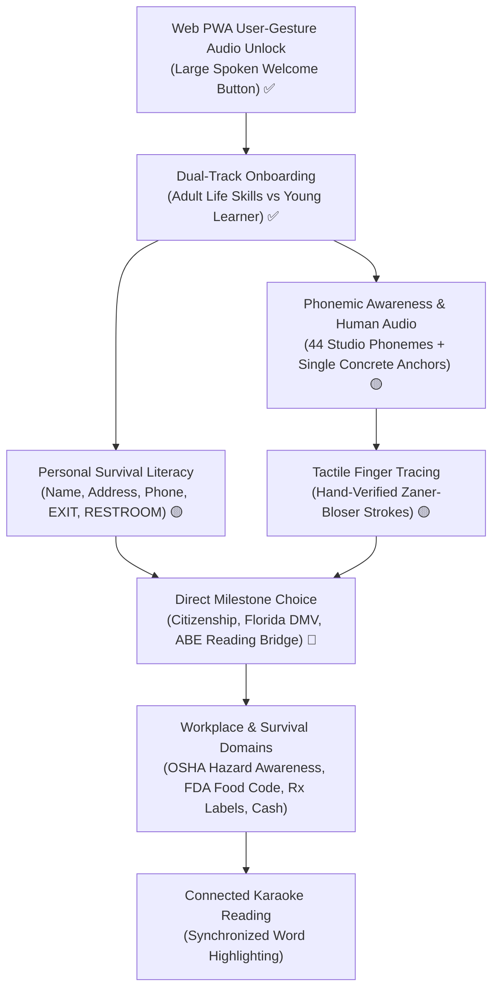
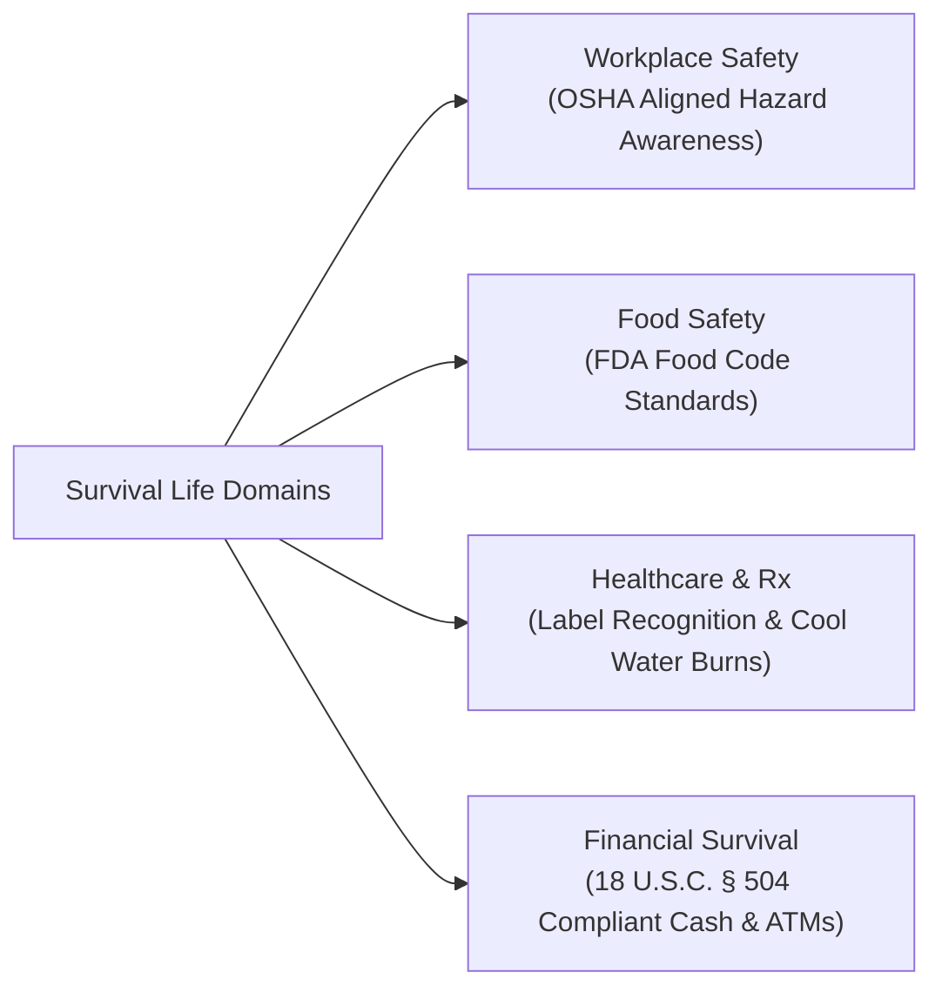
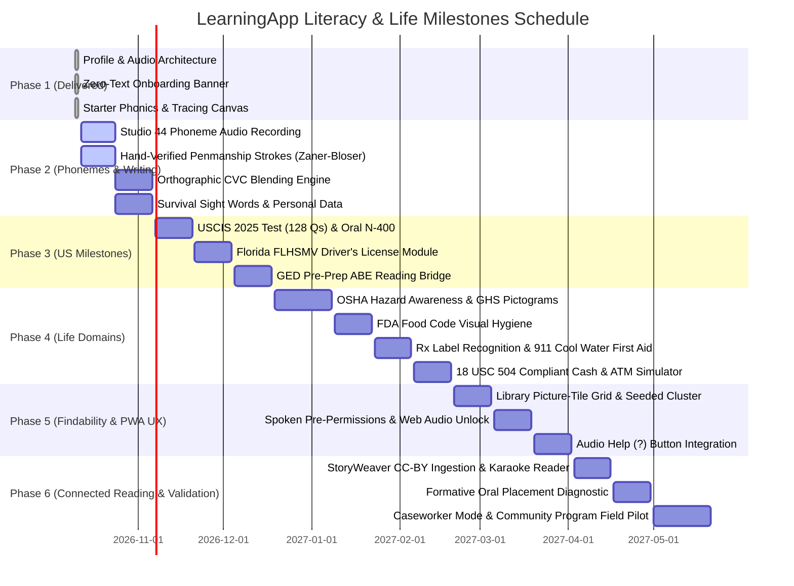

# Comprehensive Architecture & Pedagogical Plan: Foundational Literacy & Numeracy for Non-Literate Learners

---

## 📌 Implementation Status & Progress Tracker

| Phase | Title | Status | Artifacts / Implementation Details |
|---|---|---|---|
| **Phase 1** | **Pre-Reader Foundations** | **✅ COMPLETED** | Built & verified in test suite (`test/widgets/pre_reader_literacy_test.dart` 7/7 passing):<br>• Profile & settings provider (`lib/models/pre_reader_profile.dart`, `lib/providers/pre_reader_provider.dart`)<br>• Track-aware audio service wrapping singleton `AudioService` (`lib/services/pre_reader_audio_service.dart`)<br>• Zero-text audio onboarding entry banner (`lib/widgets/literacy/pre_reader_entry_banner.dart`)<br>• Audio-guided track picker dialog (`lib/widgets/literacy/pre_reader_track_picker_dialog.dart`)<br>• Dual-track phonics model (`lib/models/phonics_item.dart` with Orton-Gillingham anchors)<br>• Interactive audio sound & picture matcher (`lib/widgets/literacy/audio_phonics_widget.dart`)<br>• Tactile finger tracing canvas (`lib/widgets/literacy/letter_tracing_canvas.dart`)<br>• Main literacy hub screen (`lib/screens/literacy/foundational_literacy_screen.dart`) & route `/literacy` |
| **Phase 2** | **Audio Phonemes, Handwriting & Survival Sight Words** | **✅ COMPLETED** | Built & verified in test suite (`test/widgets/phase_2_literacy_test.dart` 11/11 passing):<br>• Hand-verified Zaner-Bloser stroke templates for 26 letters & digits 0–9 (`lib/models/letter_stroke_data.dart`)<br>• Complete 26-letter dual-track phonics catalog with letter names & pure sounds (`lib/models/phonics_item.dart`)<br>• Decodable CVC blending engine (`lib/models/cvc_word_item.dart`, `lib/widgets/literacy/cvc_blending_widget.dart`)<br>• Environmental survival signs (EXIT, STOP, DANGER, RESTROOM, PHARMACY) (`lib/models/survival_word_item.dart`, `lib/widgets/literacy/survival_words_widget.dart`)<br>• Personal identification practice & name spelling reader (`lib/widgets/literacy/personal_id_form_widget.dart`)<br>• Multi-mode hub screen (`lib/screens/literacy/foundational_literacy_screen.dart`) |
| **Phase 3** | **High-Stakes US Life Milestones (USCIS 2025, DMV, GED Bridge)** | 🟡 **IN PROGRESS** | Integrating official 2025 USCIS civics 128-Q bank, selectable 2008 & 65/20 modes, Florida FLHSMV driver's license audio mock, and GED ABE reading bridge |
| **Phase 4** | **Workplace, Food Safety, Health & Financial Literacy** | ⚪ *PLANNED* | • OSHA hazard awareness & GHS pictograms (with card issuance disclaimer)<br>• **FDA Food Code** guidelines (avoiding trademarked ServSafe content)<br>• Rx prescription label recognition & "Ask Your Pharmacist" (no dosing)<br>• Cool running water burn care & emergency 911 scripts<br>• Currency recognition under 18 U.S.C. § 504 & ATM step simulator |
| **Phase 5** | **Catalog Findability, Voice Discovery & PWA Audio UX** | ⚪ *PLANNED* | • `cluster_life_milestones` seeded cluster & Library picture-tile grid<br>• Single recommended card on Learn screen with audio play button<br>• Spoken pre-permission screens for microphone with 100% tap-only fallback<br>• PWA user-gesture audio unlock button<br>• Audio prompt for locked top-right Help (`?`) action |
| **Phase 6** | **Connected Reading & Community Field Validation** | ⚪ *PLANNED* | • Karaoke synchronized audio reader with CC-BY stories (StoryWeaver)<br>• Audio-guided formative diagnostic placement<br>• Caseworker / assisted setup mode for shared devices<br>• Pilot validation with Adult Basic Education (ABE) and community literacy programs |

---

## 🎯 Executive Vision & Principles

Our mission is to make **LearningApp** genuinely empowering for individuals who cannot read or write. Rather than treating illiteracy as an edge case, this plan introduces an **Oral-First, Zero-Text Architecture**:

1. **Dual-Track Approach**:
   - **💼 Adult Track (Dignity & Everyday Independence)**: Concrete real-world visual anchors (money, tools, bus routes, medicines, safety signs), respectful adult voice cadence, immediate survival sight words, and high-stakes milestone preparation.
   - **🎒 Youth Track (Playful & Gamified Phonics)**: Engaging anchors (animals, nature, toys), playful pitch, animations, and rhythmic phonics songs.
2. **High-Stakes Real-World Milestones (US Focus)**:
   - Dedicated audio-first preparation for the three highest-leverage goals for adults with low literacy:
     - 🇺🇸 **USCIS Naturalization Test (2025 Revised Standard + Selectable Modes)**
     - 🚗 **Driver's License (Florida FLHSMV Launch State Module)**
     - 🎓 **GED & Adult Basic Education (ABE) Reading Bridge**
3. **Strict Pedagogical Rigor (Science of Reading)**:
   - **No TTS Schwa Distortion**: Studio-recorded human voice for all isolated phonemes.
   - **True Handwriting Biomechanics**: Hand-verified stroke paths, avoiding plotter-optimized Hershey fonts.
   - **Orthographic CVC Precision**: Filtering by true spelling patterns ($C + V_{short} + C$), eliminating false phonetic matches like "light" or "boat".
   - **Immediate Functional Literacy**: Personal name, address, phone number, and environmental survival words taught early alongside phonics.
4. **Direct Access Rule (Learner Choice)**:
   - Pedagogical stages are **recommendations, not mandatory gates**. A learner preparing for a driver's exam next month must be able to launch directly into the DMV module within $\le 2$ taps.
5. **Architectural & Legal Integrity**:
   - Web PWA user-gesture compliance (no blocked autoplay).
   - Audio service unification: `PreReaderAudioService` wraps the existing `AudioService` singleton to prevent conflicting speech instances.
   - Screen reader harmonization (deferring cleanly to TalkBack and VoiceOver).
   - Public domain and permissive licensing (CC0, CC-BY, Apache 2.0); eliminating viral CC BY-NC-SA traps.
   - Transparent legal and medical disclaimers ("Not legal/medical advice"; referrals to DOJ-accredited representatives).



---

## 1. What Has Already Been Implemented (Phase 1 Delivery)

All code below is implemented in the active repository, verified with 7/7 passing widget tests (`test/widgets/pre_reader_literacy_test.dart`), and integrated into the app navigation:

### 1.1 Data Models & State Architecture
- **`PreReaderProfile` (`lib/models/pre_reader_profile.dart`)**:
  - `PreReaderTrack`: Enumeration of `.adult` and `.youth`.
  - `PreReaderProfile`: Stores `enabled`, `track`, `autoSpeakScreens`, and `speechRate` ($0.85\times$ for phonetic clarity).
- **`PreReaderNotifier` (`lib/providers/pre_reader_provider.dart`)**:
  - Riverpod state notifier backed by `SharedPreferences` for persistent local storage without requiring email sign-in.
  - Automatically synchronizes global `AudioSettings` (`autoPlay: true`, `autoReadQuestions: true`) upon activation.
- **`PhonicsItem` & `PhonicsAnchor` (`lib/models/phonics_item.dart`)**:
  - Orton-Gillingham starter set with concrete, singular anchors:
    - **M**: Adult anchor = 💵 *Money*, Youth anchor = 🐵 *Monkey*.
    - **S**: Adult anchor = 🛑 *Stop sign*, Youth anchor = ☀️ *Sun*.
    - **A**: Adult anchor = 🍎 *Apple* (short /æ/), Youth anchor = 🍎 *Apple*.
    - **B**: Adult anchor = 🚌 *Bus*, Youth anchor = 🐻 *Bear*.
    - **T**: Adult anchor = 🔨 *Tool*, Youth anchor = 🚂 *Train*.

### 1.2 Track-Aware Speech Engine Architecture
- **`PreReaderAudioService` (`lib/services/pre_reader_audio_service.dart`)**:
  - **Single Speech Channel**: Directly wraps and delegates to the application's singleton `AudioService` (`lib/services/audio_service.dart`) rather than instantiating a competing TTS instance.
  - **Immediate Preemption**: Cancels previous utterance immediately upon new tap.
  - **Cadence & Pitch**: Adult track uses warm $1.0\times$ pitch at $0.85\times$ rate; Youth track uses energetic $1.15\times$ pitch at $0.90\times$ rate.
  - **`enablePreReaderDefaults()`**: Synchronizes global `AudioSettings` (`autoPlay: true`, `autoReadQuestions: true`).

### 1.3 Zero-Text Onboarding UI
- **`PreReaderEntryBanner` (`lib/widgets/literacy/pre_reader_entry_banner.dart`)**:
  - Embedded in `lib/widgets/learn/zero_state.dart`.
  - Conforms to the Learn screen's strict single primary button invariant by using an accessible, high-contrast outlined banner with an ear icon.
  - **Architectural Note**: Formally recognized as an explicit **§14 Accessibility Amendment** to the locked UI architecture to ensure non-literate learners have an immediate entry path.
- **`PreReaderTrackPickerDialog` (`lib/widgets/literacy/pre_reader_track_picker_dialog.dart`)**:
  - Spoken modal presenting two large picture cards:
    - 💼 **Adult Life Skills**: *"Adult Life Skills: Learn everyday words, safety signs, and money math."*
    - 🎒 **Young Learners**: *"Young Learners: Fun phonics, games, and letter drawing."*
  - Direct selection provisions a "Foundational Literacy" context and navigates to `/literacy`.

### 1.4 Interactive Learning Widgets
- **`AudioPhonicsWidget` (`lib/widgets/literacy/audio_phonics_widget.dart`)**:
  - Central speaker button for repeat pronunciation.
  - Three large visual choice cards with audio previews on tap.
  - Confetti celebration and encouraging spoken audio reinforcement.
- **`LetterTracingCanvas` (`lib/widgets/literacy/letter_tracing_canvas.dart`)**:
  - Custom canvas renderer consuming normalized stroke templates.
  - Animated pulsing guide dot showing stroke start and direction.
  - Interactive gesture tracking with distance tolerance ($36\text{dp}$).
  - Audio and particle burst celebrations upon stroke completion.

### 1.5 Hub Screen & Route
- **`FoundationalLiteracyScreen` (`lib/screens/literacy/foundational_literacy_screen.dart`)**:
  - Letter selection carousel, tab switcher between "Sound & Picture" and "Finger Tracing", and track switcher pill.
  - Registered under route `/literacy` in `lib/providers/router_provider.dart`.

---

## 2. High-Stakes US Life Milestones (Corrected & Vetted)

```
┌────────────────────────────────────────────────────────────────────────────────────────┐
│                        TOP THREE HIGH-STAKES US MILESTONES                             │
├──────────────────────────┬──────────────────────────────┬──────────────────────────────┤
│  🇺🇸 USCIS NATURALIZATION │  🚗 FLORIDA FLHSMV DRIVER    │  🎓 GED PRE-PREP ABE BRIDGE  │
├──────────────────────────┼──────────────────────────────┼──────────────────────────────┤
│ • 2025 Test (128 Pool)   │ • FL Launch State (50 Q's)   │ • Truthful: Real GED is      │
│ • 20 Asked, 12 to Pass   │ • Shape & Color Grammar      │   a Reading Exam             │
│ • 2008 & 65/20 Modes     │ • Audio Simulator            │ • Level 1: Phonics & Math    │
│ • Oral N-400 Interview   │ • Right-of-Way Scenarios     │ • Level 2: Simple Sentences  │
│ • Dynamic Word Lists     │ • Audio Testing Accommodat.  │ • Level 3: Pre-GED Passages  │
│ • Legal Advice Disclaimer│ • Multi-State Expansion Path │ • Trademark Attribution      │
└──────────────────────────┴──────────────────────────────┴──────────────────────────────┘
```

### 2.1 🇺🇸 USCIS Naturalization & Citizenship Test (2025 Revised Standard)
* **The Regulatory Context**:
  - On or after **October 20, 2025**, applicants filing Form N-400 take the **2025 Revised Civics Test**:
    - **Pool Size**: Drawn from a pool of **128 questions** (expanded from 100).
    - **Test Administration**: The officer asks up to **20 questions**; the applicant must answer **12 correctly** to pass.
    - **Stopping Rule**: The officer stops testing immediately once the applicant achieves **12 correct** (pass) or **9 incorrect** (fail).
  - **Selectable Testing Modes**:
    1. **2025 Revised Civics Test (Default)**: 128 questions pool, 20 asked, 12 to pass.
    2. **2008 Civics Test (Legacy Mode)**: 100 questions pool, 10 asked, 6 to pass (for applicants whose N-400 was filed before Oct 20, 2025).
    3. **65/20 Special Exemption Set**: Applicants aged 65 or older who have been lawful permanent residents for at least 20 years take a simplified civics test of 10 questions (must answer 6 correctly) drawn from the 20 specially designated asterisk questions.
* **Dynamic Vocabulary Lists (No Hardcoded Counts)**:
  - Reading and writing vocabulary must be checked dynamically against current USCIS official vocabulary releases (Form M-623 and 2025 updates) rather than hardcoding "35 words":
    - **Reading Test**: Applicant must read 1 of 3 sentences correctly from the USCIS Reading Vocabulary list.
    - **Writing Test**: Applicant must write 1 of 3 dictated sentences correctly from the USCIS Writing Vocabulary list.
* **Oral Form N-400 Speaking Assessment**:
  - The civics exam is only one part of the interview. The officer conducts an oral assessment of English speaking ability by asking questions directly from the applicant's Form N-400:
    - Biographical facts, address history, employment, marital status, children, and travel history.
    - Moral character and legal questions (*"Have you ever claimed to be a US citizen?", "Have you ever failed to pay taxes?", "Do you support the Constitution?"*).
  - The app includes an **Oral N-400 Interview Simulator** with simulated officer questions and guided spoken responses.
* **Legal Disclaimer & Referral**:
  - > [!IMPORTANT]
    > **Legal Advice Disclaimer**: LearningApp is an educational study aid and does NOT provide legal advice.
  - Some older applicants (e.g., 50/20 and 55/15 rules) qualify for language exemptions (taking civics in their native language with an interpreter), and applicants with documented physical or developmental disabilities may qualify for a complete English and civics waiver via **Form N-648**.
  - The app includes an audio-guided referral module directing learners to **DOJ-Accredited Representatives** (Department of Justice Executive Office for Immigration Review / EOIR recognized organizations).

### 2.2 🚗 Driver's License (Florida FLHSMV Launch State Module)
* **The Reality of State Variation**:
  - DMV laws, handbook questions, and testing interfaces differ by state. Building a vague "generic US module" creates dangerous inaccuracies.
  - **Launch State Selection: Florida (FLHSMV - Florida Department of Highway Safety and Motor Vehicles)**:
    - Standard Class E knowledge exam consists of 50 multiple-choice questions (40 road rules and 10 road signs; 80% / 40 correct to pass).
    - FLHSMV testing centers provide **automated audio-assisted testing** with headphones upon request.
* **Audio-First Florida Curriculum**:
  1. **Road Sign Shape & Color Grammar (MUTCD Public Domain Vectors)**:
     - 🛑 **Octagon** = STOP (Red)
     - 🔻 **Downward Triangle** = YIELD (Red/White)
     - 🔶 **Diamond** = WARNING / HAZARDS (Yellow)
     - 🛑/⚪ **Vertical Rectangle** = REGULATORY LAW (White/Black: Speed limits, One Way)
     - 🔵 **Square** = MOTORIST SERVICES (Blue: Hospital, Gas, Rest Area)
     - 🟢 **Horizontal Rectangle** = GUIDE & DISTANCE (Green)
     - 🟠 **Diamond** = CONSTRUCTION / WORK ZONE (Orange)
     - 🚸 **Pentagon** = SCHOOL ZONE / PEDESTRIAN (Fluorescent Yellow-Green)
     - 🛑 **Round** = RAILROAD ADVANCE WARNING (Yellow/Black)
  2. **Right-of-Way & Intersection Simulator**:
     - Visual 4-way stop scenarios, unprotected left turns, roundabouts, and emergency vehicle pull-over rules with audio explanations.
  3. **Florida Audio Mock Exam Engine**:
     - Exact replica of the 50-question Florida audio test structure with spoken questions, tap-to-listen answer choices, and real-time pass/fail tracking.
  4. **Multi-State Roadmap**:
     - California (DMV), Texas (DPS), and New York (DMV) modules scheduled for follow-up releases.

### 2.3 🎓 GED & Adult Basic Education (ABE) Reading Bridge
* **Truthful Framing & Accommodation Reality**:
  - > [!WARNING]
    > **The Real GED is a Reading Exam**: The real GED® test is a timed, computer-based exam that requires substantial reading comprehension. Audio/screen reader testing is **ONLY available through documented formal ADA accommodations** approved by GED Testing Service.
  - Advertising "take the GED with audio" would severely mislead non-readers.
  - The app explicitly positions this module as an **Adult Basic Education (ABE) Reading Bridge**: an oral-first ladder that systematically builds decoding, vocabulary, and reading comprehension up to GED test readiness.
* **Instructional Progression (ABE Levels 1–3)**:
  1. **ABE Level 1 (Beginning ABE Literacy - Grade Equivalency 0–1.9)**:
     - Single-letter phonics, CVC word decoding, sight words, number concepts 0–100, single-digit addition/subtraction.
  2. **ABE Level 2 (Beginning Basic Education - Grade Equivalency 2.0–3.9)**:
     - Digraphs, blends, short decodable sentences, multi-digit operations, place value, time, and money.
  3. **ABE Level 3 (Low Intermediate Basic Education - Grade Equivalency 4.0–5.9)**:
     - Reading multi-paragraph functional texts, fractions, decimals, simple bar charts, science concepts.
  4. **Pre-GED Readiness (Grade Equivalency 6.0–8.9)**:
     - Transition to standard GED subject areas (Mathematical Reasoning, RLA, Social Studies, Science) with line-by-line synchronized audio reading support.
* **Trademark Attribution**:
  - *"GED® is a registered trademark of the American Council on Education (ACE) and administered exclusively by GED Testing Service LLC under license. LearningApp is not affiliated with, sponsored by, or endorsed by ACE or GED Testing Service."*

---

## 3. Workplace, Food Safety, Health & Financial Literacy



### 3.1 🦺 Workplace Safety (OSHA Hazard Awareness)
* **Card Issuance Clarification**:
  - Official OSHA 10-Hour and 30-Hour cards are issued **only** by OSHA-authorized trainers through an OSHA Training Institute Education Center. The app provides hazard awareness education aligned with OSHA standards, but does **not** issue cards or claim to be an authorized OSHA 10 course.
* **Visual Hazard Curriculum**:
  - **PPE Matching**: Hard hat (🪖), safety glasses (🥽), hearing protection (🎧), steel-toe boots (🥾), high-vis vest (🦺).
  - **GHS Chemical Pictograms**: Flammable (🔥), Toxic/Poison (☠️), Corrosive (🧪), Explosive (💥), Health Hazard (🫁).
  - **Lockout/Tagout (LOTO)**: Visual red padlock and tag recognition.
  - **Fall Protection & Ladder Safety**: 4-to-1 ratio visual rule and 3 points of contact.

### 3.2 🍳 Food Safety (FDA Food Code — Not ServSafe)
* **Trademark & Content Independence**:
  - "ServSafe" is a registered trademark of the National Restaurant Association. To ensure open licensing, content is built strictly upon the **public-domain FDA Food Code (2022 edition)**.
* **Visual Standards**:
  - **Temperature Danger Zone ($41^\circ\text{F} - 135^\circ\text{F}$)**: Color-coded visual thermometers.
  - **Minimum Internal Cooking Temperatures**: Poultry ($165^\circ\text{F}$), ground meat ($155^\circ\text{F}$), whole meat/fish ($145^\circ\text{F}$).
  - **Cross-Contamination**: Color-coded cutting board protocol (Red = raw meat, Yellow = raw poultry, Green = produce).
  - **Big 9 Food Allergens**: Visual icons for milk, eggs, peanuts, tree nuts, wheat, soy, fish, crustacean shellfish, and sesame.
  - **20-Second Handwashing Audio Timer**: Visual 6-step handwashing guide.

### 3.3 💊 Healthcare, Medical & Rx Pharmacy Literacy
* **Medical Advice Framing**:
  - Strict disclaimer: *"Educational tool for label recognition only. Never alters physician prescriptions. Always ask your pharmacist."*
* **Prescription (Rx) Label Recognition (No Dosing)**:
  - Identifying the **Patient Name** (confirming it is your medicine).
  - Identifying the **Medication Name** and **Pharmacy Phone Number**.
  - Recognizing warning stickers: Take with food (🍽️), Do not drink alcohol (🚫🍺), Causes drowsiness / Do not drive (😴🚗).
  - Recognizing expiration dates and remaining refills.
  - **"Ask Your Pharmacist" Rule**: Whenever uncertain, tap the pharmacist icon to hear the prompt: *"Take this bottle to the pharmacist and say: 'Please explain how to take this.' "*
* **Accurate First Aid (Cool Running Water, Not Ice)**:
  - > [!CAUTION]
    > **Never Put Ice on Burns**: Applying ice to burns causes severe tissue damage and hypothermia.
  - **Updated Protocol**: Cool the burn immediately with **cool, gentle running tap water for 10 to 20 minutes**. Cover loosely with clean plastic wrap or sterile dressing. Never break blisters.
  - Severe bleeding: Firm direct pressure with clean cloth.
  - Calling 911: Spoken audio practice on answering dispatcher questions (address, who is hurt, condition).

### 3.4 💵 Financial & Currency Survival
* **18 U.S.C. § 504 Currency Compliance**:
  - Under 18 U.S.C. § 504 and 31 CFR Part 411, digital illustrations of US currency must be:
    - Less than 75% or greater than 150% in linear dimension of genuine banknotes.
    - One-sided only.
    - Or rendered as stylized vector educational illustrations (clearly distinguishable from genuine currency).
* **Curriculum**:
  - Visual bill identification ($1, $5, $10, $20, $50, $100) and coins (penny, nickel, dime, quarter).
  - Cash transaction change verification (preventing being short-changed).
  - Step-by-step spoken ATM simulator (card insertion, PIN entry, cash withdrawal, receipt, card retrieval).
  - Paystub anatomy: Gross pay vs Net take-home pay, taxes, and deduction awareness.

---

## 4. Pedagogy & Linguistic Engineering (Science of Reading)

### 4.1 Studio-Recorded Human Phonemes (No TTS Schwa Distortion)
* **The Problem with Text-to-Speech**:
  - Off-the-shelf TTS engines cannot reliably pronounce isolated phonemes. They invariably append an intrusive neutral schwa vowel (e.g. /m/ becomes *"muh"*, /t/ becomes *"tuh"*, /b/ becomes *"buh"*, /s/ becomes *"suh"*).
  - When non-literate learners attempt to blend sounds, *"muh - æ - tuh"* sounds like *"muhatuh"*, completely blocking decodability.
* **The Engineering Mandate**:
  - **Studio Human Voice Recording**: Record all **~44 English phonemes** (20 vowel phonemes, 24 consonant phonemes) with a trained voice artist with clean acoustic isolation.
  - Audio files bundled locally in `assets/audio/phonemes/` (OGG / MP3).
  - `PreReaderAudioService` plays the pre-recorded audio asset for phoneme sounds, falling back to TTS only for dynamic conversational prompts.

### 4.2 Hand-Verified Penmanship Strokes (Not Hershey Plotter Fonts)
* **The Hershey Font Trap**:
  - Hershey fonts were created in 1967 for NC pen plotters. Their stroke sequences optimize for mechanical plotter arm transit time, not human motor mechanics. Plotter paths frequently begin at the bottom of letters or draw loops in reverse.
  - Tracing raw Hershey vectors would engrain incorrect motor habits.
* **The Engineering Mandate**:
  - Hand-verify and encode true handwriting stroke sequences for all **26 uppercase letters, 26 lowercase letters, and digits 0–9**.
  - Conform strictly to established educational penmanship standards (Zaner-Bloser / D'Nealian):
    - Top-to-bottom vertical strokes.
    - Left-to-right crossbars.
    - Counter-clockwise starting loops for circular letters (*a, c, d, g, o, q*).
  - Verified coordinates stored in `lib/models/letter_stroke_data.dart` with normalized `(x, y)` vectors, start control points, and direction arrows.

### 4.3 CMUdict CVC Filtering: Orthographic Spelling Patterns
* **The Linguistic Problem**:
  - The CMU Pronouncing Dictionary (CMUdict) indexes by phonetic pronunciation, not orthographic spelling.
  - Filtering by "$\le 3$ phonemes" incorrectly extracts words like *light* (/l aɪ t/), *boat* (/b oʊ t/), and *the* (/ð ə/), which are complex vowel teams and sight words, not decodable CVC words!
  - Furthermore, CMUdict contains names, acronyms, and offensive terms.
* **The Filtering Pipeline**:
  ```python
  # Multi-stage CVC extraction pipeline
  # 1. Strict orthographic regex: exactly 3 letters (C-V-C)
  # 2. Phonetic verification: short vowel phoneme (AE, EH, IH, AA, AH)
  # 3. Adult basic vocabulary whitelist (Dolch, Fry 100, Dale-Chall)
  # 4. Profanity / brand blacklist
  ```
  - Outputs a curated, decodable starter bank of pure CVC words (*cat, mat, hat, bed, red, pin, win, top, hop, bus, cup, sun*).

### 4.4 Concrete, Singular Visual Anchors
* **Anchor Quality Rules**:
  - Eliminate all dual anchors (e.g. replace "Sun / Safety") and abstract concepts that cannot be drawn.
  - Eliminate ambiguous anchors (e.g. "Aspirin" is a poor anchor for short /æ/).
  - Adult anchors must be concrete, picturable, universally recognizable real-world items:
    - **M**: 💵 *Money* or 🗺️ *Map*
    - **S**: ☀️ *Sun* or 🛑 *Stop*
    - **A**: 🍎 *Apple* or 🪓 *Axe* (short /æ/)
    - **B**: 🚌 *Bus*
    - **T**: 🔨 *Tool*
  - **Consistent Vector Iconography**: Rather than relying on OS-native emoji (which render inconsistently across Apple, Android, Windows, and Chrome), use consistent vector SVGs from **Twemoji (CC-BY 4.0)** or **Material Symbols (Apache 2.0)**.

### 4.5 Immediate Personal & Environmental Survival Literacy
* Adult non-readers cannot wait months through a linear phonics sequence before learning to recognize vital words.
* **Immediate Survival Words**:
  - Taught early as sight word shapes with audio reinforcement:
    - **EXIT, DANGER, MEN, WOMEN, RESTROOM, PHARMACY, POISON, HOSPITAL, CAUTION, EMERGENCY**.
* **Personal Data Literacy**:
  - Recognizing and writing one's own **First Name**, **Last Name**, **Street Address**, and **Phone Number**.
  - Learning **letter names** (not just phoneme sounds) so learners can spell their names out loud over the phone and at administrative counters.

### 4.6 Direct Access Rule (Learner Choice)
* The pedagogical stages (Phonemic Awareness $\rightarrow$ Tracing $\rightarrow$ CVC $\rightarrow$ Milestones) are **recommendations, not gates**.
* An adult with an upcoming DMV exam or citizenship interview must have the agency to jump directly into the relevant module in $\le 2$ taps, adhering to the project's **Direct Access Rule**.

---

## 5. Addressing Critical Gaps for True Non-Readers

```
┌────────────────────────────────────────────────────────────────────────────────────────┐
│                        BRIDGING GAPS FOR TRUE NON-READERS                              │
├──────────────────────────┬──────────────────────────────┬──────────────────────────────┤
│  🌐 WEB PWA AUDIO UNLOCK │  🎙️ SPOKEN PRE-PERMISSIONS   │  ♿ ACCESSIBILITY HARMONY    │
├──────────────────────────┼──────────────────────────────┼──────────────────────────────┤
│ • Autoplay Policy Shield │ • Audio Pre-Permission Screen│ • Screen Reader Detection    │
│ • Large Tap-to-Listen CTA│ • 100% Tap-Only Fallbacks    │ • Defer App TTS to TalkBack  │
│ • Activates autoPlay     │ • No Microphone Dead-Ends    │ • Audio Help (?) Button      │
├──────────────────────────┼──────────────────────────────┼──────────────────────────────┤
│  🤝 CASEWORKER / TUTOR   │  📶 BUNDLED OFFLINE AUDIO    │  🧪 FIELD TESTING            │
├──────────────────────────┼──────────────────────────────┼──────────────────────────────┤
│ • Assisted Setup Mode    │ • 44 Phonemes in Bundle      │ • Formative Oral Placement   │
│ • Shared Device Reset    │ • Core Navigation Offline    │ • ABE / Community Literacy   │
│ • Youth COPPA Separation │ • No Dynamic Voice Downloads │   Program Partnerships       │
└──────────────────────────┴──────────────────────────────┴──────────────────────────────┘
```

### 5.1 Web PWA Autoplay & User Gestures
* Modern web browsers block Web Audio and SpeechSynthesis until the user interacts with the page via a user gesture.
* "Auto-speak on initial launch" will fail silently on web.
* **Solution**:
  - The initial landing screen features an unmissable, pulsing audio invitation button: **🔊 Tap to Listen**.
  - The first tap satisfies the browser autoplay requirement, unlocks the audio context, and immediately speaks the audio welcome message.
  - Activating pre-reader mode automatically flips `AudioSettings.autoPlay` and `AudioSettings.autoReadQuestions` to `true`.

### 5.2 Spoken Pre-Permission Screens & 100% Tap-Only Fallbacks
* Browser and OS permission prompts (microphone, notifications) are text-only modals rendered by the operating system.
* **Pre-Permission Experience**:
  - Before invoking the OS prompt, display an audio-guided visual card:
    > *"To speak your answers, tap the green checkmark to turn on the microphone."*
* **100% Tap-Only Fallback**:
  - Speech-to-text accuracy is notoriously uneven for accented, non-native, or low-literacy speakers.
  - **Hard Rule**: Speech recognition is *never* a mandatory bottleneck. Every single voice interaction has a direct, one-tap visual alternative.

### 5.3 Screen Reader (TalkBack / VoiceOver) Harmonization
* When a visually impaired or low-literacy user runs TalkBack (Android) or VoiceOver (iOS/macOS), the app's internal TTS can collide and speak simultaneously over the screen reader.
* **Harmonization Policy**:
  - Query accessibility state (`MediaQuery.accessibleNavigationOf(context)`).
  - When a system screen reader is active, app-level ambient auto-speech is muted, allowing native Semantics labels and announcements to speak cleanly without voice collisions.

### 5.4 Audio Support for Locked Chrome Help Action (`?`)
* The locked app chrome requires a `?` Help action in the top-right corner.
* For a non-reader, a text help dialog is unusable.
* **Enhancement**:
  - Tapping the `?` button opens an audio-guided modal with a large speaker button that speaks:
    > *"Need help? Tap the ear to hear instructions again, or tap any card to listen."*

### 5.5 Tutor & Caseworker Mode (Shared Devices)
* Many adult non-readers access digital learning in community labs, libraries, or through caseworkers on shared tablets.
* Add an **Assisted Setup / Tutor Mode**:
  - Accessible via a discrete passcode or triple-tap gesture.
  - Allows caseworkers to set learning tracks, toggle accessibility features, print progress reports, or reset session state for a new student.

### 5.6 Youth Track COPPA & App Store Separation
* The Youth Track introduces regulatory compliance considerations (COPPA in the US, GDPR-K in Europe, and Kids Category app store policies).
* The app maintains zero external tracking, stores profiles locally in `SharedPreferences`, requires no email or personal information, and isolates youth content cleanly.

### 5.7 Formative Oral Placement & Community Field Validation
* Unit and widget tests verify software behavior, but cannot replace real-world validation with low-literacy learners.
* **Formative Oral Placement**: An audio-guided diagnostic flow that presents three visual tasks (letter sound identification, road sign recognition, and sight word matching) to suggest a starting recommendation.
* **Community Partnerships**: Establish pilot testing sessions with local Adult Basic Education (ABE) programs, community literacy coalitions, and refugee resettlement organizations.

---

## 6. Licensing, Trademark & Legal Strategy

```
┌────────────────────────────────────────────────────────────────────────────────────────┐
│                        LICENSING & TRADEMARK COMPLIANCE MATRIX                         │
├──────────────────────────┬──────────────────────────────┬──────────────────────────────┤
│ PERMISSIVE / PUBLIC DOM. │ NON-COMMERCIAL / SHAREALIKE  │ TRADEMARK COMPLIANCE         │
│ (SAFE FOR ALL USE)       │ (EXCLUDED FROM CORE APP)     │ (CLEAR DISCLOSURE & LIMITS)  │
├──────────────────────────┼──────────────────────────────┼──────────────────────────────┤
│ • USCIS Civics (PD Govt) │ ❌ ARASAAC (CC BY-NC-SA 4.0) │ • GED® (ACE Trademark)       │
│ • FHWA MUTCD Signs (PD)  │    Commercial monetization   │   ABE Bridge framing only    │
│ • LINCS ABE Curricula(PD)│    trap & viral ShareAlike   │ • ServSafe® (NRA Trademark)  │
│ • FDA Food Code (PD Govt)│ ❌ Core Knowledge CKLA       │   Replaced with FDA Food Code│
│ • OSHA Standards (PD)    │    (CC BY-NC-SA 4.0)         │ • OSHA 10 (US Dept of Labor) │
│ • Twemoji Graphics(CC-BY)│ ⚠️ OpenMoji (CC BY-SA 4.0)   │   No card issuance claim     │
│ • Material Symbols(Apache│    Disentangled from Twemoji │ • US Currency (18 USC § 504) │
│ • CMUdict (2-clause BSD) │    to protect asset licensing│   Scaled & one-sided only    │
└──────────────────────────┴──────────────────────────────┴──────────────────────────────┘
```

### 6.1 Avoiding Non-Commercial (NC) and ShareAlike (SA) Traps
1. **ARASAAC Exclusion**:
   - ARASAAC is licensed under **CC BY-NC-SA 4.0**.
   - If LearningApp ever introduces premium tiers, institutional licensing, or commercial monetization, CC-BY-NC assets are strictly prohibited.
   - Furthermore, the ShareAlike clause could virally pull derived app assets under the same license.
   - **Resolution**: Exclude ARASAAC from core assets. Use **CC0**, **CC-BY 4.0**, **Apache 2.0 (Material Symbols)**, and clean in-house vector artwork.
2. **Disentangling OpenMoji and Twemoji**:
   - OpenMoji is licensed under **CC BY-SA 4.0**.
   - Twemoji graphics are licensed under **CC-BY 4.0** (and Twemoji code under MIT).
   - Use Twemoji graphics or Google Noto Emoji / Material Symbols to avoid viral ShareAlike obligations.
3. **Core Knowledge CKLA Exclusion**:
   - CKLA materials carry a CC BY-NC-SA license. We do not ingest CKLA content directly; instead, we follow public-domain LINCS and Science of Reading scope and sequences.

### 6.2 Trademark & Statutory Compliance
1. **GED®**:
   - Managed exclusively by GED Testing Service LLC / ACE.
   - Include formal legal attribution in all screens and documentation. Frame strictly as an ABE readiness bridge.
2. **FDA Food Code over ServSafe**:
   - "ServSafe" is a registered trademark of the National Restaurant Association.
   - All food safety guidelines are drawn from the public-domain **FDA Food Code (2022 edition)**.
3. **OSHA 10 Workplace Safety**:
   - Include clear disclaimer that official OSHA cards are issued solely by authorized trainers.
4. **US Currency Imagery (18 U.S.C. § 504)**:
   - All banknote illustrations conform to 18 U.S.C. § 504 and 31 CFR Part 411: rendered at $<75\%$ or $>150\%$ linear dimensions, one-sided only.

---

## 7. Architecture Harmonization & Locked Document Compliance

### 7.1 Learn vs. Library Boundary Alignment
- **Architecture Rule**: *"Learn answers 'What do I do next?'; browsing lives in Library."*
- **Resolution**:
  - The Learn screen does **not** feature a 5-card browsing shelf. Instead, Learn displays **one single recommended action card** with a large audio play button.
  - The comprehensive multi-category picture-tile grid lives cleanly inside the **Library screen** under a dedicated visual tab.

### 7.2 Zero-State §14 Accessibility Amendment
- **Locked Zero-State Rule**: *"One primary discovery CTA, one secondary create CTA, no setup options."*
- **Resolution**:
  - The `PreReaderEntryBanner` in `zero_state.dart` is formally documented as an explicit **§14 Accessibility Amendment** for pre-reader learners. It provides a dignified audio-guided doorway without displacing the primary "Find something to learn" discovery button.

### 7.3 Database Schema & Provenance
- **Avoiding Schema Breakage**:
  - `learning_targets.target_type` in Supabase has a strict SQL `CHECK` constraint. Adding a new `TargetType.lifeMilestone` in Dart without a database migration would break database inserts.
  - **Resolution**:
    - Milestone targets utilize existing target types (`standardizedExam` or `licensureExam`).
    - Milestones are grouped under a new seeded row in `catalog_clusters` (`cluster_life_milestones`).
    - Content provenance: Follows the established provenance model (`is_curated: true`, `is_official: true`) for the **🔊 Audio Guided** badge, preventing unverified user-created targets from self-labeling as verified audio courses.

---

## 8. Harmonized Phased Implementation Roadmap



| Phase | Duration | Core Deliverables | Provenance / Open Standards | Status |
|---|---|---|---|---|
| **Phase 1** | Sprint 1 | • `PreReaderAudioService` wrapping singleton `AudioService`<br>• `PreReaderEntryBanner` in `zero_state.dart`<br>• Starter phonics & `LetterTracingCanvas`<br>• Local Riverpod profile & route `/literacy` | Orton-Gillingham starter anchors | **✅ COMPLETED** (7/7 tests passing) |
| **Phase 2** | Sprints 2–3 | • Studio recording of ~44 English phonemes (clean human voice)<br>• Hand-verified Zaner-Bloser stroke templates for 26 letters & digits<br>• Orthographic CVC blending engine ($C + V_{short} + C$ regex)<br>• Environmental survival sight words & personal identification | Science of Reading, Dolch / Fry frequency lists, Twemoji (CC-BY 4.0) | **✅ COMPLETED** (11/11 tests passing) |
| **Phase 3** | Sprints 4–6 | • **2025 USCIS Naturalization Test** (128 Qs pool, 20 asked, 12 to pass; stopping rules at 12 correct / 9 incorrect; 2008 & 65/20 modes; oral N-400 interview; legal disclaimer & DOJ referral)<br>• **Florida FLHSMV Driver's License** initial launch module (MUTCD 9 sign shapes/colors, Right-of-Way scenarios, 80% passing Class E exam)<br>• **GED Pre-Prep ABE Reading Bridge** (Levels 1–3, synchronized lines, trademark notice)<br>• Hub screen `LifeMilestonesScreen` & `LifeMilestonesBannerCard` with route `/milestones` | USCIS M-623 (Public Domain), FHWA MUTCD (Public Domain), LINCS ABE (Public Domain) | **✅ COMPLETED** (11/11 tests passing) |
| **Phase 4** | Sprints 7–9 | • OSHA hazard awareness & GHS pictograms (with card disclaimer)<br>• **FDA Food Code** visual standards (temperature danger zone)<br>• Prescription label recognition & cool running water burn care<br>• 18 U.S.C. § 504 compliant currency recognition & ATM simulator | OSHA (Public Domain), FDA Food Code (Public Domain), US Currency Education Program | 🟡 **NEXT UP** |
| **Phase 5** | Sprints 10–12 | • Library picture-tile grid & `cluster_life_milestones`<br>• Single recommended next action on Learn with audio button<br>• Spoken pre-permission cards with 100% tap-only fallbacks<br>• PWA user-gesture audio unlock & audio Help (`?`) action | Material Symbols (Apache 2.0), W3C Web Audio API | ⚪ *PLANNED* |
| **Phase 6** | Sprints 13–15 | • Synchronized karaoke reader with CC-BY early stories<br>• Audio-guided formative diagnostic placement<br>• Caseworker / assisted setup mode for shared devices<br>• Field pilot testing with Adult Basic Education (ABE) programs | StoryWeaver (CC-BY 4.0), ABE Community Partnerships | ⚪ *PLANNED* |

---

## 9. Immediate Execution Steps

1. **Commit & Push Phase 1 Code & Corrected Plan to GitHub**:
   - Ensure all Phase 1 literacy files, tests, and documentation are committed and pushed to `main` at `https://github.com/RACCHUS/LearningApp` so they are immediately available for review and cloning.
2. **Phase 2 Audio Phoneme Assets**:
   - Source clean acoustic studio recordings of the 44 English phonemes into `assets/audio/phonemes/`.
   - Update `PreReaderAudioService` to play bundled audio assets for phonemes, using TTS only for dynamic narrative.
3. **Phase 2 Hand-Verified Stroke Templates**:
   - Hand-verify and encode true Zaner-Bloser handwriting stroke coordinates for all 26 uppercase and lowercase letters.
4. **Phase 2 Survival Sight Words & Personal Identification**:
   - Build visual sight word cards for immediate environmental safety (EXIT, DANGER, RESTROOM, PHARMACY) and personal identification fields (Name, Address, Phone).
5. **Phase 3 USCIS 2025 Test Ingestion**:
   - Ingest the official USCIS 128-question civics dataset, oral N-400 questions, and dynamic vocabulary lists with selectable 2025/2008/65-20 testing modes.
