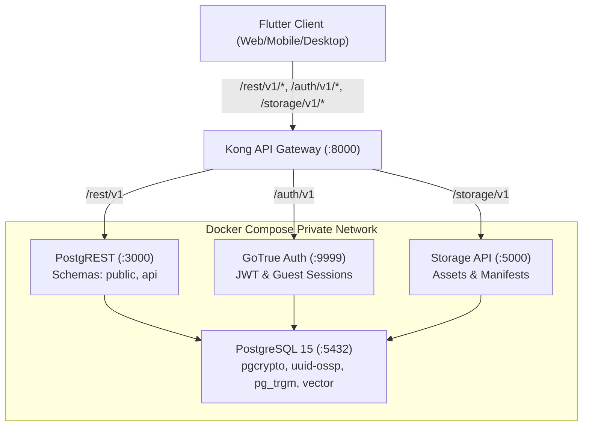

# 🚀 LearningApp Turnkey Self-Hosting Infrastructure

This directory contains the production-ready Docker Compose orchestration for self-hosting **LearningApp** and running your own independent, sovereign learning backend without any dependency on Supabase Cloud.

---

## 🏗️ Architecture Overview

The self-hosting stack reproduces the exact Supabase backend architecture expected by LearningApp's client, while exposing the versioned `api` schema, full 86-migration schema contract, and GoTrue guest authentication:



### Services Included

| Container | Service | Image | Description |
|---|---|---|---|
| `learningapp-kong` | API Gateway | `kong:2.8.1` | Routes requests, enforces CORS, terminates HTTP |
| `learningapp-rest` | Data REST API | `postgrest/postgrest:v12.2.0` | Serves `public` and `api` schemas via JSON HTTP |
| `learningapp-auth` | Authentication | `supabase/gotrue:v2.164.0` | JWT issuance, guest authentication, email auth |
| `learningapp-storage` | Object Storage | `supabase/storage-api:v1.14.3` | S3-compatible or local-disk asset storage |
| `learningapp-meta` | Postgres Meta | `supabase/postgres-meta:v0.84.2` | Database inspection & schema reflection |
| `learningapp-db` | Database | `supabase/postgres:15.8.1.189` | PostgreSQL 15 engine with all extensions |

---

## ⚡ Quickstart (3 Steps)

### Step 1: Configure Environment

Copy the example environment template:
```bash
cd deploy/self-host
cp .env.example .env
```
*(On Windows PowerShell: `Copy-Item .env.example .env`)*

> [!IMPORTANT]
> For production environments, generate strong random strings for `POSTGRES_PASSWORD` and `JWT_SECRET`, and sign custom `ANON_KEY` / `SERVICE_ROLE_KEY` tokens.

### Step 2: Bootstrap & Start Services

Execute the turnkey bootstrap script:

**Linux / macOS**:
```bash
./bootstrap.sh
```

**Windows PowerShell**:
```powershell
.\bootstrap.ps1
```

The bootstrap script automatically:
1. Validates all 86 committed migrations in `supabase/migrations/`.
2. Compiles a consolidated `01-full-schema.sql` database bundle.
3. Launches all containers via Docker Compose.
4. Waits for PostgreSQL to report healthy.

### Step 3: Run the Flutter Client

Run or build the LearningApp client pointing to your self-hosted gateway:

```bash
flutter run -d chrome \
  --dart-define=SUPABASE_URL=http://localhost:8000 \
  --dart-define=SUPABASE_ANON_KEY=your-anon-key-from-env
```

To include custom white-label branding:
```bash
flutter run -d chrome \
  --dart-define=SUPABASE_URL=http://localhost:8000 \
  --dart-define=SUPABASE_ANON_KEY=your-anon-key-from-env \
  --dart-define-from-file=brand.example.json
```

---

## 🛡️ Production Recommendations

1. **Reverse Proxy & TLS Termination**: Put Nginx, Caddy, or Cloudflare Tunnel in front of port `8000` to terminate HTTPS.
2. **Database Backups**: Use `docker exec -t learningapp-db pg_dump -U postgres postgres > backup.sql` on a daily cron schedule.
3. **Data Persistence**: Postgres database data persists in the named Docker volume `db_data`; storage assets persist in `storage_data`.

