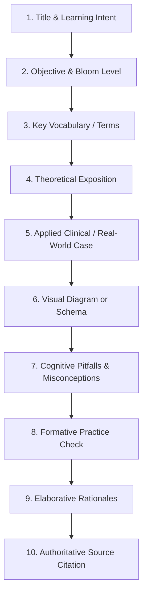
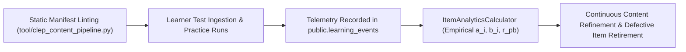

# CLEP Lesson & Assessment Item Specification

This specification establishes the pedagogical standards, psychometric rules, and production workflows for the College Board CLEP curriculum within **LearningApp**.

---

## 1. Executive Overview & Scope

The CLEP (College-Level Examination Program) enables learners to earn college credit by demonstrating college-level mastery of introductory undergraduate subjects. 

To ensure learners are genuinely prepared to pass official exams with high confidence, LearningApp enforces:
1. **Curriculum Completeness**: Comprehensive domain-by-domain instruction, not mere practice question collections.
2. **Pedagogical Rigor**: A standardized 10-element lesson architecture grounded in cognitive learning science.
3. **Psychometric Quality**: Haladyna-compliant multiple-choice authoring with elaborative feedback on all options.
4. **Empirical Validation**: Continuous telemetry via `learning_events` and psychometric parameter estimation ($a_i, b_i, r_{pb}$).
5. **Institutional Transparency**: Unambiguous disclaimers clarifying that ACE credit recommendations are advisory and individual institutions determine credit acceptance.

---

## 2. Authoritative Source Provenance & Rights Framework

### 2.1 Authorized Source Types

| Source Layer | Authoritative Provider | Approved Usage | Rights & Attribution |
| :--- | :--- | :--- | :--- |
| **Blueprint Authority** | College Board CLEP Official Examination Guides (2024–2026) | Domain taxonomy, topic scope, cognitive level distribution, percentage weight ranges. | **Fair Use / Public Domain Scope**: Used solely for taxonomic alignment and test blueprint structuring. |
| **Instructional Reference** | OpenStax OER Textbooks (e.g., *Psychology 2e* by Spielman et al.) | Core theoretical exposition, empirical findings, diagrams, and glossary terminology. | **CC BY 4.0**: Full attribution required in manifest metadata and lesson citation blocks. |
| **Diagnostic Criteria** | American Psychiatric Association (*DSM-5-TR*) & APA Ethical Standards | Classification of psychological disorders, diagnostic thresholds, ethical principles in research. | **Academic Citation**: Referencing standard diagnostic criteria and empirical research. |

> [!CAUTION]
> **Strict Prohibition on Live Test Items**: Under no circumstances should official, proprietary, or retired secure College Board test items be reproduced, paraphrased, or scraped into LearningApp. All assessment items must be original works authored to meet official blueprint objectives.

### 2.2 Institutional Credit Disclaimer Requirement

Every course overview, syllabus, lesson header, and simulated exam score report must display the following institutional policy disclaimer:

> **Important Institutional Credit Notice**:
> The American Council on Education (ACE) recommends granting 3 semester hours of college credit for achieving a scaled score of 50 or higher on this CLEP examination. However, **credit-granting policies are determined independently by each college and university**. Institutions may require higher scores, award differing semester credits, apply credits toward general education rather than major requirements, or evaluate CLEP scores under specific departmental guidelines. Learners must consult their institution's registrar or academic advisor to verify credit acceptance prior to testing.

---

## 3. The 10-Element Lesson Architecture

Every instructional lesson within a CLEP curriculum manifest must implement the following 10 structural elements across its content blocks:



### Element Breakdown

1. **Title & Learning Intent**:
   - Concise, informative title specifying the exact concept (e.g., *Long-Term Memory Systems: Explicit vs. Implicit Memory*).
   - Clear statement of what the learner will understand upon completion.

2. **Aligned Objective & Cognitive Level**:
   - Explicit linkage to the College Board curriculum objective code (e.g., `CLEP-PSYCH-OBJ-6.1`).
   - Cognitive level classified under Bloom's Revised Taxonomy: `recall`, `comprehension`, `application`, `analysis`, or `evaluation`.

3. **Key Vocabulary & Concept Terminology**:
   - Definitive list of essential technical terms.
   - All terms must be bound to canonical `concept_slugs` in the system taxonomy.

4. **Core Theoretical Exposition**:
   - Deep conceptual instruction detailing underlying physiological, cognitive, or behavioral mechanisms.
   - Structured markdown with bold definitions, bulleted structural characteristics, and sequential processes.

5. **Applied Real-World Case / Experimental Scenario**:
   - Concrete vignette illustrating how the principle operates in real life, clinical practice, or historical laboratory experiments (e.g., Patient H.M., Pavlov's salivation apparatus, Phineas Gage).

6. **Visual or Diagrammatic Representation**:
   - Structured Markdown table, ASCII architecture, flow diagram, or conceptual comparison chart illustrating contrasts between mechanisms.

7. **Cognitive Pitfalls & Common Misconceptions**:
   - Explicit debunking of common learner confusions (e.g., conflating *negative reinforcement* with *punishment*, or confusing *anterograde amnesia* with *retrograde amnesia*).

8. **Formative Knowledge Check**:
   - Haladyna-compliant single-choice question testing the lesson's target objective at the appropriate cognitive level.

9. **Elaborative Rationales**:
   - Exhaustive feedback explaining **why** the correct option is theoretically sound, and **why each individual distractor** is incorrect or misapplied.

10. **Authoritative Source Citation**:
    - Direct reference to OpenStax chapter/section (e.g., `OpenStax Psychology 2e, Section 8.2: Parts of the Brain Involved in Memory`) and relevant academic literature.

---

## 4. Haladyna Psychometric Item Authoring Standards

All formative checks and simulated examination questions must adhere to Thomas M. Haladyna's evidence-based item-writing guidelines:

### 4.1 Item Stem Rules
- **Problem-Centric**: The stem must present a complete problem or question so the learner understands the intent before reading the options.
- **Positive Phrasing Default**: Avoid negative stems (e.g., *"Which of the following is NOT..."*) unless testing critical diagnostic exclusions, safety contraindications, or ethical prohibitions. When used, the negative word must be capitalized and bolded (**NOT**, **EXCEPT**).
- **Vignette Quality**: Stems testing application or analysis must feature a realistic clinical, experimental, or observational scenario rather than abstract trivia.
- **No Extraneous Clues**: Stems must not contain grammatical cues, word associations, or qualifying words (*always*, *never*) that reveal the correct answer.

### 4.2 Distractor Construction Rules
- **Exactly Four Options**: Every item must have exactly 4 plausible choices (1 key, 3 distractors).
- **Plausibility**: Distractors must represent documented student misconceptions, related diagnostic categories, or opposing theoretical frameworks.
- **Grammatical Homogeneity**: All 4 options must be grammatically consistent with the stem, share similar structure, and be roughly equal in length.
- **Length Ratio Limit**: The ratio of the longest option to the shortest option must not exceed **2.5:1** (absolute rejection threshold is **3.0:1**).
- **Absolute Prohibitions**:
  - Never use *"All of the above"* (reduces item to partial recognition).
  - Never use *"None of the above"* (measures what the learner knows isn't true rather than what is true).
  - Never include mutually exclusive options paired with umbrella options.

### 4.3 Key Position Distribution
- Correct answer positions must be uniformly balanced across positions 0 (A), 1 (B), 2 (C), and 3 (D).
- In any 95-question test form or curriculum module, no single position may account for more than **35%** of items (warning threshold at 30%, hard failure at 45%).

---

## 5. Psychometric Validation & Empirical Calibration

Static authoring checks guarantee clean syntax and item formatting, but **true psychometric validity is empirical**. 



### 5.1 Telemetry via `public.learning_events`
Every interaction with a CLEP item emits an append-only event to `public.learning_events` containing:
- `user_id`: Learner identifier.
- `item_id`: Canonical assessment item UUID.
- `target_id`: Standardized exam target version ID.
- `response_option_index`: The selected choice (0–3).
- `is_correct`: Boolean score outcome.
- `latency_ms`: Response latency in milliseconds.
- `confidence_level`: Self-reported confidence rating (1–5).

### 5.2 Psychometric Parameter Calculation
Using the repository's `ItemAnalyticsCalculator`:

1. **Difficulty ($b_i$ / Classical $p$-Value)**:
   $$p_i = \frac{N_{\text{correct}}}{N_{\text{total}}}$$
   - Target range for CLEP simulation items: $0.40 \le p_i \le 0.85$.
   - Items with $p_i < 0.25$ (excessively difficult/ambiguous) or $p_i > 0.95$ (trivial) are flagged for revision.

2. **Discrimination ($a_i$ / Point-Biserial Correlation $r_{pb}$)**:
   $$r_{pb} = \frac{\bar{X}_1 - \bar{X}_0}{S_X} \sqrt{p_i (1 - p_i)}$$
   - Measures how effectively an item distinguishes top-performing learners from low-performing learners.
   - Acceptable: $r_{pb} \ge 0.25$.
   - Ideal: $r_{pb} \ge 0.35$.
   - Negative $r_{pb}$ ($r_{pb} < 0.05$) triggers immediate item review for misleading stems or incorrect answer keys.

3. **Distractor Functionality**:
   - Every distractor must be selected by at least **5%** of lower-scoring examinees. Distractors selected by $<2\%$ of learners are classified as non-functional and rewritten.

4. **Internal Consistency Reliability ($\alpha$)**:
   - Simulated 95-question examination forms must achieve a Cronbach's Alpha of $\alpha \ge 0.85$.

---

## 6. Official Blueprint vs. Platform Simulation Model

### 6.1 Domain Percentage Ranges vs. Integer Quotas

The College Board publishes examination specifications as **percentage ranges** rather than fixed question counts. To construct an authentic 95-question simulation, LearningApp uses the **Hamilton Largest-Remainder Method** to translate official percentages into integer question quotas:

| Domain | Official College Board Title | Official Blueprint % | Model Weight | 95-Question Quota | Quota % |
| :---: | :--- | :---: | :---: | :---: | :---: |
| **1.0** | History, Approaches, and Methods | 11–12% | 0.105 | **10** | 10.5% |
| **2.0** | Biological Bases of Behavior | 8–9% | 0.095 | **9** | 9.5% |
| **3.0** | Sensation and Perception | 7–8% | 0.084 | **8** | 8.4% |
| **4.0** | States of Consciousness | 5–6% | 0.053 | **5** | 5.3% |
| **5.0** | Learning | 8–9% | 0.084 | **8** | 8.4% |
| **6.0** | Cognition | 8–9% | 0.084 | **8** | 8.4% |
| **7.0** | Motivation and Emotion | 7–8% | 0.063 | **6** | 6.3% |
| **8.0** | Developmental Psychology Across the Lifespan | 8–9% | 0.084 | **8** | 8.4% |
| **9.0** | Personality | 7–8% | 0.074 | **7** | 7.4% |
| **10.0** | Psychological Disorders and Health | 8–9% | 0.084 | **8** | 8.4% |
| **11.0** | Treatment of Psychological Disorders | 7–8% | 0.063 | **6** | 6.3% |
| **12.0** | Social Psychology | 7–8% | 0.095 | **9** | 9.5% |
| **13.0** | Statistics, Tests, and Measurement | 3–4% | 0.032 | **3** | 3.2% |
| **Total** | *Full Introductory Psychology Examination* | **100%** | **1.000** | **95** | **100.0%** |

### 6.2 Exam Simulation Engine Rules
1. **Time Limit**: Exactly **90 minutes** countdown for 95 questions (~57 seconds per question).
2. **Scoring Model**:
   - Scaled score calculation on the official CLEP 20–80 reporting scale:
     $$\text{Raw Score} = \sum_{i=1}^{95} \text{correct}_i$$
     $$\text{Scaled Score} = 20 + \left(\frac{\text{Raw Score}}{95} \times 60\right)$$
   - Minimum passing benchmark: **50** (approx. 50–55% raw accuracy depending on form difficulty).
3. **Diagnostic Weakness Reporting**:
   - At the conclusion of the simulation, learners receive a domain-by-domain diagnostic dashboard highlighting specific competencies below the 70% mastery threshold.
   - One-click remediation routes directly to the corresponding curriculum lessons.

---

## 7. Automated 6-Stage Quality Pipeline

All CLEP manifests must pass the automated verification engine (`tool/clep_content_pipeline.py`) prior to promotion:

```bash
# Run pipeline on manifest
python tool/clep_content_pipeline.py --manifest content/clep_introductory_psychology.yaml

# Run unit tests
python -m unittest tool/tests/test_clep_content_pipeline.py
```

### Pipeline Verification Stages:
- **Stage A (Provenance)**: Validates licenses, HTTPS URLs, and authority roles.
- **Stage B (Coverage)**: Verifies all 13 domains exist with weights summing to $1.00 \pm 0.015$.
- **Stage C (Architecture)**: Confirms 10-element block structure and canonical concept bindings.
- **Stage D (Haladyna Item Standards)**: Enforces 4 options, no all/none giveaways, length ratios $\le 3.0$, and position bias $<45\%$.
- **Stage E (Simulation Quota)**: Verifies exact 95-question largest-remainder allocation.
- **Stage F (Database Staging)**: Verifies clean JSON schema conformance and zero SQL migration drift.
