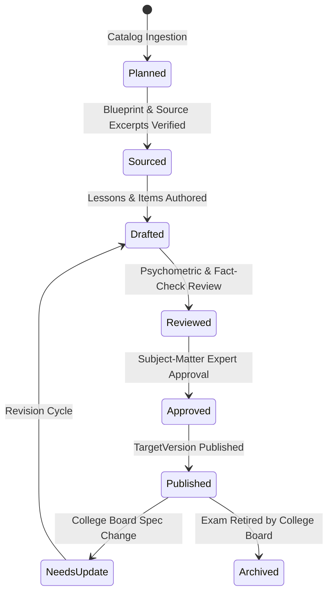

# 🎓 College Board CLEP Program & Curriculum Framework Guide

**Authority:** College Board — College-Level Examination Program (CLEP)  
**Standard Credit Recommender:** American Council on Education (ACE)  
**Framework Version:** 2026.11  
**Platform Architecture:** Learning Architecture V2 (LearningApp)  

---

## 1. Program Mission & Policy Standards

The **LearningApp CLEP Program** establishes an evidence-based, quality-controlled, psychometrically grounded curriculum framework to prepare learners for official College Board CLEP examinations.

### 1.1 Non-Negotiable Operational Principles
1. **Official Curriculum Authority**: All exam blueprints, domain definitions, percentage weighting ranges, and timing constraints are sourced directly from official College Board specifications (`https://clep.collegeboard.org`).
2. **Original Instruction & Practice**: All lesson blocks, instructional examples, and practice questions are original LearningApp authoring. **Never** scrape, reproduce, or claim access to live/secure College Board test items.
3. **Assessment Security & Answer-Key Protection**: All assessment items and simulations enforce server-side evaluation via the `EXM-02`/`EXM-03` architecture. Raw answer keys are withheld from client envelopes.
4. **Psychometric Item Integrity**: All items must strictly conform to the empirical item-writing rules of Haladyna, Downing, & Rodriguez (2002), verified statically by [`tool/lint_manifest.dart`](../../tool/lint_manifest.dart).
5. **No Synthetic Pass Guarantees**: LearningApp diagnostic indicators report objective-level mastery evidence; they never claim to be official College Board scaled scores or guarantee college credit awards.

---

## 2. Content Quality & Publication Lifecycle

Every CLEP course transitions through a rigorous, auditable quality lifecycle:



| Lifecycle State | Description | Gate Criteria |
|---|---|---|
| `planned` | Listed in the 34-exam catalog registry. | Official exam description and URL verified. |
| `sourced` | College Board domains and source references mapped. | Domain weights sum to 1.0; open-access authoritative source excerpts collected. |
| `drafted` | Original lessons, conceptual definitions, and assessment items authored. | All declared concepts taught; all objectives covered. |
| `reviewed` | Evaluated against psychometric, factual, and accessibility standards. | Zero Haladyna violations; distractor length balanced; answer positions balanced. |
| `approved` | Editorial and pedagogical sign-off. | Human review of answer keys and citations. |
| `published` | Immutable `TargetVersion` released to learners. | Passes CI validation, manifest linting, and dry-run ingestion. |

---

## 3. Official CLEP Exam Catalog (34 Exams)

Reconciled against official College Board specifications (November 2026):

### 3.1 Composition and Literature (6)
- **American Literature** (`clep-american-literature`): 90 min, ~100 questions, 3 credits.
- **Analyzing and Interpreting Literature** (`clep-analyzing-interpreting-literature`): 90 min, ~80 questions, 3 credits.
- **College Composition** (`clep-college-composition`): 115 min, 50 questions + 2 mandatory essays, 6 credits.
- **College Composition Modular** (`clep-college-composition-modular`): 90 min, ~90 questions, 3 credits.
- **English Literature** (`clep-english-literature`): 90 min, ~95 questions, 3 credits.
- **Humanities** (`clep-humanities`): 90 min, ~140 questions, 3 credits.

### 3.2 Science and Mathematics (7)
- **Biology** (`clep-biology`): 90 min, ~115 questions, 3 credits.
- **Calculus** (`clep-calculus`): 90 min, 44 questions (two sections, graphing calculator), 4 credits.
- **Chemistry** (`clep-chemistry`): 90 min, ~75 questions (scientific calculator & periodic table), 3 credits.
- **College Algebra** (`clep-college-algebra`): 90 min, ~60 questions (scientific calculator), 3 credits.
- **College Mathematics** (`clep-college-mathematics`): 90 min, ~60 questions (scientific calculator), 3 credits.
- **Natural Sciences** (`clep-natural-sciences`): 90 min, ~120 questions, 6 credits.
- **Precalculus** (`clep-precalculus`): 90 min, 48 questions (two sections, graphing calculator), 3 credits.

### 3.3 Business (5)
- **Financial Accounting** (`clep-financial-accounting`): 90 min, ~75 questions (basic calculator), 3 credits.
- **Information Systems** (`clep-information-systems`): 90 min, ~100 questions, 3 credits.
- **Introductory Business Law** (`clep-introductory-business-law`): 90 min, ~100 questions, 3 credits.
- **Principles of Management** (`clep-principles-of-management`): 90 min, ~100 questions, 3 credits.
- **Principles of Marketing** (`clep-principles-of-marketing`): 90 min, ~100 questions, 3 credits.

### 3.4 History and Social Sciences (12)
- **American Government** (`clep-american-government`): 90 min, ~100 questions, 3 credits.
- **History of the United States I: Early Colonization to 1877** (`clep-history-us-1`): 90 min, ~120 questions, 3 credits.
- **History of the United States II: 1865 to the Present** (`clep-history-us-2`): 90 min, ~120 questions, 3 credits.
- **Human Growth and Development** (`clep-human-growth-development`): 90 min, ~90 questions, 3 credits.
- **Introduction to Educational Psychology** (`clep-introduction-educational-psychology`): 90 min, ~100 questions, 3 credits.
- **Introductory Psychology (Pilot)** (`clep-introductory-psychology`): 90 min, ~95 questions, 3 credits.
- **Introductory Sociology** (`clep-introductory-sociology`): 90 min, ~100 questions, 3 credits.
- **Principles of Macroeconomics** (`clep-principles-of-macroeconomics`): 90 min, ~80 questions (basic calculator), 3 credits.
- **Principles of Microeconomics** (`clep-principles-of-microeconomics`): 90 min, ~80 questions (basic calculator), 3 credits.
- **Social Sciences and History** (`clep-social-sciences-history`): 90 min, ~120 questions, 6 credits.
- **Western Civilization I: Ancient Near East to 1648** (`clep-western-civilization-1`): 90 min, ~120 questions, 3 credits.
- **Western Civilization II: 1648 to the Present** (`clep-western-civilization-2`): 90 min, ~120 questions, 3 credits.

### 3.5 World Languages (4)
- **French Language (Levels 1 & 2)** (`clep-french-language`): 90 min (Listening ~40 min + Reading ~50 min), ~121 questions, 6–9 credits.
- **German Language (Levels 1 & 2)** (`clep-german-language`): 90 min (Listening ~40 min + Reading ~50 min), ~120 questions, 6–9 credits.
- **Spanish Language (Levels 1 & 2)** (`clep-spanish-language`): 90 min (Listening ~40 min + Reading ~50 min), ~121 questions, 6–9 credits.
- **Spanish with Writing (Levels 1 & 2)** (`clep-spanish-with-writing`): 110 min (Listening, Reading + 2 writing tasks), ~100 questions, 6–9 credits.

---

## 4. Pilot Course Architecture: Introductory Psychology

- **Target Identifier:** `clep-introductory-psychology`
- **Version Code:** `2026`
- **Manifest Location:** [`content/clep_introductory_psychology.yaml`](../../content/clep_introductory_psychology.yaml)
- **Format:** 95 multiple-choice questions, 90 minutes. ACE recommended passing score: 50.

### 4.1 Domain Weighting Matrix (13 Domains)
| Domain Code | Domain Title | Official Range | Model Weight |
|---|---|---|---|
| `1.0` | History, Approaches, and Methods | 11–12% | **0.11** |
| `2.0` | Biological Bases of Behavior | 8–9% | **0.09** |
| `3.0` | Sensation and Perception | 7–8% | **0.08** |
| `4.0` | States of Consciousness | 5–6% | **0.05** |
| `5.0` | Learning | 8–9% | **0.09** |
| `6.0` | Cognition | 8–9% | **0.09** |
| `7.0` | Motivation and Emotion | 5–6% | **0.06** |
| `8.0` | Developmental Psychology Across the Lifespan | 8–9% | **0.08** |
| `9.0` | Personality | 7–8% | **0.07** |
| `10.0` | Psychological Disorders and Health | 8–9% | **0.09** |
| `11.0` | Treatment of Psychological Disorders | 6–7% | **0.06** |
| `12.0` | Social Psychology | 9–10% | **0.10** |
| `13.0` | Statistics, Tests, and Measurement | 3–4% | **0.03** |
| **Total** | | | **1.00** |

---

## 5. Verification & Toolchain Commands

### 5.1 Catalog Validation
```bash
python tool/catalog_clep_exams.py
python -m unittest discover -s tool/tests -p "test_catalog_clep_exams.py" -v
```

### 5.2 Manifest Static Quality Linting
```bash
dart run tool/lint_manifest.dart content/clep_introductory_psychology.yaml
# Batch lint all manifests
dart run tool/lint_manifest.dart --dir content/
```

### 5.3 Dry-Run Ingestion
```bash
dart run tool/ingest_curriculum.dart \
  --target clep-introductory-psychology \
  --version 2026 \
  --manifest content/clep_introductory_psychology.yaml \
  --dry-run
```

### 5.4 Test Suite Execution
```bash
flutter test test/services/curriculum_manifest_test.dart
```

