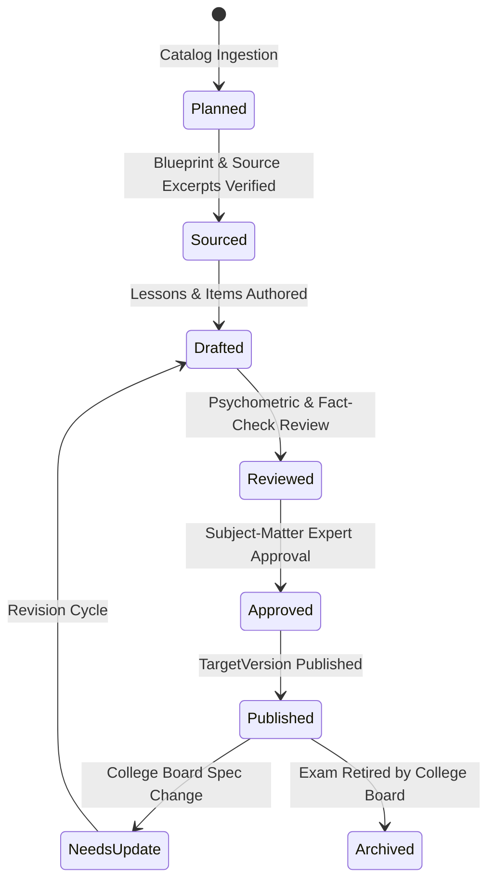

# 🎓 College Board CLEP Program & Curriculum Framework Guide

**Authority:** College Board — College-Level Examination Program (CLEP)  
**Standard Credit Recommender:** American Council on Education (ACE)  
**Framework Version:** 2026.11  
**Platform Architecture:** Learning Architecture V2 (LearningApp)  

---

## 1. Program Mission & Policy Standards

The **LearningApp CLEP Program** establishes an evidence-based, quality-controlled, psychometrically grounded curriculum framework to prepare learners for official College Board CLEP examinations.

### 1.1 Non-Negotiable Operational Principles
1. **Official Curriculum Authority**: All exam blueprints, domain definitions, percentage weighting ranges, and timing constraints are sourced directly from official College Board specifications (`https://clep.collegeboard.org`).
2. **Original Instruction & Practice**: All lesson blocks, instructional examples, and practice questions are original LearningApp authoring. **Never** scrape, reproduce, or claim access to live/secure College Board test items. Label all items as original LearningApp practice items.
3. **Assessment Security & Answer-Key Protection**: All assessment items and simulations enforce server-side evaluation via the `EXM-02`/`EXM-03` architecture. Raw answer keys are withheld from client envelopes.
4. **Psychometric Item Integrity**: All items must strictly conform to the empirical item-writing rules of Haladyna, Downing, & Rodriguez (2002), verified statically by [`tool/lint_manifest.dart`](../../tool/lint_manifest.dart).
5. **No Synthetic Pass Guarantees**: LearningApp diagnostic indicators report objective-level mastery evidence; they never claim to be official College Board scaled scores or guarantee college credit awards.

---

## 2. Critical Institutional & Psychometric Boundaries

### 2.1 Institutional Credit Policy Disclaimer
> [!IMPORTANT]
> **Advisory Nature of ACE Credit Recommendations**  
> While the American Council on Education (ACE) recommends a standard passing scaled score of **50** (on a 20–80 scale) for awarding 3 semester hours of college credit across most CLEP exams, **these recommendations are strictly advisory**.  
> Every higher education institution (university, college, or community college) independently establishes its own CLEP policies:
> - Some institutions require higher scaled scores (e.g., 55, 60, or 65) for specific subjects.
> - Some colleges award credit only for specific departmental equivalents or general education electives.
> - Some degree programs cap the total allowable credit-by-exam semester hours.  
> 
> LearningApp does not confer college credit or guarantee institutional credit acceptance. Learners must always verify their specific institution's registrar or CLEP policy page.

### 2.2 Official Exam Blueprint Ranges vs. Internal Model Weights
> [!NOTE]
> The College Board publishes exam blueprints as **percentage ranges** rather than rigid point allocations (e.g., Introductory Psychology Domain 1.0 is officially designated as $11\text{--}12\%$).  
> - **Official Blueprint Ranges**: Recorded in [`data/catalog/clep_official_catalog_2026.json`](../../data/catalog/clep_official_catalog_2026.json) as `official_percentage_range` and presented to learners as the official examination facts.
> - **Internal Model Weights**: Represented as single decimal weights (e.g., `0.11`) in curriculum manifests ([`content/clep_introductory_psychology.yaml`](../../content/clep_introductory_psychology.yaml)) to enable deterministic item sampling via the **largest-remainder method** in [`MockExamBlueprint`](../../lib/models/assessment_engine/mock_exam_blueprint.dart). Model weights always sum to exactly $1.00$ within the published College Board ranges.

### 2.3 Static Psychometric Linting vs. Empirical Calibration
> [!TIP]
> - **Static Quality Linting ([`tool/lint_manifest.dart`](../../tool/lint_manifest.dart))**: Evaluates authoring heuristics prior to publication:
>   - Ensures stems focus on a central problem and avoid negative cues ("NOT", "EXCEPT").
>   - Balances distractor lengths to prevent length-based giveaways.
>   - Prohibits "all/none of the above".
>   - Balances correct answer position distribution across choices (preventing position bias).
>   - Guarantees source citation completeness and objective coverage.
> - **Empirical Psychometric Calibration ([`ItemAnalyticsCalculator`](../../lib/services/analytics/item_analytics_calculator.dart))**: Static linting cannot establish actual empirical difficulty ($b_i$), discrimination ($a_i$), response latency, or point-biserial correlation ($r_{pbis}$). These psychometric properties are derived continuously from real learner response data logged to `public.learning_events` and calibrated in `public.item_analytics`. Manifest difficulty tags (`beginner`, `intermediate`, `advanced`) serve as instructional priors, not empirical proofs.

### 2.4 Curriculum Blueprint vs. Full Instructional Content
> [!WARNING]
> Mapping official College Board domains and competencies into a curriculum manifest establishes the **blueprint architecture**. A course is not complete or ready for learner publication until all instructional units, worked examples, retrieval flashcards, diagnostic checks, and a full 95-question simulation bank are fully authored and reviewed.

---

## 3. Content Quality & Publication Lifecycle

Every CLEP course transitions through a rigorous, auditable quality lifecycle:



| Lifecycle State | Description | Gate Criteria |
|---|---|---|
| `planned` | Listed in the 34-exam catalog registry. | Official exam description and URL verified. |
| `sourced` | College Board domains and source references mapped. | Domain weights sum to 1.0; open-access authoritative source excerpts collected. |
| `drafted` | Original lessons, conceptual definitions, and assessment items authored. | All declared concepts taught; all objectives covered. |
| `reviewed` | Evaluated against psychometric, factual, and accessibility standards. | Zero Haladyna violations; distractor length balanced; answer positions balanced. |
| `approved` | Editorial and pedagogical sign-off. | Human review of answer keys and citations. |
| `published` | Immutable `TargetVersion` released to learners. | Passes CI validation, manifest linting, and dry-run ingestion. |

---

## 4. Content Production Pipeline: The 6-Stage Workflow

The repeatable workflow for producing publishable CLEP courseware:

```
[Stage A: Source Collection]
       │
       ▼
[Stage B: Objective Research & Cognitive Mapping]
       │
       ▼
[Stage C: Original Lesson Authoring (10-Element Architecture)]
       │
       ▼
[Stage D: Practice Item Authoring (Haladyna Standards)]
       │
       ▼
[Stage E: Automated Linting & SME Peer Review]
       │
       ▼
[Stage F: Idempotent Import, Staging & Publication]
```

### Stage A — Source Collection & Attribution Standards
- Collect trusted, openly licensed reference material for each domain.
- **Primary Source Foundation for Introductory Psychology**:
  - **OpenStax Psychology 2e** (Rice University, CC BY 4.0; Senior Authors Rose M. Spielman, William J. Jenkins, Marilyn D. Lovett).
  - **American Psychological Association (APA)** Standards & Guidelines.
  - **DSM-5** Diagnostic Criteria for psychological disorders.
- Record source publisher, edition, license URL, and section citations in `source_releases`.

### Stage B — Objective Research & Cognitive Demand Mapping
For each competency, record:
1. Knowledge and skills demonstrated.
2. Prerequisite concepts.
3. Common misconceptions and distractor rationales.
4. Cognitive demand: Recall, Comprehension, Application, Analysis, or Evaluation.

### Stage C — Original Lesson Authoring (10-Element Architecture)
Each instructional unit adheres to the 10-part structure:
1. Measurable learning objectives.
2. Prerequisite knowledge links.
3. Core concept explanation (markdown blocks).
4. Concrete examples, worked problems, or clinical scenarios.
5. Key vocabulary and distinctions (`LessonTerm`).
6. Common misconceptions and distractor explanations.
7. Embedded retrieval checks (recall before reveal).
8. Concept cross-references.
9. Source attributions.
10. Formative mastery check.

### Stage D — Practice Item Authoring & Distractor Rationales
- Questions must evaluate conceptual comprehension and application—not superficial recall of lesson phrasing.
- Provide elaborative feedback explaining both why the keyed answer is correct AND why each distractor is incorrect.
- Format items as single-choice (4 plausible options) or multi-select with no giveaways.

### Stage E — Automated Linting & SME Peer Review
- Run [`tool/lint_manifest.dart`](../../tool/lint_manifest.dart) to enforce static psychometric gates.
- Verify that answer positions are uniformly distributed across indices 0, 1, 2, and 3 ($\le 35\%$ per position).
- Require SME sign-off on answer keys before advancing to `review_ready`.

### Stage F — Idempotent Import & Version Publication
- Ingest via [`tool/ingest_curriculum.dart`](../../tool/ingest_curriculum.dart) using `--apply` to create a `draft` target version.
- Review in student experience via draft preview mode.
- Advance to `review_ready` with `--stage-review`.
- Promote to immutable `published` status with `--publish`.

---

## 5. Official CLEP Exam Catalog (34 Exams)

Reconciled against official College Board specifications (November 2026):

### 5.1 Composition and Literature (6)
- **American Literature** (`clep-american-literature`): 90 min, ~100 questions, 3 credits.
- **Analyzing and Interpreting Literature** (`clep-analyzing-interpreting-literature`): 90 min, ~80 questions, 3 credits.
- **College Composition** (`clep-college-composition`): 115 min, 50 questions + 2 mandatory essays, 6 credits.
- **College Composition Modular** (`clep-college-composition-modular`): 90 min, ~90 questions, 3 credits.
- **English Literature** (`clep-english-literature`): 90 min, ~95 questions, 3 credits.
- **Humanities** (`clep-humanities`): 90 min, ~140 questions, 3 credits.

### 5.2 Science and Mathematics (7)
- **Biology** (`clep-biology`): 90 min, ~115 questions, 3 credits.
- **Calculus** (`clep-calculus`): 90 min, 44 questions (two sections, graphing calculator), 4 credits.
- **Chemistry** (`clep-chemistry`): 90 min, ~75 questions (scientific calculator & periodic table), 3 credits.
- **College Algebra** (`clep-college-algebra`): 90 min, ~60 questions (scientific calculator), 3 credits.
- **College Mathematics** (`clep-college-mathematics`): 90 min, ~60 questions (scientific calculator), 3 credits.
- **Natural Sciences** (`clep-natural-sciences`): 90 min, ~120 questions, 6 credits.
- **Precalculus** (`clep-precalculus`): 90 min, 48 questions (two sections, graphing calculator), 3 credits.

### 5.3 Business (5)
- **Financial Accounting** (`clep-financial-accounting`): 90 min, ~75 questions (basic calculator), 3 credits.
- **Information Systems** (`clep-information-systems`): 90 min, ~100 questions, 3 credits.
- **Introductory Business Law** (`clep-introductory-business-law`): 90 min, ~100 questions, 3 credits.
- **Principles of Management** (`clep-principles-of-management`): 90 min, ~100 questions, 3 credits.
- **Principles of Marketing** (`clep-principles-of-marketing`): 90 min, ~100 questions, 3 credits.

### 5.4 History and Social Sciences (12)
- **American Government** (`clep-american-government`): 90 min, ~100 questions, 3 credits.
- **History of the United States I: Early Colonization to 1877** (`clep-history-us-1`): 90 min, ~120 questions, 3 credits.
- **History of the United States II: 1865 to the Present** (`clep-history-us-2`): 90 min, ~120 questions, 3 credits.
- **Human Growth and Development** (`clep-human-growth-development`): 90 min, ~90 questions, 3 credits.
- **Introduction to Educational Psychology** (`clep-introduction-educational-psychology`): 90 min, ~100 questions, 3 credits.
- **Introductory Psychology (Pilot)** (`clep-introductory-psychology`): 90 min, ~95 questions, 3 credits.
- **Introductory Sociology** (`clep-introductory-sociology`): 90 min, ~100 questions, 3 credits.
- **Principles of Macroeconomics** (`clep-principles-of-macroeconomics`): 90 min, ~80 questions (basic calculator), 3 credits.
- **Principles of Microeconomics** (`clep-principles-of-microeconomics`): 90 min, ~80 questions (basic calculator), 3 credits.
- **Social Sciences and History** (`clep-social-sciences-history`): 90 min, ~120 questions, 6 credits.
- **Western Civilization I: Ancient Near East to 1648** (`clep-western-civilization-1`): 90 min, ~120 questions, 3 credits.
- **Western Civilization II: 1648 to the Present** (`clep-western-civilization-2`): 90 min, ~120 questions, 3 credits.

### 5.5 World Languages (4)
- **French Language (Levels 1 & 2)** (`clep-french-language`): 90 min (Listening ~40 min + Reading ~50 min), ~121 questions, 6–9 credits.
- **German Language (Levels 1 & 2)** (`clep-german-language`): 90 min (Listening ~40 min + Reading ~50 min), ~120 questions, 6–9 credits.
- **Spanish Language (Levels 1 & 2)** (`clep-spanish-language`): 90 min (Listening ~40 min + Reading ~50 min), ~121 questions, 6–9 credits.
- **Spanish with Writing (Levels 1 & 2)** (`clep-spanish-with-writing`): 110 min (Listening, Reading + 2 writing tasks), ~100 questions, 6–9 credits.

---

## 6. Pilot Course Architecture: Introductory Psychology

- **Target Identifier:** `clep-introductory-psychology`
- **Version Code:** `2026`
- **Manifest Location:** [`content/clep_introductory_psychology.yaml`](../../content/clep_introductory_psychology.yaml)
- **Format:** 95 multiple-choice questions, 90 minutes. ACE recommended passing score: 50.

### 6.1 Domain Weighting Matrix (13 Domains)
| Domain Code | Domain Title | Official Range | Model Weight |
|---|---|---|---|
| `1.0` | History, Approaches, and Methods | 11–12% | **0.11** |
| `2.0` | Biological Bases of Behavior | 8–9% | **0.09** |
| `3.0` | Sensation and Perception | 7–8% | **0.08** |
| `4.0` | States of Consciousness | 5–6% | **0.05** |
| `5.0` | Learning | 8–9% | **0.09** |
| `6.0` | Cognition | 8–9% | **0.09** |
| `7.0` | Motivation and Emotion | 5–6% | **0.06** |
| `8.0` | Developmental Psychology Across the Lifespan | 8–9% | **0.08** |
| `9.0` | Personality | 7–8% | **0.07** |
| `10.0` | Psychological Disorders and Health | 8–9% | **0.09** |
| `11.0` | Treatment of Psychological Disorders | 6–7% | **0.06** |
| `12.0` | Social Psychology | 9–10% | **0.10** |
| `13.0` | Statistics, Tests, and Measurement | 3–4% | **0.03** |
| **Total** | | | **1.00** |

---

## 7. Verification & Toolchain Commands

### 7.1 Catalog Validation
```bash
python tool/catalog_clep_exams.py
python -m unittest discover -s tool/tests -p "test_catalog_clep_exams.py" -v
```

### 7.2 Manifest Static Quality Linting
```bash
dart run tool/lint_manifest.dart content/clep_introductory_psychology.yaml
# Batch lint all manifests
dart run tool/lint_manifest.dart --dir content/
```

### 7.3 Dry-Run Ingestion
```bash
dart run tool/ingest_curriculum.dart \
  --target clep-introductory-psychology \
  --version 2026 \
  --manifest content/clep_introductory_psychology.yaml \
  --dry-run
```

### 7.4 Test Suite Execution
```bash
flutter test test/services/curriculum_manifest_test.dart
```
