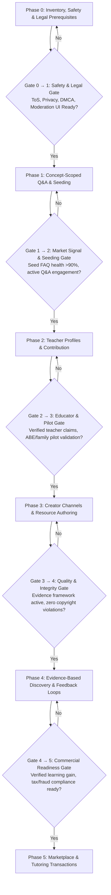

# LearningApp — Community, Educators, Creator Economy & Adaptive Knowledge Roadmap

**Status:** Proposed product roadmap; not an implementation claim.  
**Prepared:** October 11, 2026  
**Last Revised:** October 12, 2026 (incorporating peer review on UGC risks, seeding, sequencing, and stack decisions)  
**Project:** `RACCHUS/LearningApp`  
**Repository location:** `docs/product/COMMUNITY_EDUCATOR_KNOWLEDGE_ROADMAP.md`  
**Priority:** Strategic, multi-phase expansion; coexists with the active catalog-growth plan and foundational literacy plan.

---

## 0. Mission and non-negotiable intent

**Mission:** Make effective education easier to discover, afford, create, teach, understand, and complete. Help people gain actual knowledge, academic progress, qualifications, and economic opportunity—not merely consume content.

The product has **two distinct returns**:
1. **Enduring family/personal utility**, regardless of commercial success: school support for children, accessible foundational literacy for adults, CLEP and college preparation, insurance/real-estate/HVAC/contractor credentials, and practical trade skills. Build for long-term use and diverse literacy, age, and ability levels. This track is anchored by the fully implemented [LITERACY_ACCESSIBILITY_PLAN.md](../../LITERACY_ACCESSIBILITY_PLAN.md).
2. **Potential financial return** from a scalable public educational ecosystem: paid creator resources, instruction, tutoring, subscriptions, marketplace transactions, and optional services. **Do not sacrifice family educational utility merely to maximize revenue.**

**Core thesis:** Build more than a course library. Build a platform where learners ask questions, teachers teach without needing to author courses, creators publish and earn, AI assists both sides, and credible evidence about educational effectiveness makes the platform better over time.

**North-star question:** Is the platform helping people demonstrably *learn, retain, apply knowledge, and reach independently verified goals* more effectively, affordably, and accessibly?

---

## 1. What exists and must be reused

Repository review (grounded in `README.md`, `LEARNING_ARCHITECTURE_V2.md`, `UI_ARCHITECTURE_LOCKED.md`, `LITERACY_ACCESSIBILITY_PLAN.md`, `FIRST_RUN_ZERO_STATE_HELP_SPEC.md`, `HOSTED_MIGRATION_ROLLOUT.md`, `CANONICAL_TAXONOMY_ARCHITECTURE.md`, and `docs/catalog/CATALOG_GROWTH_AND_DEMAND_PLAN.md`):

- **Client & Architecture**: Flutter/Dart PWA; Riverpod + GoRouter; Supabase PostgreSQL/Auth/Storage/RLS; Hive/local sync.
- **Navigation Baseline**: Three primary destinations **Learn / Library / Progress**; collapsible desktop rail, searchable Help; no forced first-run onboarding. The locked UI baseline governs all new navigation work unless explicitly amended.
- **Foundational Literacy Core (Delivered & Verified)**: 6-phase oral-first architecture documented in [LITERACY_ACCESSIBILITY_PLAN.md](../../LITERACY_ACCESSIBILITY_PLAN.md) (51 passing automated tests): local pre-reader profiles, unified `PreReaderAudioService`, Zaner-Bloser handwriting stroke engine (A–Z, 0–9), 26-letter phonics catalog, CVC word blending, 2025 USCIS Naturalization exam (128-Q bank) & oral N-400 interview, Florida FLHSMV driver's license audio mock, GED Pre-Prep ABE Reading Bridge, OSHA safety & GHS pictograms, FDA Food Code (2022), Rx/first aid, 18 U.S.C. § 504 currency recognition & ATM cash withdrawal simulator, karaoke story reader, and caseworker setup mode.
- **Learning Entities**: Learning contexts, learning targets and published versions, curriculum nodes, autonomous `knowledge_concepts`, courses, lessons, assessment `questions`, study sets, flashcards, user progress, review scheduling, and diagnostic pathways.
- **Catalog Status (Important Reality Check)**: Official CIP/SOC/O*NET ingestion scripts and fixtures are verified and automated in CI against disposable test databases. However, **hosted production database population is an active ongoing effort** governed strictly by `docs/catalog/CATALOG_GROWTH_AND_DEMAND_PLAN.md` and `HOSTED_MIGRATION_ROLLOUT.md`. The superseded taxonomy roadmap is retired; do not revive it.
- **Catalog Provenance Vocabulary**: The system already possesses a battle-tested trust vocabulary:
  - `Official` (regulator or accredited standard)
  - `Catalog` (curated platform catalog)
  - `Community (reviewed)` (peer-reviewed and approved community submission)
  - `Community (pending)` (submitted, unreviewed community draft)
  - `Private` (personal user goal or draft)
  *All new community resources and answers must reuse this exact vocabulary rather than inventing duplicate terms.*
- **Stack & Discovery Boundary (Flutter PWA vs. Public SEO Pages)**: Flutter Web (CanvasKit/HTML renderer) is optimized for rich interactive client applications, **not for search engine web crawler indexing (SEO)**. Public, unauthenticated search discovery cannot rely solely on the Flutter web app canvas. Indexable, search-engine-crawlable Q&A and resource discovery will require a dedicated static/server-rendered frontend layer (e.g., Next.js, Astro, or Supabase edge-rendered HTML) or must remain internal to the app until a formal hybrid web stack decision is adopted.

**Implementation note:** Documentation is not proof that every feature is production-ready. Before any phase, inspect actual Flutter UI, Supabase migrations, APIs, access rules, tests, and hosted schema; record what exists vs. incomplete vs. missing. Avoid duplicating models or resetting production data.

---

## 2. Product model: destinations, knowledge, people and contributions

Maintain **distinct but linked entities**:

- **Learning destination / goal:** e.g., Florida real estate licensing exam, CLEP College Algebra, grade-level mathematics, practical reading, HVAC/EPA credential, contractor trade knowledge. Represents *what a learner hopes to accomplish*; it is not itself a course.
- **Formal requirements and versioned curriculum:** regulator/issuer rules and competencies, with jurisdiction, dates, authoritative citations, and known/unknown status. Education that is officially mandated or accredited must be labeled accordingly; ordinary exam prep is not a substitute.
- **Canonical knowledge concept:** share concept-level evidence across compatible contexts while keeping each learning context scoped; reuse existing v2 architecture.
- **Learning resource:** lesson, video, audio, text, diagram, flashcard, original practice item, exercise, simulator, workshop, external link or collection. May be platform-owned, creator-owned, reviewed community, or private. Course creation remains optional.
- **Community question and answer:** scoped knowledge exchange; separate from assessment questions. Must link to destination/concept/resource where useful.
- **Person / contribution identity:** learner, teacher/tutor, creator, subject-matter contributor, credentialed reviewer, moderator. Roles overlap; teaching does not require owning a course.
- **Evidence / provenance:** source, author, editorial review, AI involvement, freshness, reliability, moderation, rights and outcome evidence. Display what is verified vs. self-reported vs. estimated using the established catalog trust vocabulary.

**Architectural invariant:** A course, teacher, community question, and knowledge concept must not be collapsed into one row or rigid parent-child chain. Many-to-many mappings and clear provenance are essential.

---

## 3. Core experience and workstreams

### W1 — Scoped community Q&A with cold-start seeding (not a wide-open ghost town)

**User needs:** Ask a genuine question when stuck; get human or AI explanations; discover prior answers; debate or correct outdated information; follow helpful contributors; turn a useful answer into deeper learning.

**Avoiding the "Empty Forum" Failure Mode:**
- A wide-open, unseeded Quora clone with zero users will be completely empty, driving immediate bounce.
- **Concept- & Lesson-Scoped First**: Rather than launching a generic open forum, Phase 1 embeds Q&A directly inside specific learning contexts (e.g., within Florida DMV practice questions, Real Estate concepts, CLEP Algebra lessons, or Adult Literacy survival modules).
- **Cold-Start Seeding Mandate**: Every launched topic must be pre-populated with **20–50 verified, high-quality expert FAQs and explanations** before open user submissions are activated.

**Functional scope:**
- Ask questions scoped to an existing learning goal, concept, lesson, or qualification.
- Search and deduplicate near-identical questions; meaningful tags; follow/bookmark; edit history and context; clear author identity and timestamps.
- Human answers, comments/clarifications, citations, attachments where safe, useful/needs-correction feedback, reporting, and moderation.
- Optional instant **AI answer**, visibly labeled AI-generated, with uncertainty and sources where available. Allow users to request simpler, step-by-step, audio, visual or advanced explanations. An AI answer is **not** the authoritative accepted answer by default.
- **Prompt-Injection Defense**: User questions and answers feeding into AI prompts (for dynamic explanations or automated lesson linkage) must undergo strict input sanitization and prompt-injection filtering.
- Answer revision history; mark stale, contested or verified information; flag where regulation or exam syllabus may have changed.
- Link excellent answers to lessons and relevant practice *only after rights/permission and review*; do not silently appropriate creators' work.
- Account for discussions with multiple defensible perspectives, not only questions with one numeric answer.

**Critical separation:** Existing `questions` are psychometric assessment items used for spaced repetition and mastery scoring. Add a distinct community Q&A domain (`community_questions`, `community_answers`) and bridge to assessment items only through explicit, reviewed conversion.

**First release target:** Authenticated adult users can ask, answer, search, report, and link questions to concepts; moderators can intervene via a dedicated moderation queue; anonymous visitors can read approved public Q&A where supported by the web delivery stack.

---

### W2 — Teach a topic without creating a course

**User needs:** A knowledgeable person can sign up to teach a subject/skill, answer questions, tutor, host sessions, or review content. Creating a full course is optional.

**Functional scope:**
- Educator profile/channel, bio, areas of expertise, languages, availability, teaching formats and optional price.
- Apply to teach a destination, concept, subject, or skill; maintain multiple subject associations.
- Labels distinguishing self-declared expertise, evidence reviewed by platform, and independently verified licenses/credentials; re-verification and expiration as needed.
- Offer free office hours, live classes, group teaching, recorded explanations, paid tutoring or premium Q&A over time.
- Learners can follow teachers and compare teaching styles without requiring a single teacher to own an entire curriculum.
- Reputation weighted toward evidence-backed helpfulness and outcomes rather than answer volume or follower count.
- Jurisdiction-specific checks for representations about regulated instruction, continuing-education credit, and exam-approval status.

**First release target:** Educator opt-in, profile, subject association, questions answered, follower/bookmark function; do not require payments or real-time video in the initial release.

---

### W3 — Creator channels and a content marketplace

**User needs:** Create original educational work manually or with AI; own and edit it; build an audience; publish free or paid material; earn income with clear terms.

**Functional scope:**
- Creator/channel profile, followers, collections, author identity, content ownership and explicit content license.
- Upload or author individual resources, practice items, courses, study guides, audio and video. Courses are *one format*, not the default obligation.
- AI-assisted outlines, transcripts, translation, diagrams, quizzes and lesson drafts with editing and review. Preserve provenance: human-authored, AI-assisted, or substantially AI-generated.
- Publishing workflow: private draft → submitted → reviewed (when needed) → published → updated/archived. New versions preserve learner history and rights.
- Free, one-time purchase, optional subscription, group seats, tip or tutoring transactions; exact pricing/revenue share deferred until financial and compliance modeling.
- Payment ledger, refunds, entitlements, payout/identity verification, fraud controls, disputes and tax treatment before charging users.
- Prevent low-quality mass-produced AI spam, misattributed content, stolen exam questions, and misleading official affiliations.

**First release target:** Free creator publishing with moderation and attribution; test utility and supply before adding real-money transactions.

---

### W4 — Multi-modal, accessible personal learning & family utility

**User needs:** Reading, listening, speaking, asking questions and practicing should be available through the same educational context. Particularly vital for adults with low literacy, children, and learners with accessibility needs.

**Functional scope:**
- Seamless synergy with [LITERACY_ACCESSIBILITY_PLAN.md](../../LITERACY_ACCESSIBILITY_PLAN.md): pre-reader profile, studio phonemes, tactile handwriting canvas, oral milestone exams, and survival life domains.
- Read-aloud and voice interaction; adjustable speed, captions/transcripts, accessible controls, keyboard/screen-reader support and text alternatives.
- Explanations at user-selected reading levels without condescending tone; stepwise scaffolding; visual examples; multilingual support where quality can be verified.
- Adaptive hints, misconception diagnosis, retrieval practice, spaced review and teach-back, using existing study architecture.
- Young learners get age-appropriate experiences and strict privacy/access controls; adults with limited literacy can navigate by audio and visual cues with minimal required reading.
- Clearly distinguish personalized practice from official exam format; don't imply AI-generated items mirror confidential exam questions.
- Local/offline capabilities where feasible; voice and cloud AI may depend on connectivity and usage budgets.

**First release target:** Leverage existing Phase 1–6 literacy architecture, accessible Q&A reading/listening, and execute an end-to-end community pilot on adult literacy or credential prep.

---

### W5 — Measurable learning outcomes and credible recommendations

**User needs:** Learn which resources and teachers are genuinely effective for *people like me*, not simply most liked.

**Measures (keep strictly separate):**
- **Engagement:** visits, completions, saves, helpful votes.
- **Learning:** performance change from diagnostic to comparable validated assessment; concept-level retrieval over time; retained knowledge vs. content completion.
- **Outcome:** independently verified exam passes/credentials when voluntarily supplied and appropriately validated; distinguish self-reported from confirmed.
- **Quality:** expert accuracy review, content age, source freshness, accessibility, student feedback, costs.
- **Fairness/confidence:** sample size, selection bias, learner baseline, subgroup accessibility, repeated attempts, possible gaming; do not claim causal superiority from raw pass rates.

**The Coach Principle for Recommendations (Non-Negotiable):**
- All recommendations generated by the platform **only suggest—the learner always chooses**.
- The platform must never lock learners into rigid tracks or override learner agency.
- Never manufacture pass rates or grade a course as superior based only on approval scores. Publish minimum sample-size policy and uncertainty where reasonable; offer “insufficient evidence” where unknown. Ranking balances relevance, instructional suitability, trusted quality, freshness, and price. Maintain a meaningful appeals process.

**First release target:** Baseline diagnostic and aligned post-assessment for selected pilot goals, clear outcomes dashboard and feedback collection; later add adjusted comparative ranking once evidence quality warrants it.

---

### W6 — Platform feedback loop: continuous improvement, not unchecked self-editing

- Aggregate recurring learner questions, misconceptions, invalid practice items, dropout points, outdated cited regulations and accessibility complaints.
- Generate **proposals** to fix instructional gaps, create better explanations, refresh obsolete content and improve learning-path recommendations.
- Assign proposal owners; preserve sources, before/after diffs and change history; reviewer or creator approves changes before they affect published regulated content.
- Re-measure after updates. For experiment-based comparisons, document user consent/eligibility, adequate sample size, guardrails and when results are inconclusive.
- Never silently overwrite creator content or automatically treat AI-generated answers as facts. Official rules require direct authority checking and versioned evidence.

---

### W7 — Discovery, community and social graph

- Learn / Library / Progress remain the three primary destinations unless a separately reviewed IA change is approved. Discovery of teachers, Q&A and resources begins cleanly through **Library**, goal pages and contextual links.
- Search across trusted destinations, courses, resources, public questions, concepts and teacher profiles, with type filters and freshness/verification labels.
- Follow educators and subjects, save good answers, use opt-in updates. Prevent manipulative gamification, noisy default notifications and popularity-only ranking.
- Maintain source and trust distinction for official/reviewed/unreviewed/personal goals already established in the catalog architecture.

---

### W8 — Integrations and extensibility

- Design a permissioned integration boundary for voice, AI model adapters, source verification, external video/call services, credential issuer updates and creator tools.
- Provider-agnostic interfaces, model budgets, retry/fallback, observability, rate limits and revocable user consent.
- Keep server secrets server-side. Do not let third-party integrations write directly into authoritative credential requirements, grades or payment records without authorization and auditability.
- Developer integrations/API/third-party extensions are longer-term opportunities, not prerequisites for Q&A or teacher onboarding.

---

## 4. Launch approach, pilot audience & explicit Go/No-Go decision gates

### Family-first pilots without family-only product design
1. **Adult literacy & life milestones**: Voice-guided, low-reading-burden navigation and practical skill demonstrations (leveraging [LITERACY_ACCESSIBILITY_PLAN.md](../../LITERACY_ACCESSIBILITY_PLAN.md)).
2. **K–12 educational support**: Age-appropriate reading/math support; minors must have strict guardian consent controls and a complete prohibition on public profile visibility or direct contact from adult strangers.
3. **High-stakes credential/college exams**: CLEP, Florida real estate, insurance, HVAC/EPA or contractor prep; select one or two supported targets whose official requirements and legal constraints are verified.
4. **Contributor/teacher trial**: A knowledgeable adult joins an existing topic, answers questions, and gains followers without making a course.

### Explicit Go/No-Go Decision Gates Between Phases
Progress between roadmap phases is strictly governed by objective quality and safety gates:

1. **Gate 0 $\rightarrow$ 1 (Safety, Legal & Moderation Gate)**: ToS, Privacy Policy (minors), DMCA registered agent, and moderation queue UI must be operational before any public user-generated Q&A goes live.
2. **Gate 1 $\rightarrow$ 2 (Market Signal & Seeding Health Gate)**: Concept-scoped Q&A must achieve verified helpfulness, unanswered rate $<20\%$, and healthy seed usage before launching teacher profiles.
3. **Gate 2 $\rightarrow$ 3 (Educator & Pilot Validation Gate)**: Demonstrated educational gain in family/ABE pilot and verified credential labeling before opening creator publishing.
4. **Gate 3 $\rightarrow$ 4 (Instructional Integrity Gate)**: Automated content review and outcome measures functional before algorithmic discovery matching.
5. **Gate 4 $\rightarrow$ 5 (Commercial & Compliance Gate)**: Demonstrated learning efficacy, accounting/tax infrastructure, and refund/chargeback controls verified before real-money transactions or subscriptions.

---

## 5. Suggested data domains (design targets—not migrations to execute)

Map the proposed logical entities to existing tables first; use new tables only where needed:

| Domain | Candidate logical tables / entities | Key notes |
|---|---|---|
| Trust, Safety & Legal | `moderation_reports`, `moderation_queue`, `trust_and_safety_actions`, `dmca_takedown_notices` | First-class prerequisite; moderation UI, audit logs, minor privacy |
| Community Q&A | `community_questions`, `community_answers`, `answer_revisions`, `question_topic_links`, `question_reports`, `answer_feedback` | Separate from assessment `questions`; concept/target links; seed flags |
| Educators | `educator_profiles`, `educator_subjects`, `educator_verifications`, `follows`, `teaching_offerings` | Claims vs. verification; teacher doesn't own the subject |
| Creator content | `creator_channels`, `resource_versions`, `resource_authorship`, `resource_licenses`, `publication_reviews` | Extend existing courses/lessons rather than duplicating them |
| Learning quality | `assessment_evidence`, `outcome_attestations`, `content_quality_reviews`, `learning_feedback` | Distinguish diagnostic, retention, self-report, official evidence |
| Improvement | `content_issue_signals`, `content_update_proposals`, `source_check_runs` | Reviewable and versioned, with full traceability |
| Marketplace (later) | `marketplace_offers`, `orders`, `entitlements`, `payout_ledger`, `refunds` | Transaction compliance, provider segregation, server-side enforcement |
| AI / Integrations | `ai_generation_provenance`, `provider_usage`, `integration_permissions` | Model transparency, prompt sanitization logs, costs and secrets |

**Database guardrails:** Additive Supabase migrations only; RLS by role/resource; server-side authorization; protect user content and progress; avoid public leakage of minors' data; no production reset; backup/restore verification before material user-data changes. Keep source-of-truth for official licensing rules restricted to reviewed and versioned records.

---

## 6. Prioritized roadmap and delivery gates

### Phase 0 — Inventory, Trust & Safety, Legal & Observability Prerequisites (P0 Prerequisite)

**Tasks**
- [x] **Architecture & Schema Audit**: Audit actual implemented features, migrations, existing assessment `questions`, Q&A components, author ownership, voice capabilities, and hosted catalog state. Produce a verified gap matrix. (Completed in [ECO_00_ARCHITECTURE_SCHEMA_AUDIT.md](ECO_00_ARCHITECTURE_SCHEMA_AUDIT.md)).
- [x] **Trust & Safety / Legal Framework**: Author Terms of Service and Privacy Policy (with strict minor data isolation). Establish DMCA registered agent and takedown workflow. (Delivered in [TERMS_OF_SERVICE.md](../legal/TERMS_OF_SERVICE.md), [PRIVACY_POLICY.md](../legal/PRIVACY_POLICY.md), and [DMCA_TAKEDOWN_POLICY.md](../legal/DMCA_TAKEDOWN_POLICY.md)).
- [x] **Moderation Tooling**: Build an administrative moderation queue and reporting UI (replacing pure service-role script approval). (Delivered and deployed in ECO-00B via Migrations 50 & 51, PR #61, PR #69, [ECO_00B_TRUST_SAFETY_MODERATION_SPEC.md](ECO_00B_TRUST_SAFETY_MODERATION_SPEC.md), and `/#/moderation`).
- [x] **Age Eligibility Determination**: Decisively enforce age eligibility rules (adults only for public posting; minors restricted to private/guardian-managed accounts). (Codified in Terms of Service and Privacy Policy).
- [x] **Cost & Observability Dashboards**: Establish baseline hosting, AI token, TTS/STT, and media storage cost dashboards with strict alert thresholds. (Delivered and deployed in ECO-00C via Migration 52, PR #70, [ECO_00C_COST_OBSERVABILITY_SPEC.md](ECO_00C_COST_OBSERVABILITY_SPEC.md), and `/#/observability`).

**Exit:** Accepted domain model, legal protections live, moderation queue operational, cost dashboards in place, and zero duplicate schema models. (ALL PHASE 0 GATES SATISFIED — GATE 0 → 1 CLEARED).

---

### Phase 1 — Concept-Scoped Community Q&A & Cold-Start Seeding (P1)

**Tasks**
- [ ] **Concept- & Lesson-Scoped Q&A**: Embed Q&A directly within active learning contexts (DMV, Real Estate, Literacy, GED) rather than launching a disconnected global forum.
- [ ] **Cold-Start Seeding**: Author and verify 20–50 high-quality seed FAQs and answers for initial pilot topics.
- [ ] **Q&A Interaction**: Authenticated adult ask/answer/edit/report flows, answer history, spam rate limits, and report integration into the Phase 0 moderation queue.
- [ ] **AI Explanation with Prompt-Injection Defense**: Labeled AI explanations with uncertainty disclosures and strict input sanitization.
- [ ] **Web Discovery Boundary**: Deliver within Flutter app; establish architecture for external crawlable SEO pages if public indexing is pursued.
- [ ] **Automated Testing**: Unit, database RLS policy, accessibility, and E2E widget tests.

**Exit:** Learner can find existing answers on pilot topics, ask questions in context, receive timely human or AI assistance, and report issues; zero unmoderated spam.

---

### Phase 2 — Teacher Identities & Lightweight Contribution (P1)

**Tasks**
- [ ] **Educator Profiles**: Opt-in educator profiles with bio, subjects, languages, and clear distinction between self-declared vs. verified credentials.
- [ ] **"Teach This Topic" Pathway**: Enable educators to answer questions, post explanations, or contribute standalone resources without building full courses.
- [ ] **Follows & Bookmarks**: Learners can follow educators and bookmark explanations.
- [ ] **Evidence-Weighted Reputation**: Helpful votes and outcome feedback weighted over raw post volume.

**Exit:** Knowledgeable adults can establish educator presence for existing subjects and build a body of helpful contributions without authoring full courses; credentials accurately labeled.

---

### Phase 3 — Creator Channels & Family/Accessibility Pilot (P1)

**Tasks**
- [ ] **Resource Authoring**: Original resource publishing (lessons, flashcard sets, guides) with creator ownership, source citations, and AI-assisted drafts.
- [ ] **Family & ABE Field Pilot**: Conduct structured pilot combining [LITERACY_ACCESSIBILITY_PLAN.md](../../LITERACY_ACCESSIBILITY_PLAN.md) Adult Basic Education tools with credential exam prep.
- [ ] **Before/After Assessment**: Compare baseline diagnostic scores to post-study outcomes, collecting feedback on clarity, pacing, and retention.

**Exit:** Contributor can publish reviewed standalone resources; at least one verified end-to-end pilot demonstrates measurable skill improvement.

---

### Phase 4 — Evidence-Based Discovery & Feedback Loops (P2)

**Tasks**
- [ ] **Educational Quality Framework**: Evidence scoring based on diagnostic-to-post gains and concept retention (strictly separated from engagement metrics).
- [ ] **Autonomous Proposals**: System identifies content gaps, repeated misconceptions, and outdated regulatory citations, generating reviewable update proposals.
- [ ] **Coach Principle Recommendations**: Personalized recommendations matching learner needs to resources and educators—**always suggesting, never compelling**.

**Exit:** Learners receive transparent, opt-in recommendations; content improvements are systematically proposed, reviewed, published, and measured.

---

### Phase 5 — Marketplace, Tutoring & Extensibility (P3)

**Tasks**
- [ ] **Monetization Modeling**: Define creator revenue share and pricing based on demonstrated pilot demand; test with simulated transactions first.
- [ ] **Compliant Transactions**: Integrate secure payments, payout ledgers, entitlements, sales tax compliance, refunds, and fraud detection.
- [ ] **Tutoring & Sessions**: Booking, office hours, and group instruction.
- [ ] **Integration Boundary**: Provider-agnostic API adapters for external tools and institutions.

**Exit:** Compliant, economically viable transaction workflow with clear accounting reconciliation and creator payouts.

---

## 7. Epics suitable for project tracking

| ID | Epic | Priority | Dependencies | Scope Summary |
|---|---|---|---|---|
| **ECO-00** | Architecture & schema audit | **P0** | Existing repo docs, migrations | Baseline audit, gap matrix, zero duplicate schema |
| **ECO-00B** | Trust, safety, legal & moderation tooling | **P0** | ECO-00 | ToS, Privacy Policy, DMCA agent, moderation queue UI, minor safety |
| **ECO-00C** | Cost & observability dashboards | **P0** | Cloud/AI providers | Hosting, AI token, TTS/STT, and media storage budget monitoring |
| **ECO-01** | Concept-scoped Q&A & cold-start seeding | **P1** | ECO-00, ECO-00B | In-context Q&A, 20–50 seed FAQs per pilot topic, moderation hooks |
| **ECO-02** | Question-concept & goal linking | **P1** | ECO-01, existing concept model | Bi-directional linking between questions, lessons, and targets |
| **ECO-03** | AI answer disclosure & prompt-injection defense | **P1** | ECO-01, AI boundary | Labeled AI answers, uncertainty disclosures, prompt sanitization |
| **ECO-04** | Educator identities & subject affiliation | **P1** | ECO-00, ECO-00B | Opt-in teacher profiles, subject association, credential labels |
| **ECO-05** | Educator contribution & discovery | **P1** | ECO-01, ECO-04 | "Teach this topic", answers, follows, evidence-based reputation |
| **ECO-07** | Accessible voice-first learning | **P1** | Existing TTS/STT, `LITERACY_ACCESSIBILITY_PLAN.md` | Screen reader harmonization, audio Q&A readout, multi-modal cues |
| **ECO-08** | Family & ABE pilot evaluation | **P1** | ECO-07, `LITERACY_ACCESSIBILITY_PLAN.md` | Joint adult literacy & credential preparation field pilot |
| **ECO-06** | Creator channels & resource publishing | **P2** | ECO-00, ECO-00B | Standalone lesson/guide authoring, copyright review, drafts |
| **ECO-09** | Learning outcome analytics & quality measures | **P2** | ECO-08, diagnostic engine | Diagnostic-to-post gain tracking, retention vs. completion |
| **ECO-10** | Automated content issue detection & human review | **P2** | ECO-06, ECO-09 | Misconception aggregation, regulatory freshness checks, diff proposals |
| **ECO-11** | Personalized discovery (Coach Principle) | **P2** | ECO-02, ECO-05, ECO-09 | Learner-choice recommendations matching questions, resources, teachers |
| **ECO-12** | Creator monetization & tutoring marketplace | **P3** | ECO-06, legal, accounting | Paid offers, entitlements, payouts, taxes, refund ledger |
| **ECO-13** | External integrations & API ecosystem | **P3** | Security, mature usage evidence | Public APIs, partner integrations, institutional reporting |

*P0 = strict prerequisite before any public UGC; P1 = near-term core delivery; P2 = medium-term learning quality; P3 = long-term commercialization. Priorities represent sequencing order, **not delivery date commitments**.*

---

## 8. Metrics and decision rules

Track at least the following, with appropriate consent, privacy controls and definitions:

- **Learner usefulness:** percentage able to complete a desired task; relevant learning outcomes, not only session length.
- **Retrieval/retention:** concept-level recall over appropriately spaced, comparable assessments; separately report content completion.
- **Credibility:** percentage of sampled published answers/resources passing editorial factual checks; unresolved error and freshness backlog.
- **Q&A health:** time to first useful human answer, proportion of unanswered questions, reports per exposure, repeat-question rate, seed FAQ engagement.
- **Creator health:** meaningful contributions per active educator, repeat learners, revenue **after** costs when monetization exists, unfair-report appeals.
- **Economics:** AI cost per resolved question, TTS/STT cost per learning session, media storage, moderation burden, payment processing and refunds.
- **Equity/accessibility:** voice-use reliability, reading-level accessibility, mobile performance and offline coverage where supported.

**Interpretation:** Use segmented cohorts and credible denominators. Self-reported “I passed” is not equivalent to an official verified result. Educational gain is not identical to a course completion or high rating. Do not invent numerical targets before baseline data exists.

---

## 9. Trust, rights, safety and compliance gates

1. **Accuracy & Freshness:** Official regulatory priority for credential requirements; timestamps, jurisdiction/version IDs, review status and correction flow. Outdated content is deprecated without erasing learner progress.
2. **AI Transparency & Security:** Label generated content; store provenance; protect prompts and personal data; enforce strict **prompt-injection sanitization**; require human review for high-stakes published content; forbid false claims of accreditation or official test materials.
3. **Copyright & DMCA:** Creators retain rights according to agreed licenses; register a designated DMCA agent; maintain a clear takedown workflow; forbid ingestion of copyrighted paid courses or live exam questions.
4. **Minor Safety (COPPA/FERPA):** Age-appropriate experiences; parental/guardian consent; default restrict public profiles, messaging, and visibility for minors; forbid direct messaging from adult strangers to minors.
5. **Regulated Education Claims:** Distinguish study preparation from state-approved prelicensing or continuing education. Verify state, program, age, and credential claims before publishing.
6. **Security & Financial Integrity:** Least-privilege RLS; rate limits; audit logs; service credentials strictly on servers; transactional integrity for money; regular restore-tested backups.
7. **Fairness & Anti-Gaming:** Anti-spam defenses, verified reviewer procedures, appeals processes, and resistance to fake pass rates or AI answer floods.

---

## 10. Specific UX commitments

- Preserve direct access to learning and the existing Learn/Library/Progress navigation unless change control approves otherwise.
- Make ordinary Q&A discoverable via Library/search and contextual links, not a mandatory onboarding step.
- “Ask a question,” “Teach this,” and “Create material” can coexist, but appear only in relevant places and avoid overloading first-run screens.
- A user can ask a general question without selecting a course or official goal; linking to knowledge concepts is optional and assisted.
- AI help is available but not required. A teacher can teach without publishing a course. A learner can study without engaging the public community.
- Keep private family/child learning distinct from public social feeds.
- **Coach Principle:** Recommendations suggest; learners always choose.

---

## 11. Agent handoff and progress-tracking instructions

**Intake prompt for any coding agent or planning assistant working in `RACCHUS/LearningApp`:**

> Treat this file as a strategic product roadmap, not permission to implement everything immediately. First review `README.md`, `AGENTS.md`, `LEARNING_ARCHITECTURE_V2.md`, `UI_ARCHITECTURE_LOCKED.md`, `LITERACY_ACCESSIBILITY_PLAN.md`, `FIRST_RUN_ZERO_STATE_HELP_SPEC.md`, `HOSTED_MIGRATION_ROLLOUT.md`, `CANONICAL_TAXONOMY_ARCHITECTURE.md`, and `docs/catalog/CATALOG_GROWTH_AND_DEMAND_PLAN.md`, plus the latest code and Supabase migrations. Identify existing, partial, and missing functionality. Retain the completed official taxonomy work, active catalog-growth plan, and delivered 6-phase foundational literacy architecture. Convert each epic into a trackable issue/task with acceptance criteria, dependencies, status, risks, and verification steps. Do not duplicate existing models, rewrite merged migrations, reset live data, weaken RLS, claim unverified credentials, or modify locked navigation without change control. Implement only an explicitly selected and scoped phase via feature branch and PR, with tests and a rollback/backup plan. Keep the roadmap updated as issues complete; record actual evidence rather than treating planned features as shipped.

**Suggested issue fields:** `Epic ID`, `Feature`, `Goal / user story`, `Priority`, `Status (proposed / scoped / in progress / blocked / tested / shipped)`, `Dependencies`, `Acceptance criteria`, `Data changes`, `Privacy/legal risks`, `Evidence links`, `Owner`, `Last reviewed`.

**Suggested initial action:** Save the plan in the repo and create/organize tracking issues. Then begin **ECO-00** (gap audit) and **ECO-00B** (trust/safety/legal prerequisites). Do **not** build the full feature set in one implementation pass.

---

## 12. Decisions explicitly left open

- **Public SEO Architecture**: Whether to build a lightweight static/SSR frontend (e.g. Next.js, Astro, or Supabase edge-rendered HTML) for public Google indexing of approved Q&A, or keep Q&A exclusively within the Flutter app until search demand is proven.
- **Commercial Terms**: Exact creator revenue share, subscriptions, tutoring fees, or platform fees (test unit economics before committing).
- **Formal Verification Provider**: Third-party verification standard for professional licenses (e.g., state real estate licenses, EPA certifications).
- **Community Moderation Staffing**: In-house vs. community karma vs. outsourced moderation workflows as volume grows.
- **Third-Party AI & Media Infrastructure**: Long-term streaming video and voice providers, model portability, and cost optimization at scale.

**Decision principle:** Make reversible choices early; protect the long-term separation between goals, content, people, questions, and evidence. Prioritize educational value and trust over raw content volume.
