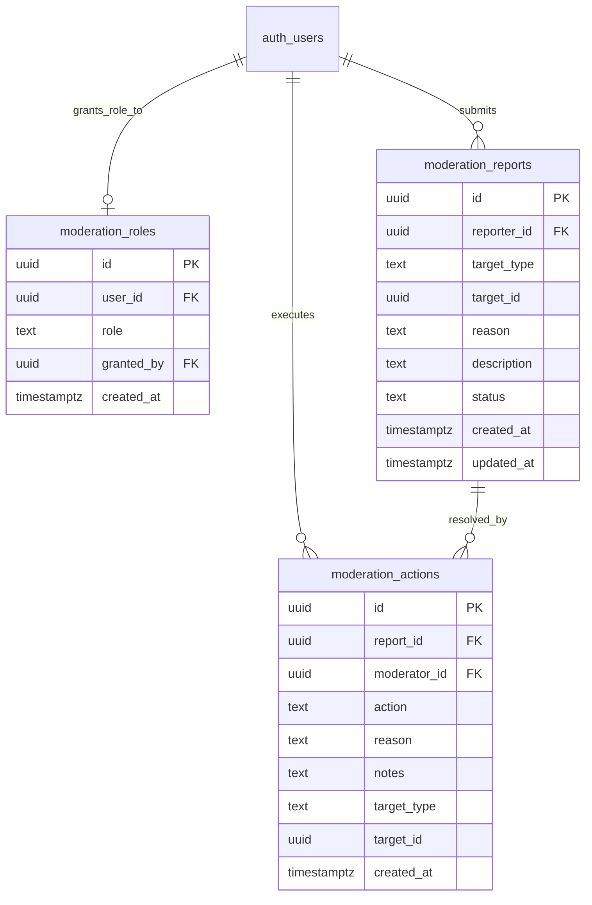

# ECO-00B: Trust, Safety, Legal & Moderation Architecture Specification

**Status:** Implementation Specification & Design  
**Epic:** ECO-00B (Phase 0 Prerequisite)  
**Date:** October 2026  
**Repository:** `RACCHUS/LearningApp`  
**Governing Documents:**  
- [COMMUNITY_EDUCATOR_KNOWLEDGE_ROADMAP.md](COMMUNITY_EDUCATOR_KNOWLEDGE_ROADMAP.md)  
- [ECO_00_ARCHITECTURE_SCHEMA_AUDIT.md](ECO_00_ARCHITECTURE_SCHEMA_AUDIT.md)  
- [UI_ARCHITECTURE_LOCKED.md](../../UI_ARCHITECTURE_LOCKED.md)  

---

## 1. Executive Summary & Problem Statement

Prior to introducing user-generated content (UGC)—such as concept-scoped questions, community answers, or public educator channels—the platform must possess an operational, secure, and legally grounded **Trust, Safety & Moderation Foundation**.

Relying solely on direct database manipulation or service-role scripts is unacceptable for live user communities. **ECO-00B** delivers:
1. **Least-Privilege Database Schema**: An append-only reporting and audit action log (`moderation_roles`, `moderation_reports`, `moderation_actions`) governed by strict Row-Level Security (RLS).
2. **Distinct Moderation Authorization**: A dedicated platform moderation role decoupled from the target-specific `curriculum_reviewers` table.
3. **Legal & Compliance Infrastructure**: Baseline Terms of Service, Privacy Policy (with minor data protection rules), and DMCA Takedown/Counter-Notice procedures.
4. **Administrative Moderation Queue UI**: An in-app responsive dashboard for moderators to review flagged content, inspect context, and take auditable actions (dismiss, warn, hide, delete, rate-limit).
5. **Operational Minor-Safety Controls**: Clear age-attestation safeguards and private-study boundaries for younger learners.

---

## 2. Authorization & Database Schema Design

### 2.1 Decoupling from `curriculum_reviewers`

The audit confirmed that `public.curriculum_reviewers` is strictly target-scoped:
```sql
-- Existing target-specific table:
create table public.curriculum_reviewers (
  id uuid primary key,
  target_id uuid references public.learning_targets(id),
  user_id uuid,
  role text check (role in ('reviewer', 'editor', 'admin')),
  created_at timestamptz
);
```
Target curriculum reviewers have domain expertise in specific certifications or curricula, but they are **not** platform-wide Trust & Safety moderators. ECO-00B creates a distinct, system-wide moderation authority.

---

### 2.2 Additive Migration Specification (`20261017000000_moderation_trust_and_safety.sql`)



#### Detailed DDL Specifications:

1. **`public.moderation_roles`**:
   - `id uuid primary key default gen_random_uuid()`
   - `user_id uuid not null references auth.users(id) on delete cascade unique`
   - `role text not null check (role in ('moderator', 'admin'))`
   - `granted_by uuid references auth.users(id) on delete set null`
   - `created_at timestamptz not null default now()`

2. **Security Definer Authorization Function**:
   ```sql
   create or replace function public.is_moderator(user_id uuid)
   returns boolean language sql security definer
   set search_path = public, pg_temp as $$
     select exists (
       select 1 from public.moderation_roles
        where user_id = is_moderator.user_id
          and role in ('moderator', 'admin')
     );
   $$;
   ```

3. **`public.moderation_reports`**:
   - `id uuid primary key default gen_random_uuid()`
   - `reporter_id uuid references auth.users(id) on delete set null`
   - `target_type text not null check (target_type in ('question', 'answer', 'comment', 'profile', 'curriculum', 'resource'))`
   - `target_id uuid not null`
   - `reason text not null check (reason in ('spam', 'harassment', 'misinformation', 'copyright', 'minor_safety', 'inappropriate', 'other'))`
   - `description text`
   - `status text not null default 'pending' check (status in ('pending', 'under_review', 'actioned', 'dismissed'))`
   - `created_at timestamptz not null default now()`
   - `updated_at timestamptz not null default now()`

4. **`public.moderation_actions`**:
   - `id uuid primary key default gen_random_uuid()`
   - `report_id uuid references public.moderation_reports(id) on delete set null`
   - `moderator_id uuid not null references auth.users(id) on delete cascade`
   - `action text not null check (action in ('dismiss', 'warn', 'hide', 'delete', 'suspend_user', 'rate_limit'))`
   - `reason text not null`
   - `notes text`
   - `target_type text not null`
   - `target_id uuid not null`
   - `created_at timestamptz not null default now()`

---

### 2.3 Row-Level Security (RLS) Policies

All tables enable RLS (`alter table ... enable row level security;`):

- **`moderation_roles`**:
  - `SELECT`: Only moderators and admins can query roles (`public.is_moderator(auth.uid())`).
  - `INSERT/UPDATE/DELETE`: Admins only or service_role.

- **`moderation_reports`**:
  - `INSERT`: Authenticated users can file a report (`with check (reporter_id = auth.uid())`).
  - `SELECT`: A user can see reports they filed (`reporter_id = auth.uid()`). Moderators can see **all** reports (`public.is_moderator(auth.uid())`).
  - `UPDATE`: Only moderators can update report status (`using (public.is_moderator(auth.uid()))`).
  - `DELETE`: Denied to everyone (append-only audit integrity).

- **`moderation_actions`**:
  - `INSERT`: Only moderators (`public.is_moderator(auth.uid())` and `with check (moderator_id = auth.uid())`).
  - `SELECT`: Only moderators.
  - `UPDATE/DELETE`: Denied to everyone (immutable compliance trail).

---

## 3. Legal & Policy Documentation Framework

ECO-00B delivers three comprehensive legal and governance documents in `docs/legal/`:

### 3.1 Terms of Service (`docs/legal/TERMS_OF_SERVICE.md`)
- **Educational Scope & Disclaimer**:
  - LearningApp is a personal study, foundational literacy, and career preparation platform.
  - Using LearningApp, completing courses, or checking milestone preparation steps **does not award an official degree, state license, or certified qualification**.
- **User Conduct & Content Standards**:
  - Prohibition of harassment, defamation, hate speech, spam, and copyright infringement.
  - Prohibition of sharing actual, confidential, or live state licensing exam items.
- **Age Requirement & Minor Accounts**:
  - Public posting and broadcasting features require users to be at least 18 years of age.
  - Minors may use the platform in private study mode with guardian or institutional supervision.
- **User Content Licensing**:
  - Creators retain ownership of original materials. By submitting public questions or answers, users grant LearningApp a non-exclusive license to display, index, and organize the content within the learning graph.

### 3.2 Privacy Policy (`docs/legal/PRIVACY_POLICY.md`)
- **Data Minimization**:
  - The platform collects only essential account credentials (email, display name) and study progress telemetry.
  - Offline pre-reader profiles and oral literacy progress remain strictly on-device by default.
- **Minor Safety & Children's Privacy**:
  - Strict isolation: zero public directory listing of minor accounts.
  - Complete prohibition of unvetted direct messaging between adult strangers and minors.
  - Documented parental consent procedures and expedited account deletion workflows.
- **Data Subject Rights**:
  - Export personal data upon request.
  - Complete account deletion ("Right to be Forgotten") erasing all personal learning targets, progress logs, and non-anonymized records.

### 3.3 DMCA Takedown & Copyright Policy (`docs/legal/DMCA_TAKEDOWN_POLICY.md`)
- **Designated Agent Notice Requirements**:
  - Identification of copyrighted work, infringing URL/identifier, contact info, good-faith statement, and physical/electronic signature.
- **Takedown & Safe Harbor Workflow**:
  - Immediate temporary concealment of contested material upon receipt of valid 17 U.S.C. § 512(c)(3) notice.
  - Prompt notification to content author.
- **Counter-Notice & Restoration**:
  - 10–14 business day statutory window for rights holders to file court actions prior to content restoration.
- **Repeat Infringer Policy**:
  - Termination of publishing privileges for persistent copyright infringers.

---

## 4. Administrative Moderation UI & Client Architecture

### 4.1 Client Models & Services

1. **`lib/models/governance/moderation_report.dart`**:
   - `ModerationReport`: id, reporterId, targetType, targetId, reason, description, status, createdAt.
   - `ModerationAction`: id, reportId, moderatorId, action, reason, notes, targetType, targetId, createdAt.
   - Enums: `ReportReason`, `ReportStatus`, `ModerationActionType`.

2. **`lib/services/governance/moderation_service.dart`**:
   - `submitReport(...)`: Creates a new report record.
   - `fetchQueue(...)`: Loads pending and under-review reports for authorized moderators.
   - `resolveReport(...)`: Executes a moderation action and transitions report status in a single workflow.
   - `checkModeratorStatus(...)`: Evaluates `public.is_moderator(auth.uid())`.

3. **`lib/providers/governance/moderation_provider.dart`**:
   - `moderatorStatusProvider`: FutureProvider checking if the current user has moderator privileges.
   - `moderationQueueProvider`: StateNotifierProvider managing filtering, sorting, and optimistic updates of reports.

### 4.2 Moderation Queue Screen (`lib/screens/governance/moderation_queue_screen.dart`)
- **Access Guard**: Automatically redirects or renders an access-denied state if `is_moderator` is false.
- **Filter Tabs**: `Pending` (badge count), `Under Review`, `Actioned`, `Dismissed`.
- **Reason Chips**: Filter by reason (`Minor Safety`, `Harassment`, `Misinformation`, `Spam`, `Copyright`).
- **Interactive Action Dialog**:
  - Allows moderator to select resolution (`Dismiss`, `Warn Author`, `Hide Content`, `Delete Content`, `Suspend User`).
  - Requires mandatory justification note.
  - Records the action immutably to `moderation_actions`.

---

## 5. Verification & Testing Plan

1. **SQL & Migration Tests (`test/supabase/moderation_trust_and_safety_test.sql`)**:
   - pgTAP test suite validating:
     - Table existence, columns, and foreign keys.
     - RLS: Anonymous user cannot read or insert reports.
     - RLS: Authenticated learner can insert report but cannot read others' reports.
     - RLS: Non-moderator cannot query `moderation_actions` or update report status.
     - RLS: Moderator can view all reports and insert actions.
2. **Dart Unit & Service Tests (`test/services/moderation_service_test.dart`)**:
   - Verify report submission, JSON serialization, status transitions, and error handling.
3. **Widget Tests (`test/widgets/governance/moderation_queue_screen_test.dart`)**:
   - Verify access control rejection for non-moderators.
   - Verify report list rendering, filter tabs, and action dialog submission.

---

## 6. Implementation Deliverables Checklist

- [ ] `docs/product/ECO_00_ARCHITECTURE_SCHEMA_AUDIT.md` updated with schema corrections.
- [ ] `docs/product/ECO_00B_TRUST_SAFETY_MODERATION_SPEC.md` authored.
- [ ] `docs/legal/TERMS_OF_SERVICE.md` authored.
- [ ] `docs/legal/PRIVACY_POLICY.md` authored.
- [ ] `docs/legal/DMCA_TAKEDOWN_POLICY.md` authored.
- [ ] Additive Supabase migration `20261017000000_moderation_trust_and_safety.sql` created.
- [ ] Dart models, services, and providers implemented in `lib/models/governance/`, `lib/services/governance/`, `lib/providers/governance/`.
- [ ] Responsive `ModerationQueueScreen` implemented in `lib/screens/governance/`.
- [ ] Automated unit, service, widget, and RLS tests passing.
