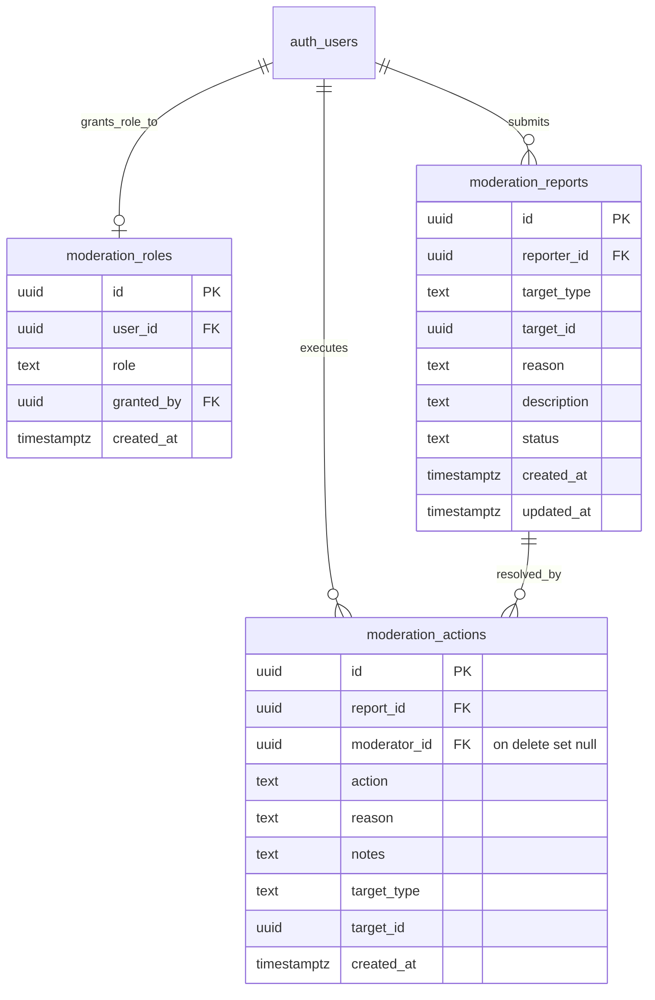

# ECO-00B: Trust, Safety, Legal & Moderation Architecture Specification

**Status:** Implementation Specification & Design  
**Epic:** ECO-00B (Phase 0 Prerequisite)  
**Date:** October 2026  
**Repository:** `RACCHUS/LearningApp`  
**Governing Documents:**  
- [COMMUNITY_EDUCATOR_KNOWLEDGE_ROADMAP.md](COMMUNITY_EDUCATOR_KNOWLEDGE_ROADMAP.md)  
- [ECO_00_ARCHITECTURE_SCHEMA_AUDIT.md](ECO_00_ARCHITECTURE_SCHEMA_AUDIT.md)  
- [UI_ARCHITECTURE_LOCKED.md](../../UI_ARCHITECTURE_LOCKED.md)  

---

## 1. Executive Summary & Problem Statement

Prior to introducing user-generated content (UGC)—such as concept-scoped questions, community answers, or public educator channels—the platform must possess an operational, secure, and legally grounded **Trust, Safety & Moderation Foundation**.

Relying solely on direct database manipulation or service-role scripts is unacceptable for live user communities. **ECO-00B** delivers:
1. **Least-Privilege Database Schema**: An append-only reporting and audit action log (`moderation_roles`, `moderation_reports`, `moderation_actions`) governed by strict Row-Level Security (RLS).
2. **Distinct Moderation Authorization**: A dedicated platform moderation role decoupled from the target-specific `curriculum_reviewers` table.
3. **Legal & Compliance Infrastructure**: Baseline Terms of Service, Privacy Policy (with minor data protection rules), and DMCA Takedown/Counter-Notice procedures.
4. **Administrative Moderation Queue UI**: An in-app responsive dashboard for moderators to review flagged content, inspect context, and take auditable actions (dismiss, warn, hide, delete, rate-limit).
5. **Operational Minor-Safety Controls**: Clear age-attestation safeguards and private-study boundaries for younger learners.

---

## 2. Authorization & Database Schema Design

### 2.1 Decoupling from `curriculum_reviewers`

The audit confirmed that `public.curriculum_reviewers` is strictly target-scoped:
```sql
-- Existing target-specific table:
create table public.curriculum_reviewers (
  id uuid primary key,
  target_id uuid references public.learning_targets(id),
  user_id uuid,
  role text check (role in ('reviewer', 'editor', 'admin')),
  created_at timestamptz
);
```
Target curriculum reviewers have domain expertise in specific certifications or curricula, but they are **not** platform-wide Trust & Safety moderators. ECO-00B creates a distinct, system-wide moderation authority.

---

### 2.2 Additive Migration Specification (`20261017000000_moderation_trust_and_safety.sql`)



#### Detailed DDL Specifications:

1. **`public.moderation_roles`**:
   - `id uuid primary key default gen_random_uuid()`
   - `user_id uuid not null references auth.users(id) on delete cascade unique`
   - `role text not null check (role in ('moderator', 'admin'))`
   - `granted_by uuid references auth.users(id) on delete set null`
   - `created_at timestamptz not null default now()`

2. **Private Schema & Zero-Argument Authorization Helpers**:
   To eliminate user ID spoofing and protect internal role evaluations:
   ```sql
   create schema if not exists private;
   revoke all on schema private from public, anon, authenticated;

   -- Zero-argument caller check for moderators or admins
   create or replace function private.is_moderator()
   returns boolean language sql stable security definer
   set search_path = '' as $$
     select exists (
       select 1 from public.moderation_roles
        where user_id = auth.uid()
          and role in ('moderator', 'admin')
     );
   $$;

   -- Zero-argument caller check for platform administrators
   create or replace function private.is_admin()
   returns boolean language sql stable security definer
   set search_path = '' as $$
     select exists (
       select 1 from public.moderation_roles
        where user_id = auth.uid()
          and role = 'admin'
     );
   $$;

   revoke all on function private.is_moderator() from public, anon, authenticated;
   grant execute on function private.is_moderator() to authenticated, service_role;

   revoke all on function private.is_admin() from public, anon, authenticated;
   grant execute on function private.is_admin() to authenticated, service_role;
   ```

3. **`public.moderation_reports`**:
   - `id uuid primary key default gen_random_uuid()`
   - `reporter_id uuid references auth.users(id) on delete set null`
   - `target_type text not null check (target_type in ('question', 'answer', 'comment', 'profile', 'curriculum', 'resource'))`
   - `target_id uuid not null`
   - `reason text not null check (reason in ('spam', 'harassment', 'misinformation', 'copyright', 'minor_safety', 'inappropriate', 'other'))`
   - `description text`
   - `status text not null default 'pending' check (status in ('pending', 'under_review', 'actioned', 'dismissed'))`
   - `created_at timestamptz not null default now()`
   - `updated_at timestamptz not null default now()`
   - **Report Deduplication**: Partial unique index:
     ```sql
     create unique index idx_moderation_reports_dedup
       on public.moderation_reports (reporter_id, target_type, target_id)
      where status in ('pending', 'under_review');
     ```

4. **`public.moderation_actions`**:
   - `id uuid primary key default gen_random_uuid()`
   - `report_id uuid references public.moderation_reports(id) on delete set null`
   - `moderator_id uuid references auth.users(id) on delete set null` (**Preserves immutable audit trail even if moderator account is deleted**)
   - `action text not null check (action in ('dismiss', 'warn', 'hide', 'delete', 'suspend_user', 'rate_limit'))`
   - `reason text not null`
   - `notes text`
   - `target_type text not null`
   - `target_id uuid not null`
   - `created_at timestamptz not null default now()`

5. **Atomic Transactional Workflow RPC (`public.apply_moderation_action`)**:
   Moderation decisions and report status changes must be recorded in a single atomic transaction:
   ```sql
   create or replace function public.apply_moderation_action(
     p_report_id uuid,
     p_action text,
     p_reason text,
     p_notes text default null
   )
   returns uuid language plpgsql security definer
   set search_path = '' as $$
   declare
     v_report record;
     v_action_id uuid;
     v_new_status text;
   begin
     if not private.is_moderator() then
       raise exception 'Access denied: caller does not possess moderator privileges' using errcode = '42501';
     end if;

     select * into v_report
       from public.moderation_reports
      where id = p_report_id;

     if not found then
       raise exception 'Report % not found', p_report_id using errcode = 'P0002';
     end if;

     v_new_status := case when p_action = 'dismiss' then 'dismissed' else 'actioned' end;

     insert into public.moderation_actions (
       report_id, moderator_id, action, reason, notes, target_type, target_id
     ) values (
       p_report_id, auth.uid(), p_action, p_reason, p_notes, v_report.target_type, v_report.target_id
     ) returning id into v_action_id;

     update public.moderation_reports
        set status = v_new_status,
            updated_at = now()
      where id = p_report_id;

     return v_action_id;
   end;
   $$;
   ```

---

### 2.3 Row-Level Security (RLS) Policies

All tables strictly enforce RLS (`alter table ... enable row level security;`):

- **`moderation_roles`**:
  - `SELECT`: Only moderators and admins can query roles (`using (private.is_moderator())`).
  - `INSERT/UPDATE/DELETE`: Admins only (`using (private.is_admin())` and `with check (private.is_admin())`).
  - **Self-Granting Prevention**: Non-admins cannot grant roles. First administrator is bootstrapped via initial migration or service-role.

- **`moderation_reports`**:
  - `INSERT`: Authenticated users can file a report (`with check (reporter_id = auth.uid())`).
  - `SELECT`: A user can see reports they filed (`reporter_id = auth.uid()`). Moderators can see **all** reports (`using (private.is_moderator())`).
  - `UPDATE`: Only moderators can update report status (`using (private.is_moderator())`).
  - `DELETE`: Denied to everyone (append-only audit integrity).

- **`moderation_actions`**:
  - `INSERT`: Only moderators via direct check or atomic RPC (`with check (private.is_moderator() and (moderator_id = auth.uid() or moderator_id is null))`).
  - `SELECT`: Only moderators (`using (private.is_moderator())`).
  - `UPDATE/DELETE`: Denied to everyone (immutable compliance trail).

---

### 2.4 Initial Administrator Provisioning & Security Hardening (`20261019000000_moderation_roles_least_privilege.sql`)

Migration 51 deployed additional defense-in-depth protections and bootstrapped root administrative access:

1. **Table-Level Least Privilege (`0026_pg_graphql_anon_table_exposed`)**:
   - Privileges on `public.moderation_roles` were explicitly revoked from `public, anon` and granted exclusively to `authenticated`. This eliminates the table from the anonymous GraphQL schema while maintaining authenticated RLS enforcement.
2. **View Security Hardening (`security_invoker`)**:
   - `public.v_field_relations_bidirectional` was updated with `security_invoker = true` to execute under the caller's context rather than security-definer semantics.
3. **Initial Administrator Bootstrap Provenance Convention**:
   - The root administrator (`richardgurudeo@gmail.com`) was provisioned via idempotent insert matching `auth.users(email)`:
     ```sql
     insert into public.moderation_roles (user_id, role, granted_by)
     select id, 'admin', id
       from auth.users
      where lower(email) = 'richardgurudeo@gmail.com'
     on conflict (user_id) do update set role = 'admin';
     ```
   - **Audit Provenance Clarification**: `granted_by` is set to the administrator's own `user_id` solely as an explicit self-referential initialization convention to satisfy foreign key and non-null constraints during migration execution. This must **not** be interpreted as evidence that the user personally granted themselves the role through the administrative UI. All subsequent operational role assignments executed post-bootstrap will record the distinct granting administrator's `auth.uid()`.
4. **Security & Performance Advisory Evaluation**:
   - *Authenticated GraphQL Visibility (`0027`)*: Reported on moderation tables; authenticated queries remain strictly governed and filtered by active table RLS policies.
   - *RLS Policy & Foreign Key Index Deferrals*: `moderation_reports_select_policy` optimization and foreign key covering indexes on `moderation_actions` are deferred until production queue throughput warrants covering indexes.
   - *Public UGC Launch Boundary*: Public UGC authoring remains strictly disabled until operational DMCA agent registration and COPPA/FERPA compliance reviews are formally approved.

---

## 3. Legal & Policy Documentation Framework

ECO-00B delivers three comprehensive legal and governance documents in `docs/legal/`:

### 3.1 Terms of Service (`docs/legal/TERMS_OF_SERVICE.md`)
- **Status**: Draft pending operational verification and qualified legal review.
- **Educational Scope & Disclaimer**:
  - LearningApp is a personal study, foundational literacy, and career preparation platform.
  - Using LearningApp, completing courses, or checking milestone preparation steps **does not award an official degree, state license, or certified qualification**.
- **User Conduct & Content Standards**:
  - Prohibition of harassment, defamation, hate speech, spam, and copyright infringement.
  - Prohibition of sharing actual, confidential, or live state licensing exam items.
- **Age Requirement & Minor Accounts**:
  - Public posting and broadcasting features require users to be at least 18 years of age.
  - Minors may use the platform in private study mode with verified parental or school consent.
  - Public user-generated content (UGC) is disabled platform-wide during Phase 0.

### 3.2 Privacy Policy (`docs/legal/PRIVACY_POLICY.md`)
- **Status**: Draft pending operational verification and qualified legal review.
- **Data Minimization**:
  - The platform collects only essential account credentials (email, display name) and study progress telemetry.
  - Offline pre-reader profiles and oral literacy progress remain strictly on-device by default.
- **Minor Safety & Children's Privacy**:
  - Strict isolation: zero public directory listing of minor accounts.
  - Complete prohibition of unvetted direct messaging between adult strangers and minors.
  - Clear articulation of COPPA/FERPA boundaries (caseworker/guardian vs statutory parental consent; school consent limited strictly to educational benefit).
- **Target Specifications Under Development**:
  - Self-service account deletion ("Right to be Forgotten") and automated data export are documented as future technical specifications under active engineering development.

### 3.3 DMCA Takedown & Copyright Policy (`docs/legal/DMCA_TAKEDOWN_POLICY.md`)
- **Status**: Draft pending operational verification and U.S. Copyright Office directory registration.
- **Designated Agent Notice Requirements**:
  - Standard statutory elements pursuant to 17 U.S.C. § 512(c)(3).
  - Explicit notice that designated agent registration in the U.S. Copyright Office directory (37 C.F.R. § 201.38) is required prior to public operations.
- **Takedown & Safe Harbor Workflow**:
  - Immediate temporary concealment of contested material upon receipt of valid notice.
  - Prompt notification to content author and 10–14 business day counter-notice statutory window.
- **Repeat Infringer Policy**:
  - Termination of publishing privileges for persistent copyright infringers.

---

## 4. Administrative Moderation UI & Client Architecture

### 4.1 Client Models & Services

1. **`lib/models/governance/moderation_report.dart`**:
   - `ModerationReport`: id, reporterId, targetType, targetId, reason, description, status, createdAt, updatedAt.
   - `ModerationAction`: id, reportId, moderatorId, action, reason, notes, targetType, targetId, createdAt.
   - Enums: `ReportReason`, `ReportStatus`, `ModerationActionType`.

2. **`lib/services/governance/moderation_service.dart`**:
   - `submitReport(...)`: Creates a new report record via client insert or RPC.
   - `fetchQueue(...)`: Loads pending and under-review reports for authorized moderators.
   - `applyModerationAction(...)`: Invokes the atomic `public.apply_moderation_action` RPC.
   - `checkModeratorStatus(...)`: Evaluates `private.is_moderator()`.

### 4.2 Moderation Queue Screen (`lib/screens/governance/moderation_queue_screen.dart`)
- **Access Guard**: Automatically redirects or renders an access-denied state if `is_moderator` is false.
- **Filter Tabs**: `Pending` (badge count), `Under Review`, `Actioned`, `Dismissed`.
- **Reason Chips**: Filter by reason (`Minor Safety`, `Harassment`, `Misinformation`, `Spam`, `Copyright`).
- **Interactive Action Dialog with Operational Clarity**:
  - Clearly labels actions as **Auditable Moderation Decisions**.
  - Explicitly states that recording `hide` or `suspend_user` creates an immutable compliance record, and distinguishes decision logging from downstream automated content muting until subsequent epics.
  - Requires mandatory justification note.
  - Executes atomically via `public.apply_moderation_action`.

---

## 5. Verification & Testing Plan

1. **pgTAP Security & RLS Tests (`supabase/tests/moderation_security_test.sql`)**:
   - Located under repository-standard `supabase/tests/`.
   - Validates:
     - Zero-argument caller enforcement (`private.is_moderator()` uses `auth.uid()`).
     - Privilege escalation defense: non-moderators cannot view reports, perform actions, or read roles.
     - Separation of powers: moderators cannot grant admin roles; only admins can modify `moderation_roles`.
     - Audit trail preservation: deleting an auth user sets `moderator_id = null` and retains all action history.
     - Atomic transaction consistency: `apply_moderation_action` updates report status and records action log together.
     - Deduplication: prevents duplicate pending reports by the same user on the same target.
2. **Dart Unit & Service Tests (`test/services/governance/moderation_service_test.dart`)**:
   - Verify report submission, atomic action execution, status parsing, and error handling.
3. **Widget Tests (`test/widgets/governance/moderation_queue_screen_test.dart`)**:
   - Verify access control rejection for non-moderators.
   - Verify report list rendering, filter tabs, action dialog validation, and operational disclaimers.

---

## 6. Implementation Deliverables Checklist

- [x] Legal drafts updated with explicit draft notices, disclaimers, and COPPA/FERPA clarifications in `docs/legal/`.
- [x] Architecture specification updated in `docs/product/ECO_00B_TRUST_SAFETY_MODERATION_SPEC.md`.
- [x] Additive Supabase migration `20261017000000_moderation_trust_and_safety.sql` deployed and verified (Migration 50).
- [x] Additive Supabase migration `20261019000000_moderation_roles_least_privilege.sql` deployed and verified (Migration 51).
- [x] pgTAP security test suite authored and passing at `supabase/tests/moderation_security_test.sql` (37 assertions).
- [x] Dart models and service implemented in `lib/models/governance/` and `lib/services/governance/`.
- [x] Responsive `ModerationQueueScreen` implemented in `lib/screens/governance/` with navigation route `/moderation`.
- [x] Automated unit, widget (1,585 assertions), and pgTAP clean-database tests passing in CI.
- [x] Guarded production deployment executed with 51/51 migrations in 1:1 remote parity.
- [x] Initial root administrator account provisioned and active on hosted database.
