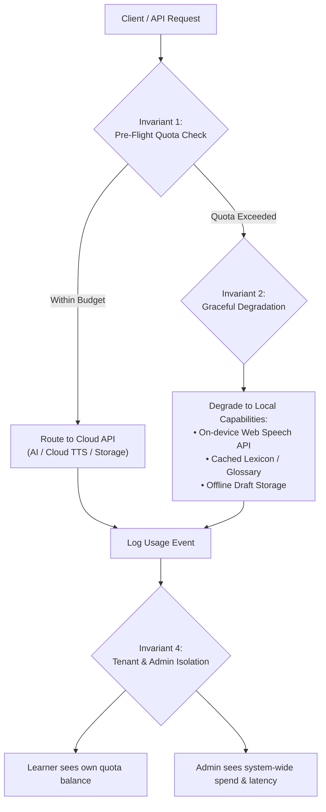
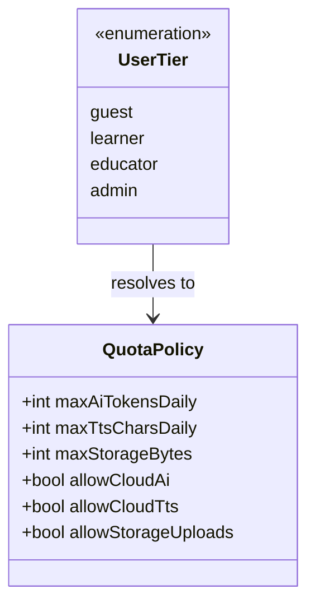
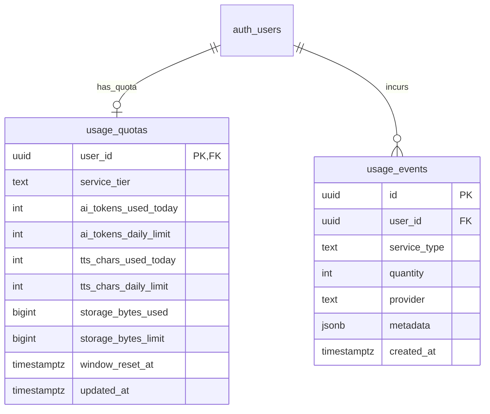
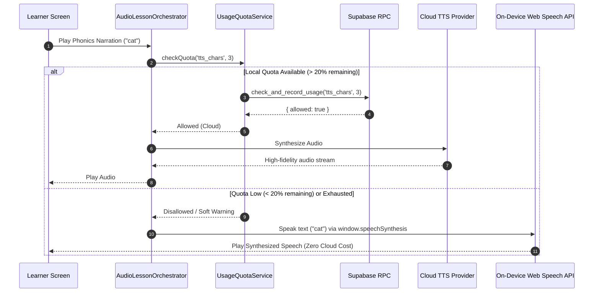

# ECO-00C: Cost, Quotas & Observability Architecture Specification

**Epic:** ECO-00C (Phase 0 Prerequisite)  
**Status:** Approved Architecture Specification  
**Dependencies:** ECO-00 (Schema Audit & Domain Separation), ECO-00B (Trust, Safety & Moderation)  
**Target Delivery:** Migration 52 (`20261021000000_cost_and_observability_quotas.sql`), `UsageQuotaService`, and `CostObservabilityDashboard`

---

## 1. Executive Summary & Problem Statement

As LearningApp prepares for community and educator features (ECO-01 through ECO-06), external operational costs and API dependencies scale directly with user activity:
1. **AI Inference Costs**: Phased lesson generation, concept summarization, and interactive Q&A consume LLM tokens.
2. **Voice & Speech Services**: Text-to-speech (TTS) audio narration for foundational literacy, pre-readers, and oral phonics utilizes cloud synthesis APIs.
3. **Storage & Assets**: User and educator lesson attachments, thumbnails, and audio clips consume object storage and egress bandwidth.
4. **Database & Edge Queries**: Client synchronizations, offline reconciliation, and catalog searches exert database load.

Without deterministic client-side and server-side rate limits, budget ceilings, and observability tooling:
- A malicious or runaway client script could exhaust cloud budgets or trigger third-party API rate limits.
- System outages or provider degradations would cause unhandled client crashes rather than graceful fallbacks.
- Platform administrators would have zero visibility into real-time spend run-rates, token usage, or provider latency trends.

**ECO-00C** delivers the foundational architecture for **Cost Quotas, Rate-Limiting Token Buckets, Graceful Provider Degradation, and Administrative Observability Dashboards**.

---

## 2. Core Architectural Invariants

All designs and implementations within ECO-00C must strictly adhere to the following four domain invariants:



### Invariant 1: Strict Spend & Quota Boundary
No automated cloud API operation (AI generation, Cloud TTS, Cloud STT) may execute without pre-flight quota verification against the caller's active rate-limit bucket. Requests exceeding daily quotas must be rejected gracefully with a cooldown reset timestamp.

### Invariant 2: Graceful Degradation to On-Device Capabilities
Quota exhaustion or external provider latency/failure must **never** block core learning or crash the client. When cloud quotas are exhausted or network latency degrades:
- **TTS Narration**: Seamlessly falls back from Cloud Neural TTS to the browser/system on-device **Web Speech API** (`window.speechSynthesis`).
- **AI Concept Assistance**: Falls back to statically bundled curriculum glossaries and offline concept definitions.
- **Media Uploads**: Enforces client-side image downscaling (maximum 1280px / 500KB) and preserves local offline draft storage.

### Invariant 3: Zero Client Secret Exposure & Server-Side Metering
Client applications never receive third-party provider API keys or service-role administrative credentials. External calls are routed through rate-limited Supabase Edge Functions or verified via atomic backend RPCs. Client-side quota telemetry is cached locally for immediate UI responsiveness and reconciled against authoritative database records.

### Invariant 4: Strict Tenant Isolation & Administrator-Only Cost Aggregation
Usage metrics and quota records are strictly tenant-isolated via PostgreSQL Row-Level Security (RLS). Ordinary learners and educators may only inspect their own quota consumption. Aggregate system spend estimations, provider latency percentiles, and global rate-limit violation logs are accessible exclusively to authenticated users holding the `admin` role in `public.moderation_roles`.

---

## 3. Consumable Cost Vectors & Quota Tiers

### 3.1 The Four Cost Vectors

| Vector | Metric Unit | Default Daily Learner Limit | Default Daily Educator Limit | Unit Economic Reference |
| :--- | :--- | :--- | :--- | :--- |
| **1. AI Inference** | Total Tokens (In + Out) | 15,000 tokens/day (~15 Q&A / summaries) | 60,000 tokens/day (~4 full phased lessons) | ~$0.15 per 1M tokens (Gemini Flash) |
| **2. Cloud TTS** | Synthesized Characters | 10,000 chars/day (~15 mins audio) | 30,000 chars/day (~45 mins audio) | ~$16.00 per 1M chars (Neural TTS) |
| **3. Media Storage** | Total Stored Bytes | 5 MB (Avatar & notes) | 50 MB (Lesson media & slides) | ~$0.021 per GB-month (Supabase Storage) |
| **4. Database Probes** | Probe Latency & Errors | Rate-limited ping (1 probe/30s) | Rate-limited ping (1 probe/30s) | Included in compute tier |

### 3.2 Tier Definitions



1. **Guest (Unauthenticated)**:
   - Cloud AI Tokens: 0 (local templates and pre-generated curriculum only).
   - TTS Narration: On-device Web Speech API only (0 cloud TTS characters).
   - Storage: Local IndexedDB / Hive storage only (0 cloud bytes).
2. **Learner (Authenticated)**:
   - 15,000 AI tokens/day, 10,000 Cloud TTS characters/day, 5 MB storage.
   - Soft limit trigger at 80% quota: warns user and prepares fallback degradation.
3. **Educator (Verified via ECO-04)**:
   - 60,000 AI tokens/day, 30,000 Cloud TTS characters/day, 50 MB storage.
4. **Administrator (`role = 'admin'`)**:
   - Uncapped or high operational ceiling (500,000 tokens/day) for system testing and diagnostic probes.

---

## 4. Database Schema Specification (`20261021000000_cost_and_observability_quotas.sql`)

### 4.1 Entity Relationship Diagram



### 4.2 Table DDL Specifications

```sql
-- -----------------------------------------------------------------------------
-- 1. Table: public.usage_quotas
-- -----------------------------------------------------------------------------
create table if not exists public.usage_quotas (
  user_id uuid primary key references auth.users(id) on delete cascade,
  service_tier text not null default 'learner' check (service_tier in ('learner', 'educator', 'admin')),
  ai_tokens_used_today int not null default 0 check (ai_tokens_used_today >= 0),
  ai_tokens_daily_limit int not null default 15000 check (ai_tokens_daily_limit > 0),
  tts_chars_used_today int not null default 0 check (tts_chars_used_today >= 0),
  tts_chars_daily_limit int not null default 10000 check (tts_chars_daily_limit > 0),
  storage_bytes_used bigint not null default 0 check (storage_bytes_used >= 0),
  storage_bytes_limit bigint not null default 52428800 check (storage_bytes_limit > 0), -- 50 MB default max
  window_reset_at timestamptz not null default timezone('utc'::text, now() + interval '1 day'),
  updated_at timestamptz not null default timezone('utc'::text, now())
);

-- RLS Enforcement
alter table public.usage_quotas enable row level security;

-- Least privilege table grants
revoke all on table public.usage_quotas from public, anon;
grant select on table public.usage_quotas to authenticated;

-- Policies: Users read own quota; Admins read all
create policy usage_quotas_select_policy on public.usage_quotas
  for select
  to authenticated
  using (user_id = auth.uid() or private.is_admin());

-- Mutations restricted exclusively to trusted security definer RPCs
-- -----------------------------------------------------------------------------

-- -----------------------------------------------------------------------------
-- 2. Table: public.usage_events (Audit & Observability Telemetry)
-- -----------------------------------------------------------------------------
create table if not exists public.usage_events (
  id uuid primary key default gen_random_uuid(),
  user_id uuid references auth.users(id) on delete set null,
  service_type text not null check (service_type in ('ai_tokens', 'tts_chars', 'stt_seconds', 'storage_bytes')),
  quantity int not null check (quantity > 0),
  provider text not null default 'internal',
  metadata jsonb not null default '{}'::jsonb,
  created_at timestamptz not null default timezone('utc'::text, now())
);

-- Indexes for time-series aggregation and user lookup
create index if not exists idx_usage_events_user_type_time on public.usage_events (user_id, service_type, created_at desc);
create index if not exists idx_usage_events_created_at on public.usage_events (created_at desc);

-- RLS Enforcement
alter table public.usage_events enable row level security;

revoke all on table public.usage_events from public, anon;
grant select on table public.usage_events to authenticated;

-- Policies: Users read own events; Admins read all
create policy usage_events_select_policy on public.usage_events
  for select
  to authenticated
  using (user_id = auth.uid() or private.is_admin());
```

### 4.3 Atomic Quota Metering & Verification RPC

To eliminate race conditions during concurrent requests:

```sql
create or replace function public.check_and_record_usage(
  p_service_type text,
  p_quantity int,
  p_provider text default 'internal',
  p_metadata jsonb default '{}'::jsonb
)
returns jsonb
language plpgsql
security definer
set search_path = ''
as $$
declare
  v_uid uuid;
  v_quota record;
  v_allowed boolean;
  v_remaining int;
  v_now timestamptz := timezone('utc'::text, now());
begin
  v_uid := auth.uid();
  if v_uid is null then
    raise exception 'Authentication required' using errcode = '42501';
  end if;

  if p_quantity <= 0 then
    raise exception 'Quantity must be positive' using errcode = '22023';
  end if;

  -- Advisory lock per user to serialize quota consumption
  perform pg_advisory_xact_lock(hashtext('usage_quota_' || v_uid::text));

  -- Ensure quota row exists
  insert into public.usage_quotas (user_id)
  values (v_uid)
  on conflict (user_id) do nothing;

  -- Fetch current quota row
  select * into v_quota
    from public.usage_quotas
   where user_id = v_uid;

  -- Check if rolling daily window has expired; reset if so
  if v_now >= v_quota.window_reset_at then
    update public.usage_quotas
       set ai_tokens_used_today = 0,
           tts_chars_used_today = 0,
           window_reset_at = v_now + interval '1 day',
           updated_at = v_now
     where user_id = v_uid
     returning * into v_quota;
  end if;

  -- Evaluate quota allowance based on service type
  if p_service_type = 'ai_tokens' then
    if (v_quota.ai_tokens_used_today + p_quantity) <= v_quota.ai_tokens_daily_limit then
      v_allowed := true;
      v_remaining := v_quota.ai_tokens_daily_limit - (v_quota.ai_tokens_used_today + p_quantity);
      update public.usage_quotas
         set ai_tokens_used_today = ai_tokens_used_today + p_quantity,
             updated_at = v_now
       where user_id = v_uid;
    else
      v_allowed := false;
      v_remaining := greatest(0, v_quota.ai_tokens_daily_limit - v_quota.ai_tokens_used_today);
    end if;

  elsif p_service_type = 'tts_chars' then
    if (v_quota.tts_chars_used_today + p_quantity) <= v_quota.tts_chars_daily_limit then
      v_allowed := true;
      v_remaining := v_quota.tts_chars_daily_limit - (v_quota.tts_chars_used_today + p_quantity);
      update public.usage_quotas
         set tts_chars_used_today = tts_chars_used_today + p_quantity,
             updated_at = v_now
       where user_id = v_uid;
    else
      v_allowed := false;
      v_remaining := greatest(0, v_quota.tts_chars_daily_limit - v_quota.tts_chars_used_today);
    end if;

  elsif p_service_type = 'storage_bytes' then
    if (v_quota.storage_bytes_used + p_quantity) <= v_quota.storage_bytes_limit then
      v_allowed := true;
      v_remaining := v_quota.storage_bytes_limit - (v_quota.storage_bytes_used + p_quantity);
      update public.usage_quotas
         set storage_bytes_used = storage_bytes_used + p_quantity,
             updated_at = v_now
       where user_id = v_uid;
    else
      v_allowed := false;
      v_remaining := greatest(0, v_quota.storage_bytes_limit - v_quota.storage_bytes_used);
    end if;

  else
    raise exception 'Unsupported service type: %', p_service_type using errcode = '22023';
  end if;

  -- If allowed, record the audit event
  if v_allowed then
    insert into public.usage_events (user_id, service_type, quantity, provider, metadata, created_at)
    values (v_uid, p_service_type, p_quantity, p_provider, p_metadata, v_now);
  end if;

  return jsonb_build_object(
    'allowed', v_allowed,
    'service_type', p_service_type,
    'quantity_requested', p_quantity,
    'remaining_balance', v_remaining,
    'window_reset_at', v_quota.window_reset_at
  );
end;
$$;

revoke all on function public.check_and_record_usage(text, int, text, jsonb) from public, anon;
grant execute on function public.check_and_record_usage(text, int, text, jsonb) to authenticated;
```

---

## 5. Client Services & Graceful Degradation Architecture

### 5.1 Service Layer Structure

```
lib/services/governance/
├── usage_quota_service.dart          # Local quota caching, pre-flight checks, RPC integration
└── cost_observability_service.dart   # Telemetry metrics, provider health probes, spend estimation
```

### 5.2 Graceful Degradation Flow (TTS Example)



---

## 6. Administrative Observability Dashboard (`lib/screens/governance/cost_observability_screen.dart`)

### 6.1 Access Guard & Routing
- Route: `/#/observability`
- Navigation: Accessible in **Settings $\rightarrow$ Administrative Tools $\rightarrow$ Cost & Observability Console**.
- Security Guard: Requires `private.is_admin() == true`; renders the standard **Access Denied** view for learners.

### 6.2 Key Dashboard Cards & Metrics

1. **Platform Operational Health**:
   - Backend Reachability (`reachable`, `degraded`, `unreachable`).
   - Latency Benchmarks (p50 ping latency in ms, 24h timeout incident count).
   - Rate-Limit Breach Count (total blocked requests across all users in last 24h).
2. **24-Hour Resource Consumption Gauges**:
   - Total AI Tokens Consumed (vs daily ceiling).
   - Total Cloud TTS Characters Synthesized (vs daily ceiling).
   - Total New Storage Bytes Ingested.
3. **Estimated Spend & Run-Rate**:
   - Calculated unit economics ($/day, projected $/month).
   - Active fallback status: count of sessions actively utilizing on-device Web Speech API.

---

## 4.5 Hardening, STT Metering & Abuse Prevention (Migration 53)

To prevent resource exhaustion, denial of service, and event table amplification:
1. **Defense-in-Depth Table Revocations**: Direct `INSERT`, `UPDATE`, and `DELETE` grants on `public.usage_quotas` and `public.usage_events` are explicitly revoked from `authenticated`, `anon`, and `public`. Modifications can only occur through security definer RPCs (`check_and_record_usage`) and `service_role`.
2. **Metadata Payload Bounding**: `octet_length(p_metadata::text)` is capped at 4,096 bytes (4 KB). Payloads exceeding 4KB are rejected with PostgreSQL error `22023`.
3. **Storage Allocation Minimum Boundary**: `storage_bytes` requests must allocate at least 1,024 bytes (1 KB) per call (`p_quantity >= 1024`). Sub-kilobyte allocations are rejected with error `22023` to prevent 1-byte micro-event table flooding.
4. **Daily Event Logging Frequency Cap**: `events_recorded_today` is metered against `events_daily_limit` (1,000/day for learners, 10,000/day for administrators). Requests exceeding this ceiling are rejected with error `42900`.
5. **Speech-to-Text (STT) Metering**: Added `stt_seconds_used_today` and `stt_seconds_daily_limit` (default 3,600s / 1 hr for learners, 36,000s / 10 hrs for admins) with automatic deduction and rollover in `check_and_record_usage`.
6. **Provider Identifier Bounding (Migration 54)**: `p_provider` text parameter is bounded to a maximum of 64 characters and must be non-empty (`length(trim(p_provider)) between 1 and 64`). Violations are rejected with SQL error `22023` to eliminate uncontrolled text storage in `usage_events`.

---

## 7. Verification & Testing Plan

1. **pgTAP Security & Quota Tests (`supabase/tests/cost_observability_test.sql`)**:
   - Test initial quota record creation for authenticated users.
   - Verify atomic locking and race prevention during concurrent calls.
   - Verify daily window reset when `now() >= window_reset_at`.
   - Verify rejection and event omission when quantity exceeds limit.
   - Verify tenant RLS isolation: ordinary users cannot inspect others' quotas or events.
   - Verify administrator bypass: users with `role = 'admin'` can read system-wide usage.
   - Verify abuse prevention: provider string bound <= 64 chars, metadata size >4KB rejection, storage request <1KB rejection, and event frequency ceiling.
   - Verify defense-in-depth: direct table writes by authenticated clients denied with 42501.
2. **Dart Unit Tests (`test/services/governance/usage_quota_service_test.dart`)**:
   - Verify token estimation integration with `PromptContextCompressor`.
   - Verify Hive offline quota caching and reconciliation.
   - Verify 80% soft-limit warning emission for AI, TTS, STT, and event logging.
3. **Widget Tests (`test/widgets/governance/cost_observability_screen_test.dart`)**:
   - Verify Access Denied rendering for non-admins.
   - Verify gauge rendering, health badge display, STT audio, and abuse prevention tiles.
4. **Guarded Deployment**:
   - Verify clean dry-run and migration ledger parity for migrations 52, 53, and 54 via `tool/guarded_supabase_deploy.dart`.

---

## 8. Implementation Deliverables Checklist

- [x] Architecture specification approved in `docs/product/ECO_00C_COST_OBSERVABILITY_SPEC.md`.
- [x] Additive Supabase migration `20261021000000_cost_and_observability_quotas.sql` (Migration 52) created and deployed.
- [x] Additive Supabase migration `20261022000000_usage_quotas_hardening_and_stt.sql` (Migration 53) created and tested.
- [x] Additive Supabase migration `20261023000000_quota_provider_length_guard.sql` (Migration 54) created and tested.
- [x] pgTAP test suite authored at `supabase/tests/cost_observability_test.sql` (39 tests).
- [x] Dart models and services created in `lib/models/governance/` and `lib/services/governance/`.
- [x] `CostObservabilityScreen` implemented in `lib/screens/governance/`.
- [x] Router integration with route `/observability` and Settings navigation entry.
- [x] Automated unit, widget, and pgTAP tests passing.
- [x] Guarded production deployment executed and verified.
