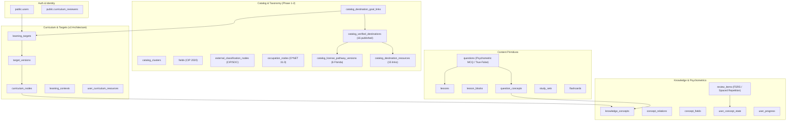
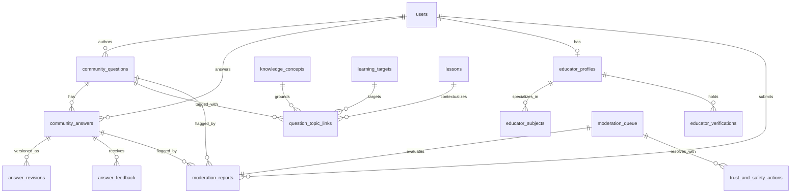
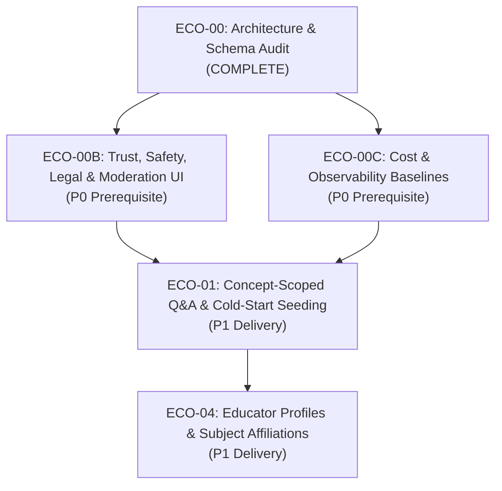

# ECO-00: Community, Educator & Creator Platform — Architecture & Schema Audit

**Status:** Completed Audit & Baseline Specification  
**Epic:** ECO-00 (Phase 0 Prerequisite)  
**Date:** October 2026  
**Repository:** `RACCHUS/LearningApp`  
**Governing Documents:**  
- [COMMUNITY_EDUCATOR_KNOWLEDGE_ROADMAP.md](COMMUNITY_EDUCATOR_KNOWLEDGE_ROADMAP.md)  
- [LEARNING_ARCHITECTURE_V2.md](../../LEARNING_ARCHITECTURE_V2.md)  
- [UI_ARCHITECTURE_LOCKED.md](../../UI_ARCHITECTURE_LOCKED.md)  
- [LITERACY_ACCESSIBILITY_PLAN.md](../../LITERACY_ACCESSIBILITY_PLAN.md)  
- [CATALOG_GROWTH_AND_DEMAND_PLAN.md](../catalog/CATALOG_GROWTH_AND_DEMAND_PLAN.md)  
- [P2H_LEARNER_FACING_PATHWAY_PREPARATION.md](../catalog/P2H_LEARNER_FACING_PATHWAY_PREPARATION.md)  

---

## 1. Executive Summary & Objective

The **Community, Educator, Creator Economy & Adaptive Knowledge Roadmap** outlines an ambitious expansion of `LearningApp` from an individual study and foundational literacy client into an open, evidence-grounded educational ecosystem.

Before writing code or authoring database migrations for community interactions, educator identities, or content marketplaces, **ECO-00** mandates an exhaustive audit of:
1. Existing database tables, schemas, and RLS policies across 46 migrations.
2. Existing Flutter client models, state providers, and UI services.
3. Overlaps, naming conflicts, and potential failure modes (especially conflating psychometric testing items with social Q&A).
4. Safety, legal, minor-privacy (COPPA/FERPA), and cost/observability requirements.

This document establishes the official **Gap Matrix**, specifies the **Domain Separation Invariants**, and models the additive entities needed for subsequent epics (**ECO-00B** through **ECO-05**).

---

## 2. Current Architecture & Implemented State Inventory

### 2.1 Database & Schema Inventory (`supabase/migrations/`)

The database consists of 46 ordered, append-only migrations. Key subsystems include:

#### Detailed Findings on Key Existing Tables:

1. **`public.questions` (Psychometric Assessment Items)**:
   - **Schema**: `id (uuid)`, `lesson_id (uuid FK to lessons)`, `question_text (text)`, `options (jsonb array)`, `correct_answer (int)`, `type (mcq|true_false|short_answer)`, `explanation (text)`, `user_id (uuid)`, `created_at`, `updated_at`.
   - **Role**: Serves exclusively as graded items for spaced repetition (`review_items`), diagnostic readiness (`AssessmentEngine`), and weighted concept evidence (`question_concepts` $\rightarrow$ `user_concept_state`).
   - **Critical Constraint**: `questions` has a single numeric `correct_answer` and strict scoring semantics. It is completely unsuitable for multi-perspective, threaded, or conversational community Q&A.

2. **`public.users` (User Identity)**:
   - **Schema**: `id (uuid PK references auth.users)`, `email (text unique)`, `display_name (text)`, `created_at (timestamptz)`.
   - **Role**: Minimal identity record.
   - **Gaps**: Does not track user roles, age bracket/minor status, educator bio, verification state, social links, or public profile preferences.

3. **`public.learning_targets` & `catalog_destination_goal_links`**:
   - Distinguishes official regulator credentials from private user goals.
   - Enforces strict RLS: users can only link private, unreviewed draft goals to published catalog destinations in the matching jurisdiction.

4. **`public.curriculum_reviewers`**:
   - Minimal table (`user_id`, `created_at`) used by administrative RPCs to govern curriculum promotion.

---

### 2.2 Client-Side Services & Models (`lib/`)

1. **Foundational Literacy Core (`lib/models/`, `lib/services/`)**:
   - 6 phases delivered and verified (51 passing automated tests).
   - `PreReaderAudioService`, tactile Zaner-Bloser stroke engine (`LetterStrokeData`), phonics catalog, decodable stories, and CVC word blending.
   - Practical survival domains: USCIS Civics oral mock, FLHSMV audio driver's exam, GED ABE reading bridge, OSHA pictograms, Currency recognition (18 U.S.C. § 504), Food Code.
   - `CaseworkerMode` and `PreReaderProfile`: All learner profiles and oral milestone progresses are currently kept **strictly local on-device** via `SharedPreferences`/Hive.

2. **Audio & Voice Interaction**:
   - `AudioLessonOrchestrator`, `VoiceInputService`, `VoiceCommandRouter`, `HandsFreeSettingsService`.
   - Client-side speech recognition and synthesis integration.

3. **AI Generation & Prompt Engine**:
   - `AiPromptService`: Phased blueprint and curriculum generation with terminology locking.
   - `ContentQualityService`: Client-side heuristic analysis for readability, structure, and accessibility.
   - **Security Gap**: Lacks input sanitization and prompt-injection filters for untrusted user inputs.

4. **License Pathway Preparation (P2h)**:
   - `PathwayTreeParser`, `PathwayReadinessService`, `PathwayPreparationSheet`, `PathwayPreparationGoalCard`.
   - Client-side interactive route selection (`op: 'any'`) and self-reported checklist tracking for 6 Florida licenses.

---

## 3. Comprehensive Gap Matrix

The following matrix compares current capabilities against the strategic roadmap requirements:

| Architectural Domain | Existing Implementation | Roadmap Requirement (ECO) | Gap Classification | Architectural Strategy & Invariant |
| :--- | :--- | :--- | :--- | :--- |
| **1. Social Q&A vs. Psychometrics** | `public.questions` table is strictly psychometric (MCQ, 0-indexed answer, linked to `user_concept_state` mastery). | Conversational, threaded questions and answers scoped to lessons/concepts/targets with upvotes, citations, and revisions. | **Missing Subsystem** | **Invariant 1**: Complete domain isolation. Create `community_questions` and `community_answers`. Never mix social Q&A into psychometric `questions`. |
| **2. Educator & Creator Identity** | Minimal `public.users` (id, email, display_name). No public profile UI. | Educator channels, subject expertise, credential verification tags, followers, office hours. | **Missing Subsystem** | **Invariant 2**: Create additive `educator_profiles` and `educator_subjects`. Distinguish self-declared vs. verified credentials. |
| **3. Trust, Safety & Moderation** | Administrative SQL scripts & RLS. No user reporting UI or moderator inbox. | User flagging, moderation queue UI, audit log of actions, DMCA notices, automated profanity/spam filters. | **Missing Subsystem (P0 Prerequisite)** | **ECO-00B**: Build `moderation_reports`, `moderation_queue`, and admin moderation UI before enabling public UGC. |
| **4. Child Safety & Minor Protection** | Pre-reader profiles stored locally in offline Hive/SharedPreferences. | Strict COPPA/FERPA compliance. Minors prohibited from public posting or direct adult messaging. | **Critical Legal Gap** | **Invariant 3**: Minors default to private, guardian-managed accounts. Public posting restricted to verified adults ($\ge 18$). |
| **5. AI Transparency & Prompt Security** | `AiPromptService` generates lesson plans via rigid schemas. | In-context AI answer synthesis, uncertainty flags, prompt-injection defense. | **Partial / Security Gap** | **Invariant 4**: Sanitize all user questions through input filter before LLM submission. Label AI answers clearly. |
| **6. Content Licensing & Provenance** | `content_provenance.dart` models source URL and checked dates for official catalog destinations. | Explicit creator licensing (CC-BY, CC-BY-SA, All Rights Reserved), derivative rights tracking. | **Missing Subsystem** | Add `resource_licenses` table and require explicit license selection upon publishing. |
| **7. Multi-Modal Audio Harmonization** | Rich local TTS/STT and oral literacy mocks. | Audio playback for community Q&A, voice question asking, accessible explanations. | **Integration Opportunity** | Re-use `PreReaderAudioService` and `AudioLessonOrchestrator` to vocalize community answers. |
| **8. Cost & Observability Monitoring** | Basic `supabase_health_service.dart`. | Real-time monitoring of AI tokens, TTS/STT API costs, media storage, and rate-limit violations. | **Missing Operational Tooling** | **ECO-00C**: Implement cost quotas, rate-limiting token buckets, and alert thresholds. |

---

## 4. Core Architectural Invariants

To maintain structural integrity, the following invariants are strictly binding for all future ECO epics:

### Invariant 1: Psychometric Assessment Isolation
- **Rule**: `public.questions` is reserved exclusively for validated assessment items that produce concept mastery evidence.
- **Enforcement**: Community knowledge discussions must reside in `public.community_questions` and `public.community_answers`.
- **Bridge**: A community answer can only become an assessment item through an explicit editorial review and transformation workflow that attaches options, distractors, and concept weights.

### Invariant 2: Trust Vocabulary Consistency
- **Rule**: All community content, educator profiles, and answers must reuse the platform's standardized trust vocabulary:
  - `Official` (issued by accredited body/state regulator)
  - `Catalog` (curated by platform curriculum team)
  - `Community (reviewed)` (peer-reviewed and approved by credentialed contributor)
  - `Community (pending)` (submitted, unreviewed community draft)
  - `Private` (learner's personal unshared draft)
- **Prohibition**: Never invent redundant labels (e.g., "Verified Answer", "Certified Expert") that blur regulatory vs. platform vs. self-reported distinctions.

### Invariant 3: Minor Safety & Privacy (COPPA / FERPA)
- **Rule**: Public user-generated content (asking public questions, posting answers, creating public channels) is restricted to verified adult users ($\ge 18$).
- **Minor Accounts**: Learners under 18 (or accounts managed under caseworker/family profiles) operate in **Private Study Mode**:
  - No public profile indexing.
  - No direct messaging from adult strangers.
  - Can read approved public FAQs and community answers, but cannot broadcast UGC without guardian/caseworker mediation.

### Invariant 4: Prompt-Injection Defense & AI Disclosure
- **Rule**: Any user-authored question or answer passed to an LLM for summarization, tag extraction, or AI explanation must undergo deterministic input sanitization.
- **Controls**:
  - Strip system-instruction delimiters (`<role>`, `<task>`, `system:`, `ignore previous instructions`).
  - Cap question input length (e.g., max 1,000 characters).
  - Explicitly mark all AI-synthesized responses with visual robot badges, confidence disclaimers, and links to official regulator sources.

### Invariant 5: Navigation Baseline & First-Run Help Integrity
- **Rule**: The core navigation destinations remain **Learn**, **Library**, and **Progress** per [UI_ARCHITECTURE_LOCKED.md](../../UI_ARCHITECTURE_LOCKED.md).
- **Placement**:
  - Community Q&A is contextual: embedded in lesson sheets, practice review dialogs, and library search.
  - Do NOT inject a top-level "Social" or "Forum" bottom-nav item.
  - Searchable Help (`?`) in the top-right chrome remains intact.

---

## 5. Target Entity Relationship Model (ECO Data Domains)

Below is the design target for the additive database entities required across Phase 0 through Phase 2. *(Design target only; do not execute as premature migrations).*

### 5.1 Trust, Safety & Moderation Domain (`ECO-00B`)
- `moderation_reports`: `id`, `reporter_id`, `target_type` (`question|answer|comment|profile`), `target_id`, `reason` (`spam|harassment|misinformation|copyright|minor_safety`), `description`, `created_at`.
- `moderation_queue`: `id`, `report_id`, `status` (`pending|under_review|actioned|dismissed`), `priority`, `assigned_moderator_id`, `escalated_at`.
- `trust_and_safety_actions`: `id`, `moderator_id`, `target_type`, `target_id`, `action` (`warn|hide|delete|ban_user|rate_limit`), `justification`, `actioned_at`.
- `dmca_takedown_notices`: `id`, `claimant_name`, `claimant_email`, `infringing_url`, `original_work_description`, `sworn_statement_verified`, `received_at`, `status`.

### 5.2 Community Q&A Domain (`ECO-01`)
- `community_questions`: `id`, `author_id`, `title`, `body_markdown`, `status` (`published|under_review|archived`), `is_seeded` (boolean), `view_count`, `upvote_count`, `created_at`, `updated_at`.
- `community_answers`: `id`, `question_id`, `author_id`, `is_ai_generated` (boolean), `ai_model_name`, `body_markdown`, `status`, `is_accepted` (boolean), `upvote_count`, `created_at`, `updated_at`.
- `answer_revisions`: `id`, `answer_id`, `revision_number`, `body_markdown`, `editor_id`, `edit_reason`, `created_at`.
- `question_topic_links`: `id`, `question_id`, `concept_id` (optional FK), `target_id` (optional FK), `lesson_id` (optional FK), `cip_code` (optional).
- `answer_feedback`: `id`, `answer_id`, `user_id`, `is_helpful` (boolean), `feedback_tag`, `created_at`.

### 5.3 Educator Profiles Domain (`ECO-02`, `ECO-04`)
- `educator_profiles`: `id (uuid references auth.users)`, `bio`, `headline`, `avatar_url`, `website_url`, `hourly_rate_cents`, `is_accepting_students` (boolean), `created_at`, `updated_at`.
- `educator_subjects`: `id`, `educator_id`, `field_id` (FK to `fields`), `target_type`, `experience_years`, `self_declared_summary`.
- `educator_verifications`: `id`, `educator_id`, `credential_type` (`license|degree|certification`), `issuer_name`, `jurisdiction`, `verification_status` (`unverified|pending|verified|expired`), `verified_at`, `expires_at`.
- `follows`: `id`, `follower_id`, `educator_id`, `created_at`.

---

## 6. Execution Sequencing & Next Milestones

Based on this audit, work must proceed in strict dependency order:

### Action Items for Next Step:
1. **ECO-00B (Trust, Safety & Legal Infrastructure)**:
   - Draft repository Terms of Service and COPPA/FERPA-compliant Privacy Policy.
   - Establish DMCA agent registration and takedown policy.
   - Design additive `moderation_reports` and `moderation_queue` schema.
   - Build admin moderation queue UI.
2. **ECO-00C (Observability & Limits)**:
   - Implement rate limits and AI token budget controls in client/backend.
